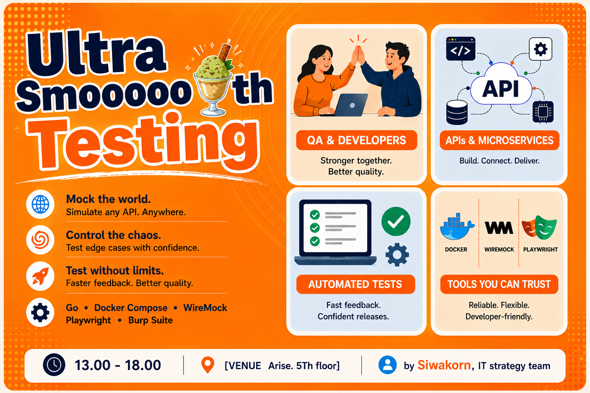
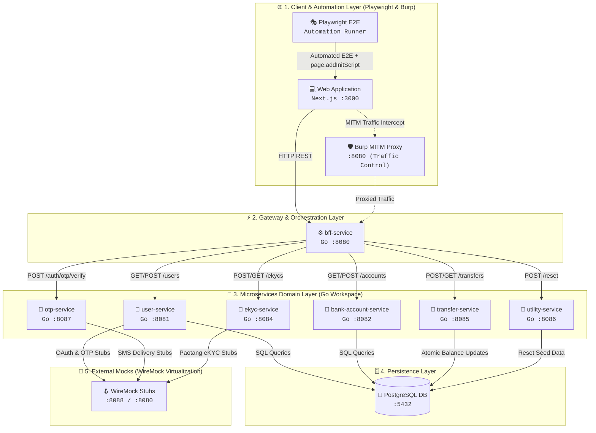

# 🧪 Microservices Integration Testing Workshop Guide

<div align="center">



</div>

> **Mock the world. Control the chaos. Test without limits.**

Welcome to the **Microservices Integration Testing Workshop**! This guide provides a comprehensive framework, architecture overview, setup instructions, and **11 practical thinking cases with runnable verification recipes and solution keys** for testing microservices in a real-world enterprise banking ecosystem.

## Workshop Overview

This is a hands-on workshop for QA engineers, developers, SDETs, automation engineers, and tech leads to design, build, test, and debug reliable microservices through realistic banking workflows and controlled failure scenarios. Using Go, Docker Compose, WireMock, Playwright, and Burp Suite, participants connect shared requirements and risk discovery with API testing, integration testing, browser automation, service mocking, fault injection, security inspection, service-contract validation, downstream-failure testing, data-integrity checks, and end-to-end verification before production.

---

## 🏗️ Ecosystem Architecture



---

## 📋 Prerequisites & Tools

| Tool | Purpose in Workshop |
| :--- | :--- |
| **Docker & Docker Compose** | Orchestrating PostgreSQL, WireMock, and microservice containers. |
| **Playwright** | Running End-to-End (E2E) browser tests and API integration test suites. |
| **Burp Suite** | **MITM Proxy**: Intercepting, inspecting, and security testing HTTP API traffic. |
| **Go (v1.25+)** | Workspace development (`go.work`) and executing unit/integration test suites. |
| **WireMock GUI** | Stubbing 3rd-party external APIs (Paotang Pass OAuth, SMS Gateway, OTP) at `http://localhost:8088/__admin/webapp`. |

### 🌐 Quick Access URLs

| Service / Interface | Local URL | Notes / Credentials |
| :--- | :--- | :--- |
| 💻 **Website** | [http://localhost:3000](http://localhost:3000) | QA Application (Default user: Narin `+66800000001`) |
| 🪝 **WireMock Web UI** | [http://localhost:8088/__admin/webapp](http://localhost:8088/__admin/webapp) | Interactive Stub & Scenario Dashboard (`admin` / `password`) |
| ⚙️ **BFF Service** | [http://localhost:8080](http://localhost:8080) | Backend-for-Frontend API Gateway |
| 🗺️ **Architecture Diagram** | [http://localhost:3031](http://localhost:3031) | Interactive diagram (`make diagram`) |
| 📊 **Slidev Presentation** | [http://localhost:3030](http://localhost:3030) | Workshop slide deck (`make slides`) |

---

## 🎯 11 Workshop Thinking Cases & Test Scenarios

### 📍 Category 1: Service-to-Service Workflow Integration

#### **Case 1: End-to-End Fund Transfer Execution**

- **Flow**: `Client` ➔ `BFF Service` ➔ `Transfer Service` ➔ `Bank Account Service` ➔ `PostgreSQL`
- **Challenge**: Verify that when `POST /transfers` is called, the transfer record is created, and the source account balance decreases while the target account balance increases.
- **Runnable Verification**:
  ```bash
  # Trigger Transfer via BFF
  curl -i -X POST http://localhost:8080/api/v1/transfers \
    -H "Content-Type: application/json" \
    -d '{"source_account_id":"00000000-0000-0000-0000-000000000011","target_account_id":"00000000-0000-0000-0000-000000000012","amount":100}'
  ```
- **Key Assertions & Solution Key**:
  - Response status: `201 Created` with `Location: /transfers/{id}` header.
  - Query accounts: Source balance decreases by 100, Target increases by 100.
  - Verified in `tests/specs/integration/bff.spec.ts`.

#### **Case 2: eKYC-Gated Account Opening**

- **Flow**: `Client` ➔ `BFF Service` ➔ `eKYC Service` & `User Service`
- **Challenge**: A user requests a new bank account. The system must verify eKYC status (`APPROVED`) before creating the account in `bank-account-service`.
- **Runnable Verification**:
  ```bash
  # Submit eKYC verification
  curl -i -X POST http://localhost:8080/api/v1/ekycs/verify \
    -H "Content-Type: application/json" \
    -d '{"customer_id":"00000000-0000-0000-0000-000000000001","national_id":"1101700000001","full_name":"Narin Chaiyasit","document_type":"national_id"}'
  ```
- **Key Assertions & Solution Key**:
  - If eKYC is `APPROVED`: Account creation succeeds (`201 Created`).
  - If eKYC is `REJECTED` or missing: Blocked with `400 Bad Request`.

---

### 📍 Category 2: Data Integrity & Database Persistence

#### **Case 3: Atomic Transaction & Rollback Validation**

- **Scenario**: Source account has 500 THB. User attempts to transfer 1,000 THB to Target account.
- **Challenge**: Ensure the database operation fails atomically. Source account balance must remain 500 THB, Target account balance must remain unchanged, and no partial transfer record is committed.
- **Runnable Verification**:
  ```bash
  curl -i -X POST http://localhost:8080/api/v1/transfers \
    -H "Content-Type: application/json" \
    -d '{"source_account_id":"00000000-0000-0000-0000-000000000011","target_account_id":"00000000-0000-0000-0000-000000000012","amount":999999}'
  ```
- **Key Assertions & Solution Key**:
  - Returns `400 Bad Request` with `{"error":"insufficient funds","code":"INSUFFICIENT_FUNDS"}`.
  - PostgreSQL transaction is rolled back completely.

#### **Case 4: Concurrent Transfers (Race Condition / Double Spend)**

- **Scenario**: User has 100 THB balance. Two transfer requests of 80 THB each arrive simultaneously.
- **Challenge**: Test database locking / concurrency control. Exactly ONE transfer must succeed (`201 Created`); the second MUST fail with insufficient balance (`400 Bad Request`).
- **Solution Key**:
  - In `services/transfer-service/repository.go`, `executeMoneyTransfer` utilizes `SELECT ... FOR UPDATE` with ordered account IDs to serialize balance deductions safely.

---

### 📍 Category 3: External Integrations & Stubbing (WireMock)

#### **Case 5: OTP SMS Delivery Failure**

- **Flow**: `BFF Service` ➔ `OTP Service` ➔ `WireMock (SMS Provider)`
- **Challenge**: Configure the SMS provider stub or header to simulate provider downtime.
- **Runnable Verification**:
  ```bash
  curl -i -X POST http://localhost:8080/api/v1/accounts \
    -H "Content-Type: application/json" \
    -H "Mock-Scenario: SMS:FAIL" \
    -d '{"user_id":"00000000-0000-0000-0000-000000000001","balance":500,"phone":"+66800000001"}'
  ```
- **Key Assertions & Solution Key**:
  - BFF catches downstream SMS provider error and returns `502 Bad Gateway` with clear error details.

#### **Case 6: OAuth Token Exchange (Paotang Pass)**

- **Flow**: `User Service` ➔ `WireMock (Paotang Pass OAuth)`
- **Challenge**: Test OAuth callback integration (`POST /auth/paotang/callback`) using a WireMock stub returning a mock Bearer access token.
- **Runnable Verification**:
  ```bash
  curl -i -X POST http://localhost:8080/auth/paotang/callback \
    -H "Content-Type: application/json" \
    -d '{"code":"valid-paotang-auth-code"}'
  ```
- **Key Assertions & Solution Key**:
  - User Service exchanges auth code for token (`200 OK` with `access_token`).

#### **Case 6B: Payment Webhook Idempotency**

- **Flow**: `Payment Provider` ➔ `WireMock payment webhook stub`
- **Challenge**: Deliver a successful payment webhook, then replay the same event and verify duplicate delivery is rejected.
- **Solution Key**:
  - Check `labs/wiremock-stateful/payment-webhook-idempotency` for stateful scenario definitions.

---

### 📍 Category 4: Frontend & API Aggregation (BFF)

#### **Case 7: BFF Data Aggregation (User Dashboard View)**

- **Flow**: `Next.js Web Frontend` ➔ `BFF Service` ➔ (`User Service` + `Bank Account Service`)
- **Challenge**: `BFF Service` fetches user details from `user-service` and account list from `bank-account-service` sequentially, combining them into a single `UserDetail` JSON payload.
- **Runnable Verification**:
  ```bash
  curl -i http://localhost:8080/api/v1/users/00000000-0000-0000-0000-000000000001
  ```

#### **Case 8: Strict REST Schema & Header Contract Validation**

- **Challenge**: Test that all endpoints strictly follow REST standards:
  - Resource creation returns `201 Created` with `Location` header.
  - Invalid JSON payload returns `400 Bad Request` with standard error schema: `{"error": "...", "code": "..."}`.
  - Non-existent resource returns `404 Not Found`.

---

### 📍 Category 5: Resilience, Timeouts & Fault Injection

#### **Case 9: Downstream Service Timeout (Latency Fault Injection)**

- **Challenge**: Configure WireMock delay on external dependencies and verify microservice client timeouts.
- **Solution Key**:
  - See `labs/wiremock-stateless/08-delayed-response.http` and `labs/wiremock-stateless/09-random-delay.http`.

#### **Case 10: Idempotent Payment Request Retries**

- **Scenario**: Client submits a transfer, but network drops before receiving HTTP response. Client retries the identical request with the same `Idempotency-Key` or transaction reference.
- **Solution Key**:
  - Handled via `labs/wiremock-stateful/retry-recovery-flow`.

---

### 📍 Category 6: Mobile Web Hybrid & Native Bridge Testing

#### **Case 11: Mobile WebView JSBridge Native Feature Mocking via Playwright**

- **Flow**: `Playwright / E2E Runner (page.addInitScript)` ➔ `Web Application (window.JSBridge injected)` ➔ `BFF Service`
- **Challenge**: Simulate a hybrid mobile app container in web browsers using `page.addInitScript`.
- **Solution Key**:
  - Implemented in `tests/specs/e2e/website.spec.ts`.

---

## 🛠️ Practical Hands-on Workshop Matrix

| Exercise | Practical Activity | Primary Commands / Tools |
| :--- | :--- | :--- |
| **Ex 1** | **Build & Sync Microservices** | `make sync && make build` |
| **Ex 2** | **Run Service Unit Tests & Lint** | `make check` |
| **Ex 3** | **Spin Up Docker Ecosystem** | `make setup` |
| **Ex 4** | **Run Integration Tests** | `make test-integration` |
| **Ex 5** | **Run Playwright E2E Tests** | `make test-e2e` |
| **Ex 6** | **WireMock Fault Injection** | Open WireMock GUI at `http://localhost:8088/__admin/webapp` |
| **Ex 7** | **MITM Traffic Inspection** | Configure Burp Suite Proxy at `http://127.0.0.1:8080` |
| **Ex 8** | **Present Workshop Slides** | `make slides` |

---

## 🧪 Interactive Participant Practice Labs

The workshop presentations include dedicated **Hands-On Practice Checkpoints** that participants can run directly from their terminals or VS Code REST Client.

### 🪝 WireMock Practice Labs (`http://localhost:8088`)

#### 📍 Practice Lab: Web UI & Precision Matching Challenge
- **Slide Reference**: [`slides.md#L1247`](slides/slides.md#L1247) (Slide 28)
- **Goal**: Explore the live Web UI dashboard and verify JSONPath request matching.
- **1. Open Web UI**: Navigate to [http://localhost:8088/__admin/webapp](http://localhost:8088/__admin/webapp) (Login: `admin` / `password`).
- **2. Send High-Value Payment Request**:
  ```bash
  curl -s -X POST http://localhost:8088/lab/api/stateless/payments \
    -H "Content-Type: application/json" \
    -d '{"payment":{"amount":2500},"customer":{"name":"Alice","email":"alice@bank.local"},"items":[{"sku":"SKU-001"}]}'
  ```
  *Response*: `201 Created` with `"flag": "HIGH_VALUE_TRANSACTION"`.
- **3. Challenge**: Change `amount` to `500` (below the 1000 threshold).
  ```bash
  curl -s -X POST http://localhost:8088/lab/api/stateless/payments \
    -H "Content-Type: application/json" \
    -d '{"payment":{"amount":500},"customer":{"name":"Alice","email":"alice@bank.local"},"items":[{"sku":"SKU-001"}]}'
  ```
  *Result*: Returns `404 Not Found`. Inspect the diff in the **Requests** tab of the Web UI to see why the stub rejected it!

---

#### 📍 Practice Lab: Scenario Steering & Token Replay Challenge
- **Slide Reference**: [`slides.md#L2207`](slides/slides.md#L2207) (Slide 44)
- **Goal**: Experience state transitions in WireMock Finite State Machines (FSM).
- **1. First Call (Consumes Authorization Code)**:
  ```bash
  curl -s -X POST http://localhost:8088/lab/api/oauth/token \
    -H "Content-Type: application/x-www-form-urlencoded" \
    -d "grant_type=authorization_code&code=auth_code_12345"
  ```
  *Response*: `200 OK {"access_token": "jwt_token_demo"}` (State transitions to `TOKEN_ISSUED`).
- **2. Replay Attack Attempt (Second Call)**:
  ```bash
  curl -s -X POST http://localhost:8088/lab/api/oauth/token \
    -H "Content-Type: application/x-www-form-urlencoded" \
    -d "grant_type=authorization_code&code=auth_code_12345"
  ```
  *Response*: `400 Bad Request {"error": "invalid_grant"}`! The auth code cannot be reused.
- **3. Reset State Machine (All or Specific Scenario)**:
  ```bash
  # Option A: Reset all scenarios
  curl -s -X POST http://localhost:8088/__admin/scenarios/reset

  # Option B: Reset only this specific scenario
  curl -s -X PUT http://localhost:8088/__admin/scenarios/oauth-code-exchange/state \
    -H "Content-Type: application/json" \
    -d '{"state": "Started"}'
  ```
  Re-running the first call will succeed with `200 OK` again.

---

#### 📍 Practice Lab: Flapping Failure & Client Self-Healing
- **Slide Reference**: [`slides.md#L2316`](slides/slides.md#L2316) (Slide 46)
- **Goal**: Validate client exponential backoff and circuit breaker recovery against transient upstream outages.
- **Run Consecutive Calls**:
  ```bash
  # Attempt 1 -> 503 Flapping
  curl -s -w "\nHTTP %{http_code}\n" http://localhost:8088/lab/api/flaky
  # Attempt 2 -> 503 Flapping
  curl -s -w "\nHTTP %{http_code}\n" http://localhost:8088/lab/api/flaky
  # Attempt 3 -> 200 OK Self-Healing Recovered!
  curl -s -w "\nHTTP %{http_code}\n" http://localhost:8088/lab/api/flaky
  ```

---

#### 📍 Practice Lab: Dynamic Templating & Chaos Latency
- **Slide Reference**: [`slides.md#L1717`](slides/slides.md#L1717) (Slide 36)
- **Goal**: Test Handlebars dynamic math calculations and assert client timeout cancellation.
- **1. Math & VAT Calculation**:
  ```bash
  curl -s -X POST http://localhost:8088/lab/api/stateless/orders \
    -H "Content-Type: application/json" \
    -d '{"userId":"U-100","price":4000}'
  ```
  *Result*: `total` calculates to `4280.0` (computed via `math '*' 1.07`) and `orderId` is a fresh UUID.
- **2. Chaos Delay & Timeout Verification**:
  ```bash
  # Injected 8000ms delay with 2s client timeout trigger
  time curl -s --max-time 2 http://localhost:8088/lab/api/stateless/delayed
  ```
  *Result*: Exits after 2 seconds with exit code `28` (Operation timeout), verifying that your client timeout cancels cleanly without hanging.

---

### 🛡️ Burp Suite Practice Labs (`http://127.0.0.1:8080`)

> **Port Notice**: Burp Suite's default proxy runs on `127.0.0.1:8080`. In these labs, client requests are sent via proxy directly to the core services (e.g. `user-service :8081` or `transfer-service :8085`), routing packets through Burp cleanly.

#### 🛠️ Burp Suite Core Tools Reference & Playbook
- **Slide Reference**: [`slides.md#L3715`](slides/slides.md#L3715) & [`slides.md#L3922`](slides/slides.md#L3922) (Slides 69 & 74–79)
- **Role in Integration Testing**: Burp Suite acts as an in-flight Man-In-The-Middle (MITM) inspection, replay, and mutation proxy between browser/mobile clients and backend gateways (`bff-service`).

| Tool &amp; Icon | Category | Core Capability &amp; Primary Shortcut | Microservices / API QA Testing Scenario |
| :--- | :--- | :--- | :--- |
| ⚡ **Proxy** | Traffic Control | Captures live HTTP/S traffic; pause/edit/drop packets mid-flight. Toggle `Intercept is on`. | Tampering with request headers or JSON payloads in transit before reaching backend gateways. |
| 🎯 **Target** | Topology &amp; Scope | Hierarchical site map tree of discovered hosts, paths, and endpoints. Filter by in-scope rules. | Scoping test suites strictly to `localhost` microservices and excluding external browser noise. |
| 🔁 **Repeater** | Ad-Hoc Replay | Isolated HTTP request workbench. Modify payloads and re-issue instantly (`Cmd+R` / `Ctrl+R`). | Rapidly testing API edge cases, validation boundaries, and error codes without re-running UI suites. |
| ⚡ **Intruder** | Automated Fuzzing | Configurable payload attack engine (`Sniper`, `Battering Ram`, `Pitchfork`, `Cluster Bomb`). | Concurrency race-condition testing, rate-limit boundary probes, and negative payload fuzzing. |
| 📋 **Logger** | Unified Audit | Full-fidelity chronological traffic log across all Burp tools with regex filtering and 1-click handoff. | Real-time debugging of multi-step API sequences and inspecting raw server response headers. |
| 🔤 **Decoder** | Transformations | Bi-directional encoding/decoding: URL, Base64, Hex, HTML, Hashes, and JWT token inspection. | Unpacking serialized session cookies, inspecting JWT claims, and decoding binary gateway payloads. |
| ⚖️ **Comparer** | Visual Diffing | Visual word-by-word and byte-by-byte diff engine between two requests, responses, or fuzz outputs. | Diffing successful `200 OK` vs failure `403 Forbidden` responses to isolate exact state discrepancies. |
| 🎲 **Sequencer** | Entropy Testing | Statistical randomness analysis for session cookies, CSRF tokens, OTPs, and generated IDs. | Verifying that banking session identifiers and OTPs have high entropy and cannot be predicted. |
| 🧩 **Extensions (BApp)** | Extensibility | Extensible plugin architecture supporting custom Python, Java, and Ruby automation scripts. | Exporting OpenAPI specs, custom HMAC authentication signing, and bespoke CI/CD test reporters. |
| ⚙️ **Match &amp; Replace** | Headless Steering | Automatic regex find-and-replace rules inside Proxy settings without pausing traffic. | Unattended CI/CD test runs: auto-injecting `Mock-Scenario` headers into automated Playwright suites. |

---

#### 🛠️ Proxy Setup &amp; Verification (Prerequisites)
- **Slide Reference**: [`slides.md#L3092`](slides/slides.md#L3092), [`slides.md#L3173`](slides/slides.md#L3173), [`slides.md#L3202`](slides/slides.md#L3202) &amp; [`slides.md#L3635`](slides/slides.md#L3635) (Slides 59–68: HTTPS, PKI Infrastructure, CA Chaining, Platform Setup &amp; SSL Pinning)
- **Lab Folder**: [`labs/burp-suite/`](labs/burp-suite/)
- **Companion Files**:
  - Mobile Testing &amp; SSL Pinning Guide: [`labs/burp-suite/README.md#mobile-app-testing--ssl-pinning-bypass-guide`](labs/burp-suite/README.md#mobile-app-testing--ssl-pinning-bypass-guide)
  - Verification Helper: [`labs/burp-suite/verify-proxy.sh`](labs/burp-suite/verify-proxy.sh)
  - REST Client Walkthrough: [`labs/burp-suite/requests.http`](labs/burp-suite/requests.http)
  - Configuration Settings: [`labs/burp-suite/burp-config-example.json`](labs/burp-suite/burp-config-example.json)
- **1. Verify Proxy Listener**:
  - In Burp Suite, open **Proxy ➔ Proxy settings**.
  - Ensure the listener on port `8080` is active and checked **Running**.
- **2. macOS Loopback Bypass Fix (`/etc/hosts`)**:
  - macOS network stack and browsers automatically bypass HTTP proxies for `localhost` and `127.0.0.1`.
  - Add `localhost.com` to `/etc/hosts` to route local requests through Burp Suite:
    ```bash
    echo "127.0.0.1 localhost.com" | sudo tee -a /etc/hosts
    ```
- **3. Run Verification Script**:
  ```bash
  chmod +x labs/burp-suite/verify-proxy.sh
  ./labs/burp-suite/verify-proxy.sh
  ```
  *Result*: Validates that Burp Suite's proxy listener is responding and test health probes succeed through the proxy socket.

---

#### 📍 Practice Lab: Live MITM Packet Interception
- **Slide Reference**: [`slides.md#L3852`](slides/slides.md#L3852) (Slide 73)
- **Goal**: Intercept live HTTP traffic mid-flight and tamper with headers to steer downstream mocks without modifying application source code.
- **1. Turn Intercept ON**: In Burp Suite, open **Proxy ➔ Intercept** and toggle **Intercept is ON**.
- **2. Send Request via Proxy**:
  ```bash
  curl -x http://127.0.0.1:8080 -s -X POST http://localhost.com:8081/api/v1/users \
    -H "Content-Type: application/json" \
    -d '{"username":"student","password":"secret"}'
  ```
- **3. Tamper in Burp**: Inject header: `Mock-Scenario: PAOTANG:SUCCESS,OTP:EXPIRED`. Click **Forward**.
- **4. Result**: The client receives an expired OTP error response produced downstream by WireMock!

---

#### 📍 Practice Lab: Automated Match & Replace Rules
- **Slide Reference**: [`slides.md#L4053`](slides/slides.md#L4053) (Slide 76)
- **Goal**: Configure unattended rule-based traffic steering for automated test suites.
- **1. Configure Rule**:
  - In Burp Suite, go to **Proxy ➔ Proxy settings ➔ Match and replace**.
  - Add Rule: Type = `Request header`, Match = `^User-Agent:.*$`, Replace = `Mock-Scenario: TRANSFER:FAIL`.
  - Turn **Intercept OFF**.
- **2. Run Automated Request**:
  ```bash
  curl -x http://127.0.0.1:8080 -s http://localhost.com:8081/api/v1/transfers
  ```
  *Result*: Check Burp's **HTTP history** tab. Notice every outbound request automatically carries the injected failure steering header!

---

### 🏆 Hands-On Workshop Challenges (Self-Guided Exercises)

Ready to test your skills with production scenarios? After watching the live instructor walkthrough, take on these hands-on workshop challenges.

#### 🔄 Workshop Challenge A: WireMock Stateful Order Fulfillment Machine (Stateful)
- **Slide Reference**: [`slides.md#L2818`](slides/slides.md#L2818) (Slides 53 & 54)
- **Test Folder**: [`labs/wiremock-stateful/order-fulfillment-lifecycle/`](labs/wiremock-stateful/order-fulfillment-lifecycle/)
- **Target File**: `wiremock/mappings/diy-order-lifecycle.json`
- **Requirements**:
  1. Define scenario `order-lifecycle`.
  2. Step 1 (`Started`): `POST /lab/api/orders/101/pay` transitions to `PAID` (returns `200 OK {"status": "PAID"}`).
  3. Step 2 (`PAID`): `POST /lab/api/orders/101/ship` transitions to `SHIPPED` (returns `200 OK {"status": "SHIPPED"}`).
  4. Step 3 (`SHIPPED`): Repeated `POST /lab/api/orders/101/ship` returns `400 Bad Request {"error": "ALREADY_SHIPPED"}`.
- **Verification Commands**:
  ```bash
  # Reset scenario state before test
  curl -s -X POST http://localhost:8088/__admin/scenarios/reset

  # 1. Pay order -> PAID
  curl -s -X POST http://localhost:8088/lab/api/orders/101/pay

  # 2. Ship order -> SHIPPED
  curl -s -X POST http://localhost:8088/lab/api/orders/101/ship

  # 3. Duplicate ship -> 400 ALREADY_SHIPPED
  curl -s -X POST http://localhost:8088/lab/api/orders/101/ship
  ```

---

#### 🪝 Workshop Challenge B: WireMock Biometric Face Scan Stub (Stateless)
- **Slide Reference**: [`slides.md#L3018`](slides/slides.md#L3018) (Slides 56 & 57)
- **Test File**: [`labs/wiremock-stateless/diy-biometrics.http`](labs/wiremock-stateless/diy-biometrics.http)
- **Requirements**:
  1. Virtualize `POST /lab/api/ekyc/biometrics`.
  2. If `confidence < 85.0`, return `HTTP 422` with body:
     ```json
     {"error": "LIVENESS_FAILED", "code": "ERR_LOW_CONFIDENCE"}
     ```
  3. If `confidence >= 85.0`, return `HTTP 200` with dynamic response templating:
     - `scanId`: dynamic UUID (`{{randomValue type='UUID'}}`)
     - `nationalId`: echoed from request body (`{{jsonPath request.body '$.nationalId'}}`)
     - `verified`: `true`
     - `processedAt`: current ISO timestamp (`{{now}}`)
  4. Inject `2500ms` fixed delay to simulate vendor network latency.
- **Verification Commands**:
  ```bash
  # 1. Low confidence -> 422
  curl -s -i -X POST http://localhost:8088/lab/api/ekyc/biometrics \
    -H "Content-Type: application/json" \
    -d '{"nationalId":"1100500123456","confidence":71.2,"livenessPassed":false}'

  # 2. High confidence -> 200 OK with dynamic scanId
  curl -s -i -X POST http://localhost:8088/lab/api/ekyc/biometrics \
    -H "Content-Type: application/json" \
    -d '{"nationalId":"1100500123456","confidence":92.4,"livenessPassed":true}'

  # 3. Timeout check (client aborts after 1s)
  time curl -s --max-time 1 http://localhost:8088/lab/api/ekyc/biometrics \
    -H "Content-Type: application/json" \
    -d '{"nationalId":"1100500123456","confidence":88.0,"livenessPassed":true}'
  ```

---

#### 🛡️ Workshop Challenge C: Burp Suite In-Flight Fraud Tampering
- **Slide Reference**: [`slides.md#L4280`](slides/slides.md#L4280) & [`slides.md#L4347`](slides/slides.md#L4347) (Slides 80 & 81)
- **Test Folder**: [`labs/burp-suite/`](labs/burp-suite/)
- **Goal**: Intercept an outbound transfer and tamper with both body and headers to observe how the client application and downstream services handle unexpected fraud alerts.
- **Steps**:
  1. In Burp Suite, turn **Intercept is on** on `127.0.0.1:8080`.
  2. Send transfer cURL:
     ```bash
     curl -x http://127.0.0.1:8080 -s -X POST http://localhost.com:8081/api/v1/transfers \
       -H "Content-Type: application/json" \
       -d '{"fromAccount":"ACC-001","toAccount":"ACC-999","amount":500.00}'
     ```
  3. In Burp's Proxy Intercept tab, change `"amount": 500.00` to `"amount": 5000000.00` and inject `Mock-Scenario: FRAUD_BLOCKED`.
  4. Click **Forward** and verify how the response is logged in **Logger / HTTP history**.
