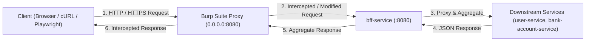

# 🧪 Lab: Burp Suite MITM Proxy & API Security Inspection

Welcome to the **Burp Suite MITM Proxy & API Security Inspection Lab**! This lab provides a hands-on guide for intercepting, inspecting, modifying, and security-testing HTTP/HTTPS API traffic in a microservices ecosystem using **Burp Suite**.

---

## 🎯 Purpose & Objectives

In modern microservices development and QA testing, an intercepting Man-In-The-Middle (MITM) proxy allows engineers to:

1. **Inspect Raw HTTP Traffic**: View unencrypted headers, query strings, and payloads exchanged between clients (Web Frontend, Mobile Apps, or cURL) and backend services.
2. **Intercept & Tamper Requests**: Modify request headers, parameters, or payloads on-the-fly before they reach the `bff-service` or downstream microservices.
3. **Inject Mock & Test Headers**: Inject headers like `Mock-Scenario: PT_PASS:SUCCESS_ONCE` and `Mock-ID: request-123` into live traffic to trigger specific WireMock stubs without code changes.
4. **Manual Boundary & Security Testing**: Replay API requests via **Burp Repeater** to validate error handling, input validation (`400 Bad Request`), and REST contracts.

## 🧭 How to Learn with This Lab

1. Start the services and Burp Suite with the proxy listener on `0.0.0.0:8080` so clients on the local subnet can connect.
2. Open `labs/burp-suite/requests.http` with the VS Code REST Client extension and send each request.
3. Intercept the requests, modify headers or payloads, then forward them.
4. Move interesting requests to Repeater and compare the response with the exercise instructions below.

The lab’s REST Client examples are kept in one file: [`requests.http`](./requests.http).

---

## 🏗️ Proxy Traffic Topology



---

## 🛠️ Step 1: Burp Suite Setup & Proxy Listener Configuration

### 1. Launch Burp Suite

Open **Burp Suite Community Edition** (or Professional) and select **Temporary Project** ➔ **Use Burp Defaults**.

### 2. Verify Proxy Listener

1. Go to **Proxy** ➔ **Proxy settings** (or **Options**).
2. Under **Proxy Listeners**, verify that a listener is running on all interfaces at port `8080` with the `Running` checkbox enabled.

The example configuration also scopes Burp to the `192.168.1.0/24` private subnet. Replace the subnet regex in `burp-config-example.json` with the LAN subnet used by your lab before importing it.

### 3. macOS Setup: Loopback Proxy Bypass & /etc/hosts

On macOS, the operating system network stack and browsers (Chrome, Safari) automatically bypass HTTP proxies for `localhost` and `127.0.0.1`. To ensure traffic routes through Burp Suite on macOS, add a local hostname alias:

```bash
echo "127.0.0.1 localhost.com" | sudo tee -a /etc/hosts
```

All requests can then target `http://localhost.com:8080` (or `http://localhost.com:8081`) cleanly through the proxy.

### 4. Install Burp CA Certificate (for HTTPS Inspection)

See the official [PortSwigger certificate setup guide](https://portswigger.net/burp/documentation/desktop/external-browser-config/certificate).

1. Configure your browser or system proxy to the Burp host's LAN IP and port `8080` (for example, `192.168.1.10:8080`).
2. Visit `http://burpsuite` in your browser and click **CA Certificate** to download `cacert.der`.
3. Or use the repository copy at [`asset/cacert.der`](./asset/cacert.der).
4. Import `cacert.der` into your browser's Trusted Root Certification Authorities.

---

## 📚 Practical Hands-on Exercises

### 📍 Exercise 1: Request Interception & Parameter Tampering

**Goal**: Intercept a user creation request to `bff-service`, tamper with the request payload before it hits the backend, and observe the saved state.

1. Ensure the ecosystem is running (`docker compose up --build`).
2. In Burp Suite, go to **Proxy** ➔ **Intercept** and turn **Intercept is ON**.
3. Send a user creation request via `cURL` using Burp Proxy:

   ```bash
   curl -x http://127.0.0.1:8080 -X POST http://localhost.com:8080/api/v1/users \
     -H "Content-Type: application/json" \
     -d '{"name": "Original Name", "email": "original@example.com", "phone": "+66800000001"}'
   ```

4. Burp will pause the request. In the **Intercept** tab:
   - Change `"name": "Original Name"` ➔ `"name": "Tampered Name via Burp"`.
5. Click **Forward**.
6. **Assertion**: Verify that the returned response contains `"name": "Tampered Name via Burp"`.

---

### 📍 Exercise 2: Header Injection for WireMock Scenario Simulation

**Goal**: Inject `Mock-Scenario` headers into live traffic through Burp to trigger specific WireMock stub behaviors (e.g. testing Paotang OAuth or OTP verification).

1. In Burp Suite **Proxy** ➔ **Intercept**, ensure **Intercept is ON**.
2. Send an OTP verification request to `bff-service`:

   ```bash
   curl -x http://127.0.0.1:8080 -X POST http://localhost.com:8080/auth/otp/verify \
     -H "Content-Type: application/json" \
     -d '{"phone": "+66800000001", "code": "123456"}'
   ```

3. In the intercepted request in Burp, add the following header:

   ```http
   Mock-Scenario: OTP:SUCCESS
   ```

4. Click **Forward**.
5. **Assertion**: Observe response returns `200 OK` (`{"verified": true}`).
6. Repeat the test, but change the header in Burp to:

   ```http
   Mock-Scenario: OTP:INVALID
   ```

7. Click **Forward**.
8. **Assertion**: Observe response returns `400 Bad Request` (`{"error": "invalid_otp"}`).

---

### 📍 Exercise 3: Manual API Security Testing with Burp Repeater

**Goal**: Use **Burp Repeater** to isolate requests and perform rapid boundary testing without re-typing cURL commands.

1. In Burp **Proxy** ➔ **HTTP history**, right-click any `POST /api/v1/users` request and select **Send to Repeater** (or press `Cmd+R` / `Ctrl+R`).
2. Switch to the **Repeater** tab.
3. Test **Validation Failure** (Missing required `phone` field):
   - Remove `"phone": "+66800000001"` from the JSON body.
   - Click **Send**.
   - **Expected Result**: `400 Bad Request` with `{"error": "phone is required"}`.
4. Test **Malformed JSON Payload**:
   - Change body to `{ invalid json syntax`.
   - Click **Send**.
   - **Expected Result**: `400 Bad Request`.
5. Test **SQL Injection Prevention**:
   - Set `"name": "Alice'; DROP TABLE users; --"`.
   - Click **Send**.
   - **Expected Result**: User created cleanly with name literal `Alice'; DROP TABLE users; --` because Go's `pgx` library uses parameterized queries.

---

### 📍 Exercise 4: Automated Match & Replace Rules

**Goal**: Automate header injection so all outgoing requests passing through Burp automatically have mock testing headers appended.

1. Go to **Proxy** ➔ **Proxy settings** ➔ **Match and replace rules**.
2. Click **Add**.
3. Configure the rule:
   - **Type**: `Request header`
   - **Match**: *(leave blank)*
   - **Replace**: `Mock-Scenario: PT_PASS:SUCCESS_ONCE`
   - **Comment**: `Inject Paotang Mock Scenario`
4. Click **OK** and check the enabled box.
5. Any request sent through `http://127.0.0.1:8080` will now automatically have `Mock-Scenario: PT_PASS:SUCCESS_ONCE` injected.

---

### 📍 Exercise 5: Concurrency & Race Condition Fuzzing with Burp Intruder

**Goal**: Use **Burp Intruder** to simulate concurrent race-condition attacks (e.g. testing double-spending or TOCTOU coupon redemption) and observe how backend database transactions handle atomic state transitions.

1. In Burp **Proxy** ➔ **HTTP history**, locate a `POST /api/v1/transfers` request.
2. Right-click and choose **Send to Intruder** (or press `Cmd+I` / `Ctrl+I`).
3. In the **Intruder** tab:
   - **Positions**: Click **Clear §**.
   - Highlight the transfer amount or transaction reference: `{"amount": §100.00§}`.
   - Select **Attack type**: `Sniper` (for single parameter boundary fuzzing) or `Pitchfork` (for paired credentials).
4. In the **Payloads** tab:
   - **Payload type**: Choose **Numbers** (from `1` to `20`, step `1`) or **Null payloads** (to send 20 identical requests).
5. In **Resource Pool**:
   - Set **Maximum concurrent requests**: `20` (or enable HTTP/2 single-packet attack).
6. Click **Start attack**.
7. **Assertion**: Verify backend responses in the Intruder results table.
   - Successful balance deductions return `200 OK`.
   - Subsequent concurrent attempts exceeding balance or using the same idempotency key return `409 Conflict` or `422 Unprocessable Entity`—confirming database row locking (`SELECT ... FOR UPDATE`) is working as designed!

---

---

## 📱 Mobile App Testing & SSL Pinning Bypass Guide

When testing native iOS and Android mobile banking applications against microservices, standard browser proxy configuration is insufficient due to operating system trust stores and application-level **SSL Pinning**.

### 1. Device Wi-Fi Proxy Configuration

1. Connect your physical mobile device or emulator to the **same Wi-Fi network / subnet** as your workstation running Burp Suite.
2. In Burp Suite: **Proxy ➔ Proxy settings ➔ Proxy listeners**, edit the listener to bind to **All interfaces** or your specific LAN IP (e.g. `192.168.1.50:8080`).
3. Configure the mobile device:
   - **iOS**: **Settings ➔ Wi-Fi** ➔ tap your network `(i)` ➔ **Configure Proxy ➔ Manual** ➔ Server: `<Workstation-LAN-IP>`, Port: `8080`.
   - **Android**: **Settings ➔ Network & Internet ➔ Wi-Fi** ➔ tap gear/edit ➔ **Proxy ➔ Manual** ➔ Proxy hostname: `<Workstation-LAN-IP>`, Port: `8080`.
   - **Android Emulator**: Start from terminal:
     ```bash
     emulator -avd <emulator_name> -http-proxy http://10.0.2.2:8080
     ```

---

### 2. CA Certificate Installation & Full Trust

#### iOS (iPhone / iPad / Simulator)
1. Open **Safari** on iOS and navigate to `http://burpsuite`.
2. Tap **CA Certificate** to download `cacert.der`.
3. Go to **Settings ➔ Profile Downloaded ➔ Install** (enter device passcode).
4. **Mandatory Step**: Go to **Settings ➔ General ➔ About ➔ Certificate Trust Settings** and toggle **Enable Full Trust for Root Certificates** for the PortSwigger CA.

#### Android (Phone / Emulator)
1. Open **Chrome** on Android and navigate to `http://burpsuite` to download `cacert.der`.
2. Rename the downloaded file to `cacert.crt` using a file manager.
3. Go to **Settings ➔ Security ➔ Encryption & Credentials ➔ Install a certificate ➔ CA certificate**.
4. Confirm installation. Note: On Android 7.0+ (API 24+), this installs as a **User** certificate, which release apps ignore by default.

---

### 3. White-Box App Configuration (Dev & QA Builds)

#### Android: Network Security Config (`res/xml/network_security_config.xml`)
To permit user-installed certificates without weakening production release security, use `<debug-overrides>`:

```xml
<?xml version="1.0" encoding="utf-8"?>
<network-security-config>
    <!-- Production release uses default system trust anchors and pins -->
    <base-config>
        <trust-anchors>
            <certificates src="system" />
        </trust-anchors>
    </base-config>

    <!-- Debug and QA staging builds automatically trust Burp Suite user CA -->
    <debug-overrides>
        <trust-anchors>
            <certificates src="user" />
            <certificates src="system" />
        </trust-anchors>
    </debug-overrides>
</network-security-config>
```

Reference this file in `AndroidManifest.xml`:
```xml
<application
    android:networkSecurityConfig="@xml/network_security_config"
    ...>
</application>
```

#### iOS: Compiler Flags for Pinning (`#if DEBUG`)
In your networking layer (e.g. `URLSessionDelegate` or `TrustKit`):
```swift
#if DEBUG || STAGING
// Bypass SSL Pinning evaluation for local proxy testing
completionHandler(.useCredential, URLCredential(trust: serverTrust))
#else
// Production: Enforce strict SPKI public key hash evaluation
validateServerTrustWithPinning(serverTrust, completionHandler: completionHandler)
#endif
```

---

### 4. Black-Box Testing & SSL Pinning Bypass (Release APK / IPA)

When testing pre-built production release candidates or third-party binaries where source code is unavailable, bypass pinning using dynamic binary instrumentation or system CA injection:

#### Option A: Frida Dynamic Memory Hooking (Android & iOS)
Install Frida and objection:
```bash
pip install frida-tools objection
```

Hook verification in RAM at runtime:
```bash
# Android (bypasses OkHttp, TrustManagerImpl, and custom pins)
frida -U --codeshare akabe1/frida-multiple-unpinning -f com.shopvibe.mobile

# iOS (bypasses SecTrustEvaluate and TrustKit in memory)
objection --gadget "ShopVibe" explore -s "ios sslpinning disable"
```

#### Option B: Android Emulator System Store Injection (Rooted)
Convert Burp's certificate into Android's native hashed subject format and mount into the system partition:
```bash
# 1. Calculate Android subject hash
HASH=$(openssl x509 -inform DER -in asset/cacert.der -subject_hash_old -noout)
openssl x509 -inform DER -in asset/cacert.der -out ${HASH}.0

# 2. Mount and push to Android system store
adb root
adb remount
adb push ${HASH}.0 /system/etc/security/cacerts/
adb shell "chmod 644 /system/etc/security/cacerts/${HASH}.0"
adb reboot
```
After reboot, Android treats Burp Suite as a factory-installed **System Root CA**, allowing all apps to be intercepted without code modifications.

---

## 🛠️ Verification Script

Run the included verification script to check proxy connectivity and BFF endpoint reachability:

```bash
# Make executable and run
chmod +x labs/burp-suite/verify-proxy.sh
./labs/burp-suite/verify-proxy.sh
```

---

## 📂 Lab Files Directory

```
labs/burp-suite/
├── README.md                         # This lab guide
├── requests.http                     # REST Client walkthrough for all exercises
├── burp-config-example.json          # Example Burp Suite configuration settings
└── verify-proxy.sh                   # Helper script to test proxy connectivity
```
