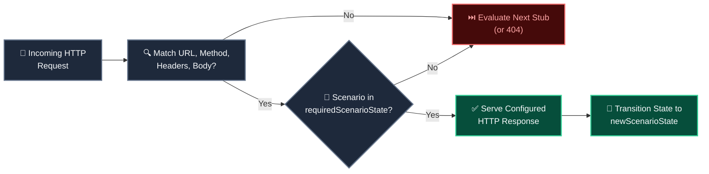
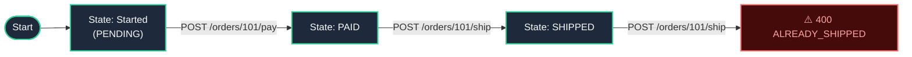

<div class="flex justify-center items-center w-full h-full my-auto">
  <div class="cover-poster-container">
    
  </div>
</div>

---
class: pt-3 pb-2 px-8
---

# ⚠️ The Testing Crisis

### Why Traditional Microservice Testing Fails in Practice

<div class="grid grid-cols-2 gap-3 mt-1.5">

<div class="slide-card p-3 border-rose-500/40 bg-rose-950/20">
  <h3 class="text-rose-400 font-bold mb-1 text-base flex items-center gap-1.5">
    <span>🌪️</span> 1. The Flakiness Spiral
  </h3>
  <p class="text-slate-300 text-xs leading-relaxed">
    Shared staging databases and unstable 3rd-party sandboxes cause <strong>40%+ false-positive CI failures</strong>. Teams start ignoring red pipelines.
  </p>
  <div class="mt-1.5 text-rose-300 font-mono text-[11px]">
    🚨 "Just re-run CI until it passes" anti-pattern.
  </div>
</div>

<div class="slide-card p-3 border-amber-500/40 bg-amber-950/20">
  <h3 class="text-amber-400 font-bold mb-1 text-base flex items-center gap-1.5">
    <span>⏳</span> 2. The Debugging Black Hole
  </h3>
  <p class="text-slate-300 text-xs leading-relaxed">
    Engineers waste <strong>5+ hours/week</strong> triaging "works on my machine" drift, port collisions, and orphan background zombie processes.
  </p>
  <div class="mt-1.5 text-amber-300 font-mono text-[11px]">
    🚨 Discrepancy between macOS and Linux CI runners.
  </div>
</div>

<div class="slide-card p-3 border-amber-500/40 bg-amber-950/20">
  <h3 class="text-amber-400 font-bold mb-1 text-base flex items-center gap-1.5">
    <span>💸</span> 3. Third-Party Sandbox Quotas &amp; Lock-in
  </h3>
  <p class="text-slate-300 text-xs leading-relaxed">
    Payment and SMS provider test environments have <strong>rate limits, maintenance windows, and billing costs</strong> that block parallel pull requests.
  </p>
  <div class="mt-1.5 text-amber-300 font-mono text-[11px]">
    🚨 Blocked deployments waiting on sandbox stability.
  </div>
</div>

<div class="slide-card p-3 border-emerald-500/40 bg-emerald-950/20">
  <h3 class="text-emerald-400 font-bold mb-1 text-base flex items-center gap-1.5">
    <span>🎯</span> 4. The Goal: Ultra Smoooooth
  </h3>
  <p class="text-slate-300 text-xs leading-relaxed">
    Achieve <strong>100% deterministic, hermetic, sub-second test execution</strong> on local laptops and CI with zero shared infrastructure flakiness.
  </p>
  <div class="mt-1.5 text-emerald-300 font-mono text-[11px]">
    ✨ Green locally = Guaranteed green in CI.
  </div>
</div>

</div>

---
class: agenda-slide pt-4 pb-2 px-8
---

# 📋 Workshop Agenda

### What We'll Cover Today

<div class="agenda-grid">

<div class="agenda-card">
  <h3>🏗️ Part 1 — Ecosystem Architecture</h3>
  <p>Go Workspace monorepo, microservices topology, and technology stack overview.</p>
</div>

<div class="agenda-card">
  <h3>🪝 Part 2 — WireMock Deep Dive</h3>
  <p>Request matching, priority stubs, Handlebars templating, and state machines.</p>
</div>

<div class="agenda-card">
  <h3>🛡️ Part 3 — Burp Suite MITM</h3>
  <p>HTTP intercept, header tampering, Match &amp; Replace rules, and traffic auditing.</p>
</div>

<div class="agenda-card">
  <h3>🐳 Part 4 — Testcontainers</h3>
  <p>Ephemeral container lifecycle, dynamic port binding, and bootstrapping.</p>
</div>

<div class="agenda-card col-span-2">
  <h3>🎭 Part 5 — Playwright (Full-Stack Automation)</h3>
  <p>Web locators, dynamic route mock steering, native device bridge injection, and CI trace diagnostics.</p>
</div>

</div>

---
class: strategy-slide
---

# 🎯 Testing Strategy & Core Pillars

### Comprehensive Architectural Foundations for Integration Testing

<div class="strategy-grid text-sm">

<div class="slide-card">
  <h3 class="text-emerald-400 font-bold mb-1 text-base">🌐 1. External API Virtualization (WireMock)</h3>
  <p class="text-slate-300 leading-relaxed">
    Virtualize all third-party external integrations with deterministic stateful stubs, dynamic Handlebars responses, and zero sandbox dependencies.
  </p>
</div>

<div class="slide-card">
  <h3 class="text-emerald-400 font-bold mb-1 text-base">⚡ 2. In-Flight Traffic Interception (Burp Suite)</h3>
  <p class="text-slate-300 leading-relaxed">
    Intercept live HTTP traffic in-flight, tamper with payloads, inject fault scenarios, and probe security/IDOR boundaries.
  </p>
</div>

<div class="slide-card">
  <h3 class="text-emerald-400 font-bold mb-1 text-base">🐳 3. Hermetic Infrastructure (Testcontainers)</h3>
  <p class="text-slate-300 leading-relaxed">
    Execute integration suites against isolated, ephemeral Docker containers with dynamic ports and guaranteed Ryuk teardown.
  </p>
</div>

<div class="slide-card">
  <h3 class="text-emerald-400 font-bold mb-1 text-base">🎭 4. Full-Stack E2E Automation (Playwright)</h3>
  <p class="text-slate-300 leading-relaxed">
    Drive unified browser DOM interactions and headless REST API validation with zero-flake auto-waiting assertions and rich tracing.
  </p>
</div>

</div>

---

# 🌐 Pillar 1: External API Virtualization (WireMock)

### Eliminating External API Dependencies & Sandbox Flakiness

<div class="multi-col-grid-2">

<div class="col-card space-y-3">
  <h3 class="text-emerald-400">🪝 Architectural Role</h3>
  <div class="text-sm text-slate-200 space-y-3 leading-relaxed">
    <div>
      <strong class="text-emerald-300 block text-base font-bold mb-0.5">1. Third-Party Simulation</strong>
      Virtualize Paotang OAuth (<code>/oauth/token</code>) and SMS gateways with lightweight HTTP stubs.
    </div>
    <div>
      <strong class="text-emerald-300 block text-base font-bold mb-0.5">2. Deterministic Edge Cases</strong>
      Instantly test token expiration, rate-limit throttling, HTTP 503, and network timeouts on demand.
    </div>
    <div>
      <strong class="text-emerald-300 block text-base font-bold mb-0.5">3. Zero Limits &amp; Zero Billing</strong>
      Execute thousands of CI/CD test runs without provider sandboxes or billing quotas.
    </div>
  </div>
</div>

<div class="col-card">
  <h3 class="text-emerald-400">📄 Mapping Stub Example</h3>

```json
{
  "request": {
    "method": "POST",
    "url": "/oauth/token",
    "headers": {
      "Mock-Scenario": { "contains": "SUCCESS" }
    }
  },
  "response": {
    "status": 200,
    "jsonBody": {
      "access_token": "mock_jwt_paotang_9988",
      "token_type": "Bearer",
      "expires_in": 3600
    }
  }
}
```

</div>

</div>

---

# ⚡ Pillar 2: In-Flight Traffic Interception (Burp Suite)

### Live MITM Traffic Inspection, Fault Injection & Security Boundaries

<div class="multi-col-grid-2">

<div class="col-card space-y-3">
  <h3 class="text-amber-400">🔀 MITM Interception Role</h3>
  <div class="text-sm text-slate-200 space-y-3 leading-relaxed">
    <div>
      <strong class="text-amber-300 block text-base font-bold mb-0.5">1. Transparent In-Flight Proxy</strong>
      Sits between browser / mobile WebViews and backend services to inspect and alter HTTP traffic.
    </div>
    <div>
      <strong class="text-amber-300 block text-base font-bold mb-0.5">2. Mock-Scenario Header Steering</strong>
      Inject <code>Mock-Scenario: PAOTANG:SUCCESS</code> on the fly to steer stubs without code modifications.
    </div>
    <div>
      <strong class="text-amber-300 block text-base font-bold mb-0.5">3. Response Status &amp; Payload Tampering</strong>
      Mutate backend responses into HTTP 401/500 to test frontend fallback UI banners and error handling.
    </div>
  </div>
</div>

<div class="col-card">
  <h3 class="text-amber-400">📡 Intercepted HTTP Packet</h3>

```http
POST /api/v1/auth/login HTTP/1.1
Host: localhost:8080
Content-Type: application/json
Mock-Scenario: PAOTANG:SUCCESS,OTP:SUCCESS

{
  "auth_code": "auth_code_live_7721",
  "phone": "0812345678"
}
```

  <div class="text-sm text-slate-200 mt-2 font-medium">
    💡 Injects scenario headers directly in-flight before forwarding to BFF.
  </div>
</div>

</div>

---

# 🐳 Pillar 3: Hermetic Infrastructure (Testcontainers)

### Isolated Ephemeral Containers, Dynamic Ports & Automatic Teardown

<div class="grid grid-cols-3 gap-3.5 mt-4">

<div class="slide-card p-4 border border-cyan-500/40 bg-slate-900/60 flex flex-col justify-between">
  <div>
    <div class="flex items-center justify-between mb-2 pb-1.5 border-b border-cyan-500/30">
      <span class="text-cyan-300 font-bold text-sm">🐳 Ephemeral Instances</span>
      <span class="text-xs font-mono text-cyan-400 bg-cyan-950 px-1.5 py-0.5 rounded">Hook-Driven</span>
    </div>
    <p class="text-sm text-slate-200 leading-relaxed">
      Spins up sterile PostgreSQL 16 and WireMock instances directly inside test suite hooks—destroying and recreating state on demand.
    </p>
  </div>
  <div class="mt-3 pt-2 border-t border-cyan-500/20 text-xs font-mono text-cyan-300">
    ✨ Zero dirty database state
  </div>
</div>

<div class="slide-card p-4 border border-cyan-500/40 bg-slate-900/60 flex flex-col justify-between">
  <div>
    <div class="flex items-center justify-between mb-2 pb-1.5 border-b border-cyan-500/30">
      <span class="text-cyan-300 font-bold text-sm">🔌 Dynamic Host Ports</span>
      <span class="text-xs font-mono text-cyan-400 bg-cyan-950 px-1.5 py-0.5 rounded">Zero Collision</span>
    </div>
    <p class="text-sm text-slate-200 leading-relaxed">
      Docker binds random available host ports (e.g. <code>:5432 ➔ :32768</code>), completely eliminating port collision in parallel CI and dev environments.
    </p>
  </div>
  <div class="mt-3 pt-2 border-t border-cyan-500/20 text-xs font-mono text-cyan-300">
    ✨ Parallel execution safe
  </div>
</div>

<div class="slide-card p-4 border border-cyan-500/40 bg-slate-900/60 flex flex-col justify-between">
  <div>
    <div class="flex items-center justify-between mb-2 pb-1.5 border-b border-cyan-500/30">
      <span class="text-cyan-300 font-bold text-sm">🧹 Guaranteed Ryuk Teardown</span>
      <span class="text-xs font-mono text-cyan-400 bg-cyan-950 px-1.5 py-0.5 rounded">Auto Reap</span>
    </div>
    <p class="text-sm text-slate-200 leading-relaxed">
      Moby Ryuk sidecar automatically monitors test process lifecycle and purges containers, networks, and volumes even on unexpected aborts.
    </p>
  </div>
  <div class="mt-3 pt-2 border-t border-cyan-500/20 text-xs font-mono text-cyan-300">
    ✨ Zero orphan containers
  </div>
</div>

</div>

<div class="slide-card p-3 mt-4 border border-cyan-500/30 bg-cyan-950/20 rounded-lg flex items-center justify-between">
  <span class="text-sm text-slate-200 font-medium">
    💡 <strong>Hermetic Guarantee:</strong> Every test suite executes against isolated, disposable Docker containers with zero state leakage.
  </span>
  <span class="text-xs font-mono text-cyan-300 bg-cyan-900/50 px-2 py-1 rounded">
    Next: Code Bootstrap ➔
  </span>
</div>

---
class: pt-2 pb-1 px-8
---

# 💻 Pillar 3: Container Bootstrap in Code

### Dynamic Port Mapping & Ephemeral Bootstrap in TypeScript

<div class="slide-card p-2.5 border border-slate-700/60 bg-slate-900/60 mt-1">
  <div class="flex items-center justify-between mb-1 pb-1 border-b border-slate-700/60">
    <span class="text-slate-200 font-bold text-xs flex items-center gap-2">
      <span>💻</span> <code>tests/specs/support/containers.ts</code>
    </span>
    <span class="text-[11px] font-mono text-cyan-300 bg-cyan-950/60 px-2 py-0.5 rounded border border-cyan-500/30">
      Testcontainers Node.js SDK
    </span>
  </div>

```typescript
// 1. Spin up clean PostgreSQL 16 container with fresh schema
const postgres = await new PostgreSqlContainer("postgres:16-alpine").withDatabase("ultrasmooth").start();

// 2. Spin up WireMock container with exposed mock HTTP port
const wiremock = await new GenericContainer("wiremock/wiremock:3.3.1").withExposedPorts(8080).start();

// 3. Inject randomized host ports into runtime environment
process.env.DB_PORT = postgres.getMappedPort(5432).toString();
process.env.WIREMOCK_PORT = wiremock.getMappedPort(8080).toString();
```

</div>

<div class="grid grid-cols-2 gap-2.5 mt-2">
  <div class="slide-card p-2 text-xs border border-emerald-500/30 bg-emerald-950/20 rounded">
    <strong class="text-emerald-300 block mb-0.5 text-xs font-semibold">🔌 Dynamic Host Port Mapping</strong>
    <span class="text-slate-300 leading-snug"><code>postgres.getMappedPort(5432)</code> resolves container ports to random open host ports (e.g. <code>:32768</code>), preventing local collisions.</span>
  </div>
  <div class="slide-card p-2 text-xs border border-cyan-500/30 bg-cyan-950/20 rounded">
    <strong class="text-cyan-300 block mb-0.5 text-xs font-semibold">🧹 Automatic Teardown Hook</strong>
    <span class="text-slate-300 leading-snug">Ryuk reaps all containers on process exit, or explicitly call <code>await postgres.stop()</code> in <code>afterAll</code>.</span>
  </div>
</div>

---

# 🎭 Pillar 4: Full-Stack E2E Automation (Playwright)

### Unified Browser Automation, REST API Testing & Zero Flakiness

<div class="multi-col-grid-2">

<div class="col-card space-y-3">
  <h3 class="text-purple-400">🎭 Full-Stack Test Engine</h3>
  <div class="text-sm text-slate-200 space-y-3 leading-relaxed">
    <div>
      <strong class="text-purple-300 block text-base font-bold mb-0.5">1. Unified UI + API Testing</strong>
      Drive browser DOM interactions and headless REST verification in the same test spec.
    </div>
    <div>
      <strong class="text-purple-300 block text-base font-bold mb-0.5">2. Web-First Auto-Waiting</strong>
      Eliminates flaky <code>sleep()</code> by dynamically awaiting element visibility and network idle.
    </div>
    <div>
      <strong class="text-purple-300 block text-base font-bold mb-0.5">3. Post-Mortem CI Tracing</strong>
      Captures DOM snapshots, action timelines, and network waterfalls for failure analysis.
    </div>
  </div>
</div>

<div class="col-card">
  <h3 class="text-purple-400">💻 Full-Stack TypeScript Spec</h3>

```typescript
// tests/specs/e2e/website.spec.ts
test("Paotang login flow", async ({
  page, request
}) => {
  mockScenario(page)(
    "PAOTANG:SUCCESS", "OTP:SUCCESS"
  );

  await page.goto(`${websiteUrl}/login`);
  await page.getByTestId("btn-paotang").click();
  await expect(page).toHaveURL(/\/dashboard$/);

  const res = await request.get(`${bffUrl}/me`);
  expect(res.status()).toBe(200);
});
```

</div>

</div>

---
layout: section
---

# 🏗️ Part 1
## Ecosystem Architecture

<p class="section-narrative">
  Before we can eliminate test flakiness, we need to understand our system topology: a Go Workspace monorepo, 6 microservices, PostgreSQL, and external provider integrations.
</p>

---
class: pt-2 pb-2 px-8
---

# 🗺️ Detailed Service Topology & Flow

### Interactive Microservices Ecosystem & Call Flow Diagram

<div class="w-full flex justify-center items-center my-auto">
  <iframe 
    src="/system-architecture.html?embed=1&theme=dark" 
    class="w-full h-[66vh] rounded-lg border border-slate-700/60 shadow-2xl bg-[#020617]"
    allow="fullscreen"
  ></iframe>
</div>

---

# ⚙️ Technology Stack — Core Runtime & Services

### Monorepo Workspaces, Modern Web & Relational Persistence

<div class="slide-card text-sm space-y-3 pt-2">

<div>
  <h3 class="text-emerald-400 font-bold mb-1 text-base">🐹 Go Workspaces (`go.work`)</h3>
  <p class="text-slate-300 leading-relaxed">
    Unifies all 6 microservices in a single monorepo with cross-service dependency synchronization, fast incremental compilation, and shared domain models.
  </p>
</div>

<div>
  <h3 class="text-emerald-400 font-bold mb-1 text-base">⚛️ Next.js 19</h3>
  <p class="text-slate-300 leading-relaxed">
    Modern React 19 application with Tailwind CSS for testing full-stack user journeys, authentication flows, and dynamic client routing.
  </p>
</div>

<div>
  <h3 class="text-emerald-400 font-bold mb-1 text-base">🐘 PostgreSQL Relational Database</h3>
  <p class="text-slate-300 leading-relaxed">
    Provides transactional ACID integrity for bank balances, atomic transfer rollbacks, and concurrent debit race condition testing.
  </p>
</div>

</div>

---
class: pt-3 pb-3 px-8
---

# 🧪 Technology Stack — Virtualization & Traffic Control

### External API Simulation (WireMock) & In-Flight Traffic Interception (Burp Suite)

<div class="grid grid-cols-2 gap-3.5 mt-2">

<div class="slide-card p-4 md:p-5 border border-emerald-500/40 bg-emerald-950/20 flex flex-col justify-between">
  <div>
    <div class="flex items-center justify-between mb-2 pb-1.5 border-b border-emerald-500/30">
      <span class="text-emerald-300 font-bold text-base md:text-lg flex items-center gap-1.5">
        <span>🪝</span> WireMock
      </span>
      <span class="text-xs font-mono text-emerald-300/80 bg-emerald-900/40 px-2 py-0.5 rounded">Pillar 1 • Virtualization</span>
    </div>
    <p class="text-sm md:text-base text-slate-200 leading-snug mb-2 font-medium">
      Out-of-process HTTP stand-in server with deterministic stubbing &amp; fault injection
    </p>
    <ul class="space-y-1.5 text-sm md:text-base text-slate-300 leading-snug">
      <li>• <strong>Precision Matching:</strong> Routes requests by dynamic UUIDs, JSONPath expressions, and regex patterns.</li>
      <li>• <strong>Dynamic Handlebars:</strong> Computes VAT totals, generates UUIDs, and echoes client tracing headers.</li>
      <li>• <strong>Chaos &amp; Statefulness:</strong> Injects socket faults, 503 flapping, and multi-step state machines.</li>
    </ul>
  </div>
  <div class="mt-2.5 pt-1.5 border-t border-emerald-500/30 text-xs md:text-sm font-mono text-emerald-300">
    ✨ Sub-5ms loopback • 100% hermetic CI execution
  </div>
</div>

<div class="slide-card p-4 md:p-5 border border-cyan-500/40 bg-cyan-950/20 flex flex-col justify-between">
  <div>
    <div class="flex items-center justify-between mb-2 pb-1.5 border-b border-cyan-500/30">
      <span class="text-cyan-300 font-bold text-base md:text-lg flex items-center gap-1.5">
        <span>🛡️</span> Burp Suite
      </span>
      <span class="text-xs font-mono text-cyan-300/80 bg-cyan-900/40 px-2 py-0.5 rounded">Pillar 2 • Traffic Control</span>
    </div>
    <p class="text-sm md:text-base text-slate-200 leading-snug mb-2 font-medium">
      Transparent duplex HTTP proxy for live inspection, tampering &amp; automated fuzzing
    </p>
    <ul class="space-y-1.5 text-sm md:text-base text-slate-300 leading-snug">
      <li>• <strong>Bi-Directional Interception:</strong> Inspects and mutates client requests and backend responses mid-flight.</li>
      <li>• <strong>Match &amp; Replace:</strong> Automatically injects Mock-Scenario headers without application code changes.</li>
      <li>• <strong>Security Inspection:</strong> Identifies IDOR vulnerabilities, broken auth, and contract flaws before prod.</li>
    </ul>
  </div>
  <div class="mt-2.5 pt-1.5 border-t border-cyan-500/30 text-xs md:text-sm font-mono text-cyan-300">
    ✨ In-flight tampering • Zero-code failure injection
  </div>
</div>

</div>

---
class: pt-3 pb-3 px-8
---

# 🧪 Technology Stack — Infrastructure & E2E Automation

### Ephemeral Containers (Testcontainers) & Unified Full-Stack Testing (Playwright)

<div class="grid grid-cols-2 gap-3.5 mt-2">

<div class="slide-card p-4 md:p-5 border border-sky-500/40 bg-sky-950/20 flex flex-col justify-between">
  <div>
    <div class="flex items-center justify-between mb-2 pb-1.5 border-b border-sky-500/30">
      <span class="text-sky-300 font-bold text-base md:text-lg flex items-center gap-1.5">
        <span>🐳</span> Testcontainers
      </span>
      <span class="text-xs font-mono text-sky-300/80 bg-sky-900/40 px-2 py-0.5 rounded">Pillar 3 • Infrastructure</span>
    </div>
    <p class="text-sm md:text-base text-slate-200 leading-snug mb-2 font-medium">
      Code-driven Docker container lifecycle with dynamic ports and automatic teardown
    </p>
    <ul class="space-y-1.5 text-sm md:text-base text-slate-300 leading-snug">
      <li>• <strong>Zero Port Collisions:</strong> Allocates random OS loopback ports to enable 100% parallel CI test suites.</li>
      <li>• <strong>Production DDL Execution:</strong> Runs real PostgreSQL schemas, seeds, and migrations on every test run.</li>
      <li>• <strong>Moby Ryuk Teardown:</strong> Automatically removes containers on test completion to prevent orphan resource leaks.</li>
    </ul>
  </div>
  <div class="mt-2.5 pt-1.5 border-t border-sky-500/30 text-xs md:text-sm font-mono text-sky-300">
    ✨ Disposable containers • Clean test isolation
  </div>
</div>

<div class="slide-card p-4 md:p-5 border border-purple-500/40 bg-purple-950/20 flex flex-col justify-between">
  <div>
    <div class="flex items-center justify-between mb-2 pb-1.5 border-b border-purple-500/30">
      <span class="text-purple-300 font-bold text-base md:text-lg flex items-center gap-1.5">
        <span>🎭</span> Playwright
      </span>
      <span class="text-xs font-mono text-purple-300/80 bg-purple-900/40 px-2 py-0.5 rounded">Pillar 4 • E2E Automation</span>
    </div>
    <p class="text-sm md:text-base text-slate-200 leading-snug mb-2 font-medium">
      Unified browser automation and REST API integration runner with web-first assertions
    </p>
    <ul class="space-y-1.5 text-sm md:text-base text-slate-300 leading-snug">
      <li>• <strong>Auto-Waiting Assertions:</strong> Eliminates arbitrary sleep() flakiness with built-in DOM actionability checks.</li>
      <li>• <strong>Network Routing:</strong> Intercepts browser HTTP traffic and injects Mock-Scenario headers via page.route().</li>
      <li>• <strong>Deep Diagnostics:</strong> Captures full execution traces, network HAR logs, and DOM snapshots on failure.</li>
    </ul>
  </div>
  <div class="mt-2.5 pt-1.5 border-t border-purple-500/30 text-xs font-mono text-purple-300">
    ✨ Headless speed • Complete trace diagnostics
  </div>
</div>

</div>

---
layout: section
---

# 🪝 Part 2
## WireMock — External API Virtualization

<p class="section-narrative">
  We know our architecture, but external third-party dependencies (OAuth, SMS) are unpredictable and fragile. How do we virtualize external APIs deterministically? Enter WireMock.
</p>


---

# 🪝 What is WireMock? — Core Capabilities

### Programmable HTTP Mock Server for External API Simulation

<div class="multi-col-grid-3">

<div class="col-card">
  <h3 class="text-emerald-400">🌐 Precision Matching</h3>
  <p>Match incoming HTTP traffic by exact URLs, regex patterns, custom headers (e.g. <code>Mock-Scenario</code>), query parameters, and semantic JSON payloads.</p>
</div>

<div class="col-card">
  <h3 class="text-emerald-400">🪄 Dynamic Templating</h3>
  <p>Echo client request parameters, compute arithmetic fee calculations, and generate ISO dates/UUIDs dynamically via Handlebars.</p>
</div>

<div class="col-card">
  <h3 class="text-emerald-400">⚡ Chaos &amp; FSM (Finite State Machine)</h3>
  <p>Inject network latency, dropped TCP sockets, and model multi-step lifecycles (e.g. <code>Started → PAID</code>) with automatic test reset.</p>
</div>

</div>

---

# 🎯 Why WireMock in Testing?

### Deterministic Isolation, Zero Sandbox Flakiness & Fast Test Execution

<div class="multi-col-grid-3">

<div class="col-card">
  <h3 class="text-emerald-400">🛡️ Hermetic Isolation</h3>
  <p>Eliminates third-party sandbox flakiness and maintenance windows by simulating SMS, OAuth, and banking APIs with deterministic local stubs.</p>
</div>

<div class="col-card">
  <h3 class="text-emerald-400">⚡ Sub-Millisecond Speed</h3>
  <p>Executes tests in sub-milliseconds with zero remote network roundtrips, zero API credit costs, and zero provider rate-limit throttling.</p>
</div>

<div class="col-card">
  <h3 class="text-emerald-400">🔄 Live Proxy &amp; Record</h3>
  <p>Records real-world HTTP traffic directly into JSON stub definitions and transparently proxies unmapped routes to live upstream providers.</p>
</div>

</div>

---
class: pt-2 pb-2 px-8
---

# ⚡ WireMock — URL & Path Matching

### Exact Path Routing, Regex Patterns & Dynamic Resource Validation

<div class="grid grid-cols-2 gap-3 mt-1.5 flex-1">

<div class="slide-card p-3 border border-emerald-500/40 bg-emerald-950/20 flex flex-col justify-between">
  <div>
    <div class="flex items-center justify-between mb-1.5 pb-1 border-b border-emerald-500/30">
      <span class="text-emerald-300 font-bold text-sm flex items-center gap-1.5">
        <span>🌐</span> Path Matcher Operators
      </span>
      <span class="text-[11px] font-mono text-emerald-300/80 bg-emerald-900/40 px-2 py-0.5 rounded">Routing</span>
    </div>
    <ul class="space-y-1.5 text-xs text-slate-300 leading-snug">
      <li>• <strong><code>url</code></strong>: Matches full absolute path <em>including</em> query parameters.</li>
      <li>• <strong><code>urlPath</code></strong>: Matches URI path only, safely ignoring query parameters.</li>
      <li>• <strong><code>urlPathPattern</code></strong>: Regular expression matching on URI paths.</li>
      <li>• <strong><code>urlPattern</code></strong>: Regular expression matching on the complete URL.</li>
    </ul>
  </div>
  <div class="mt-2 pt-1 border-t border-emerald-500/30 text-xs font-mono text-emerald-300">
    💡 Best Practice: Use <code>urlPath</code> for stable paths and <code>urlPathPattern</code> for dynamic IDs.
  </div>
</div>

<div class="slide-card p-2.5 border border-slate-700/60 bg-slate-900/50 flex flex-col justify-between">
  <div>
    <div class="flex items-center justify-between mb-1 pb-1 border-b border-slate-700/60">
      <span class="text-slate-100 font-bold text-xs flex items-center gap-1.5">
        <span>📄</span> Path Pattern Mapping Stub
      </span>
      <span class="text-[11px] font-mono text-slate-400 bg-slate-800 px-2 py-0.5 rounded">JSON</span>
    </div>

```json
{
  "request": {
    "method": "GET",
    "urlPathPattern": "/lab/api/users/[0-9]+"
  },
  "response": {
    "status": 200,
    "jsonBody": { "status": "ACTIVE", "role": "USER" }
  }
}
```

  </div>
  <div class="mt-1 pt-1 border-t border-slate-700/60 text-xs text-slate-400">
    🎯 Matches any numeric user path (e.g. <code>/users/101</code>) without hardcoding.
  </div>
</div>

</div>

---
class: pt-2 pb-2 px-8
---

# ⚡ WireMock — Header Matching & Scenario Steering

### Exact Matches, Substrings, Regex & Mock Scenario Steering

<div class="grid grid-cols-2 gap-3 mt-1.5 flex-1">

<div class="slide-card p-3 border border-cyan-500/40 bg-cyan-950/20 flex flex-col justify-between">
  <div>
    <div class="flex items-center justify-between mb-1.5 pb-1 border-b border-cyan-500/30">
      <span class="text-cyan-300 font-bold text-sm flex items-center gap-1.5">
        <span>🏷️</span> Operator Reference
      </span>
      <span class="text-[11px] font-mono text-cyan-300/80 bg-cyan-900/40 px-2 py-0.5 rounded">Headers</span>
    </div>
    <ul class="space-y-1.5 text-xs text-slate-300 leading-snug">
      <li>• <strong><code>equalTo</code></strong>: Exact case-sensitive match (<code>application/json</code>).</li>
      <li>• <strong><code>matches</code></strong>: Regex on header value (<code>Bearer [A-Za-z0-9-_\\.]+</code>).</li>
      <li>• <strong><code>contains</code></strong>: Substring match (<code>TRANSFER:INSUFFICIENT_FUNDS</code>).</li>
      <li>• <strong><code>absent</code></strong>: Asserts header is completely omitted.</li>
    </ul>
  </div>
  <div class="mt-2 pt-1 border-t border-cyan-500/30 text-xs font-mono text-cyan-300">
    💉 Header Steering: Selects specific mock responses without restarting services.
  </div>
</div>

<div class="slide-card p-2.5 border border-slate-700/60 bg-slate-900/50 flex flex-col justify-between">
  <div>
    <div class="flex items-center justify-between mb-1 pb-1 border-b border-slate-700/60">
      <span class="text-slate-100 font-bold text-xs flex items-center gap-1.5">
        <span>📄</span> Auth &amp; Steering Mapping Stub
      </span>
      <span class="text-[11px] font-mono text-slate-400 bg-slate-800 px-2 py-0.5 rounded">JSON</span>
    </div>

```json
{
  "request": {
    "method": "POST",
    "urlPath": "/lab/api/transfers",
    "headers": {
      "Authorization": { "matches": "Bearer [A-Za-z0-9-_]+" },
      "Mock-Scenario": { "contains": "ACCOUNT_ACTIVE" }
    }
  },
  "response": {
    "status": 200,
    "jsonBody": { "status": "APPROVED" }
  }
}
```

  </div>
  <div class="mt-1 pt-1 border-t border-slate-700/60 text-xs text-slate-400">
    🛡️ Validates Bearer token format &amp; routes on <code>Mock-Scenario</code> header.
  </div>
</div>

</div>

---
class: pt-2 pb-2 px-8
---

# ⚡ WireMock — Query Parameter & Cookie Filters

### Parameter Flags, Cookie Assertions & Multi-Criteria Conjunction

<div class="grid grid-cols-2 gap-3 mt-1.5 flex-1">

<div class="slide-card p-3 border border-amber-500/40 bg-amber-950/20 flex flex-col justify-between">
  <div>
    <div class="flex items-center justify-between mb-1.5 pb-1 border-b border-amber-500/30">
      <span class="text-amber-300 font-bold text-sm flex items-center gap-1.5">
        <span>🔍</span> Filter Operators
      </span>
      <span class="text-[11px] font-mono text-amber-300/80 bg-amber-900/40 px-2 py-0.5 rounded">Query &amp; Cookie</span>
    </div>
    <ul class="space-y-1.5 text-xs text-slate-300 leading-snug">
      <li>• <strong><code>queryParameters</code></strong>: Match flags (<code>?active=true</code>) or limits (<code>?limit=10</code>).</li>
      <li>• <strong><code>cookies</code></strong>: Assert session, authentication, or tracking cookies.</li>
      <li>• <strong><code>absent: true</code></strong>: Verify optional query parameters or cookies are omitted.</li>
      <li>• <strong>Conjunction Rule</strong>: Method, path, headers, and queries must <strong>all</strong> evaluate to true.</li>
    </ul>
  </div>
  <div class="mt-2 pt-1 border-t border-amber-500/30 text-xs font-mono text-amber-300">
    ⚖️ If any matcher fails, evaluation cascades to next priority stub.
  </div>
</div>

<div class="slide-card p-2.5 border border-slate-700/60 bg-slate-900/50 flex flex-col justify-between">
  <div>
    <div class="flex items-center justify-between mb-1 pb-1 border-b border-slate-700/60">
      <span class="text-slate-100 font-bold text-xs flex items-center gap-1.5">
        <span>📄</span> Query Flag Mapping Stub
      </span>
      <span class="text-[11px] font-mono text-slate-400 bg-slate-800 px-2 py-0.5 rounded">JSON</span>
    </div>

```json
{
  "request": {
    "method": "GET",
    "urlPath": "/lab/api/users/filter",
    "queryParameters": {
      "active": { "equalTo": "true" },
      "limit": { "matches": "[0-9]+" }
    }
  },
  "response": {
    "status": 200,
    "jsonBody": { "count": 10, "users": [] }
  }
}
```

  </div>
  <div class="mt-1 pt-1 border-t border-slate-700/60 text-xs text-slate-400">
    🏷️ Matches exact flag (<code>?active=true</code>) and regex limit (<code>?limit=10</code>).
  </div>
</div>

</div>

---
class: pt-2 pb-1 px-8
---

# ⚖️ WireMock — Priority & 3-Tier Precedence Hierarchy

### Specific Error Overrides vs. Default Happy Paths vs. Catch-All Proxies

<div class="grid grid-cols-3 gap-3 mt-2 text-xs">

<div class="slide-card p-2.5 bg-slate-900/60 border-rose-500/30 flex flex-col justify-between">
  <div>
    <div class="flex items-center justify-between mb-1 pb-1 border-b border-rose-500/30">
      <span class="text-rose-400 font-bold text-xs">🥇 Tier 1: Fault Override</span>
      <span class="text-xs font-mono text-rose-300 bg-rose-950 px-1.5 py-0.5 rounded">priority: 1</span>
    </div>
    <p class="text-xs text-slate-300 mb-1.5">Explicit scenario fault contracts.</p>
    <div class="bg-slate-950/90 rounded p-1.5 font-mono text-xs text-rose-200 border border-slate-700/50 space-y-0.5">
      <div><code>"priority": 1</code></div>
      <div><code>"urlPath": "/api/transfers"</code></div>
      <div><code>"headers": {"Mock-Scenario":"FUNDS"}</code></div>
      <div><code>"status": 400 (ERR_FUNDS)</code></div>
    </div>
  </div>
  <div class="pt-1 border-t border-rose-500/20 text-xs font-mono text-rose-300 mt-1.5">
    🎯 Highest precedence
  </div>
</div>

<div class="slide-card p-2.5 bg-slate-900/60 border-emerald-500/30 flex flex-col justify-between">
  <div>
    <div class="flex items-center justify-between mb-1 pb-1 border-b border-emerald-500/30">
      <span class="text-emerald-400 font-bold text-xs">🥈 Tier 2: Happy Path</span>
      <span class="text-xs font-mono text-emerald-300 bg-emerald-950 px-1.5 py-0.5 rounded">priority: 10</span>
    </div>
    <p class="text-xs text-slate-300 mb-1.5">Standard routes without scenario header.</p>
    <div class="bg-slate-950/90 rounded p-1.5 font-mono text-xs text-emerald-200 border border-slate-700/50 space-y-0.5">
      <div><code>"priority": 10</code></div>
      <div><code>"urlPath": "/api/transfers"</code></div>
      <div><code>"status": 201 Created</code></div>
      <div><code>"jsonBody": {"status":"COMPLETED"}</code></div>
    </div>
  </div>
  <div class="pt-1 border-t border-emerald-500/20 text-xs font-mono text-emerald-300 mt-1.5">
    🎯 Default domain route
  </div>
</div>

<div class="slide-card p-2.5 bg-slate-900/60 border-cyan-500/30 flex flex-col justify-between">
  <div>
    <div class="flex items-center justify-between mb-1 pb-1 border-b border-cyan-500/30">
      <span class="text-cyan-400 font-bold text-xs">🛡️ Tier 3: Catch-All Proxy</span>
      <span class="text-xs font-mono text-cyan-300 bg-cyan-950 px-1.5 py-0.5 rounded">priority: 100</span>
    </div>
    <p class="text-xs text-slate-300 mb-1.5">Fallback for unmatched upstream traffic.</p>
    <div class="bg-slate-950/90 rounded p-1.5 font-mono text-xs text-cyan-200 border border-slate-700/50 space-y-0.5">
      <div><code>"priority": 100</code></div>
      <div><code>"urlPattern": "/.*"</code></div>
      <div><code>"proxyBaseUrl":</code></div>
      <div class="truncate"><code>"https://api.external.com"</code></div>
    </div>
  </div>
  <div class="pt-1 border-t border-cyan-500/20 text-xs font-mono text-cyan-300 mt-1.5">
    🎯 Live fallback proxy
  </div>
</div>

</div>

<div class="slide-card text-xs bg-slate-900/70 border-cyan-500/40 p-2 mt-2 flex items-center gap-2">
  <span class="text-base">💡</span>
  <span class="text-slate-200 text-xs"><strong>Precedence Rule:</strong> Lower integer = higher priority (<code>1 &gt; 10 &gt; 100</code>). WireMock stops evaluation on the first matching stub. If omitted, default is <strong>5</strong>.</span>
</div>

---

# ⚖️ Priority Precedence in Action

### Comparing Matched Stubs: Scenario Override vs. Default Route

<div class="multi-col-grid-2 gap-3 mb-1.5">

<div class="col-card p-2.5 space-y-1 bg-slate-900/60 border-rose-500/30">
  <h3 class="text-rose-400 text-sm mb-0.5">🥇 Case A: Header Present (Priority 1 Wins)</h3>
  <div class="text-xs text-slate-300">
    <code>POST /lab/api/transfers</code> + <span class="text-amber-300">Mock-Scenario: INSUFFICIENT_FUNDS</span>
  </div>
  <div class="bg-slate-950/90 rounded p-1.5 border border-rose-500/40 font-mono text-xs text-rose-200 mt-auto">
    <div class="text-xs text-slate-400 font-sans mb-0.5">💥 Evaluated Response:</div>
    <code>HTTP/1.1 400 Bad Request<br/>
    {"code": "ERR_INSUFFICIENT_FUNDS"}</code>
  </div>
  <p class="text-rose-300/80 text-xs leading-tight">
    Matches Priority 1 error stub explicitly; evaluation terminates immediately.
  </p>
</div>

<div class="col-card p-2.5 space-y-1 bg-slate-900/60 border-emerald-500/30">
  <h3 class="text-emerald-400 text-sm mb-0.5">🥈 Case B: Header Absent (Falls to Priority 10)</h3>
  <div class="text-xs text-slate-300">
    <code>POST /lab/api/transfers</code> (Standard request, no steer header)
  </div>
  <div class="bg-slate-950/90 rounded p-1.5 border border-emerald-500/40 font-mono text-xs text-emerald-200 mt-auto">
    <div class="text-xs text-slate-400 font-sans mb-0.5">✅ Evaluated Response:</div>
    <code>HTTP/1.1 201 Created<br/>
    {"status": "COMPLETED"}</code>
  </div>
  <p class="text-emerald-300/80 text-xs leading-tight">
    Priority 1 check fails (missing header); cascades down to Priority 10 happy path.
  </p>
</div>

</div>

<div class="slide-card text-xs bg-slate-900/70 border-cyan-500/50 p-2 flex items-center gap-2 shadow-lg">
  <span class="text-base">💡</span>
  <span class="text-slate-200 leading-snug"><strong>Resolution Rule</strong>: Lowest integer priority wins first. Cascades downward until a stub's full criteria (URL, method, headers, body) match.</span>
</div>

---

# 🔀 Multi-Scenario Steering — Comma-Separated Headers

### Steer Multiple Downstream Services from a Single Test Request

<div class="multi-col-grid-2 gap-3 mb-1.5">

<div class="col-card p-2.5 space-y-1.5">
  <h3 class="text-cyan-400 text-sm mb-0.5">📤 1. Injected Steering Header</h3>
  <p class="text-slate-300 text-xs leading-relaxed">
    Playwright or Burp Suite injects a single comma-separated header targeting multiple downstream dependencies:
  </p>
  <div class="bg-slate-950/80 rounded p-1.5 border border-cyan-500/40 font-mono text-xs text-cyan-200 mt-auto">
    <code>Mock-Scenario: PAOTANG:SUCCESS,OTP:EXPIRED,TRANSFER:FAIL</code>
  </div>
</div>

<div class="col-card p-2.5 space-y-1.5">
  <h3 class="text-emerald-400 text-sm mb-0.5">🎯 2. Independent Stub Matching (<code>contains</code>)</h3>
  <ul class="space-y-0.5 text-slate-200 text-xs leading-relaxed">
    <li>• <strong>Paotang Stub</strong>: <code>"contains": "PAOTANG:SUCCESS"</code> ➔ <span class="text-emerald-400 font-semibold">200 OK</span></li>
    <li>• <strong>OTP Stub</strong>: <code>"contains": "OTP:EXPIRED"</code> ➔ <span class="text-rose-400 font-semibold">400 Expired</span></li>
    <li>• <strong>Transfer Stub</strong>: <code>"contains": "TRANSFER:FAIL"</code> ➔ <span class="text-rose-400 font-semibold">500 Error</span></li>
  </ul>
  <div class="bg-slate-950/80 rounded p-1.5 border border-emerald-500/40 font-mono text-xs text-emerald-200 mt-auto">
    <code>"headers": { "Mock-Scenario": { "contains": "OTP:EXPIRED" } }</code>
  </div>
</div>

</div>

<div class="slide-card text-xs bg-slate-900/70 border-cyan-500/50 p-2 flex items-center gap-2 shadow-lg">
  <span class="text-base">💡</span>
  <span class="text-slate-200 leading-snug"><strong>Orchestration Benefit</strong>: Using <code>contains</code> instead of <code>equalTo</code> allows a single test case to orchestrate complex multi-service branch paths simultaneously.</span>
</div>

---

# 📦 WireMock — Semantic JSON Matching (`equalToJson`)

### Data & Structural Meaning vs. Raw Character Matching

<div class="multi-col-grid-2 gap-3 mb-1.5">

<div class="col-card p-2.5 space-y-1.5">
  <h3 class="text-rose-400 text-sm mb-0.5">❌ Literal String Matching (Raw Text)</h3>
  <ul class="space-y-0.5 text-slate-200 text-xs leading-relaxed">
    <li>• <strong>Character Stream</strong>: Treats JSON as unparsed dumb text.</li>
    <li>• ⚠️ <strong>Spacing Sensitive</strong>: <code>{"a":1}</code> ≠ <code>{"a": 1}</code>.</li>
    <li>• ⚠️ <strong>Newline Sensitive</strong>: Indented JSON triggers test failure.</li>
    <li>• ⚠️ <strong>Key Order Sensitive</strong>: <code>{"a":1,"b":2}</code> ≠ <code>{"b":2,"a":1}</code>.</li>
  </ul>
  <div class="bg-rose-950/50 rounded p-1.5 border border-rose-500/40 text-xs text-rose-200 mt-auto flex items-center justify-between font-mono">
    <span>{"a":1, "b":2}</span>
    <span class="text-rose-400 font-bold font-sans">❌ NO MATCH</span>
    <span>{"b":2, "a":1}</span>
  </div>
</div>

<div class="col-card p-2.5 space-y-1.5">
  <h3 class="text-emerald-400 text-sm mb-0.5">✅ Semantic JSON Matching (<code>equalToJson</code>)</h3>
  <ul class="space-y-0.5 text-slate-200 text-xs leading-relaxed">
    <li>• <strong>AST Object Parsing</strong>: Parses JSON document tree first.</li>
    <li>• 🟢 <strong>Whitespace Immune</strong>: Ignores spaces, tabs, and linebreaks.</li>
    <li>• 🟢 <strong>Key Order Agnostic</strong>: Compares key-values semantically.</li>
    <li>• 🟢 <strong>Cross-Language Safe</strong>: 100% stable across Go, Java, and Node.</li>
  </ul>
  <div class="bg-emerald-950/50 rounded p-1.5 border border-emerald-500/40 text-xs text-emerald-200 mt-auto flex items-center justify-between font-mono">
    <span>{"a":1, "b":2}</span>
    <span class="text-emerald-400 font-bold font-sans">✅ EQUIVALENT</span>
    <span>{"b":2, "a":1}</span>
  </div>
</div>

</div>

<div class="slide-card text-xs bg-slate-900/70 border-cyan-500/50 p-2 flex items-center gap-2 shadow-lg">
  <span class="text-base">💡</span>
  <span class="text-slate-200 leading-snug"><strong>Key Principle</strong>: <code>equalToJson</code> validates the <em>data contract and values</em> rather than accidental serializer formatting differences.</span>
</div>

---
class: pt-2 pb-2 px-8
---

# ⚙️ WireMock — Body Match Operators & Lenient Flags

### Strict Matchers vs. Resilient Microservice Contracts

<div class="grid grid-cols-2 gap-3 mt-1.5 flex-1">

<div class="slide-card p-3 border border-emerald-500/40 bg-emerald-950/20 flex flex-col justify-between">
  <div>
    <div class="flex items-center justify-between mb-1.5 pb-1 border-b border-emerald-500/30">
      <span class="text-emerald-300 font-bold text-sm flex items-center gap-1.5">
        <span>⚙️</span> Lenient Flags
      </span>
      <span class="text-[11px] font-mono text-emerald-300/80 bg-emerald-900/40 px-2 py-0.5 rounded">Resilience</span>
    </div>
    <ul class="space-y-1.5 text-xs text-slate-300 leading-snug">
      <li>• <strong><code>equalToJson</code></strong>: Semantic JSON equivalence (AST-based).</li>
      <li>• <strong><code>ignoreExtraElements: true</code></strong>: Ignores new fields (e.g. <code>traceId</code>) for safe schema evolution.</li>
      <li>• <strong><code>ignoreArrayOrder: true</code></strong>: Treats array items as sets (<code>[A, B]</code> matches <code>[B, A]</code>).</li>
    </ul>
  </div>
  <div class="mt-2 pt-1 border-t border-emerald-500/30 text-xs font-mono text-emerald-300">
    💡 Prevents false test failures when upstream microservices add fields.
  </div>
</div>

<div class="slide-card p-2.5 border border-slate-700/60 bg-slate-900/50 flex flex-col justify-between">
  <div>
    <div class="flex items-center justify-between mb-1 pb-1 border-b border-slate-700/60">
      <span class="text-slate-100 font-bold text-xs flex items-center gap-1.5">
        <span>📄</span> Lenient Body Mapping Stub
      </span>
      <span class="text-[11px] font-mono text-slate-400 bg-slate-800 px-2 py-0.5 rounded">JSON</span>
    </div>

```json
{
  "request": {
    "method": "POST",
    "urlPath": "/lab/api/accounts/open",
    "bodyPatterns": [
      {
        "equalToJson": { "type": "SAVINGS" },
        "ignoreExtraElements": true,
        "ignoreArrayOrder": true
      }
    ]
  },
  "response": {
    "status": 201,
    "jsonBody": { "accountId": "ACC-998877" }
  }
}
```

  </div>
  <div class="mt-1 pt-1 border-t border-slate-700/60 text-xs text-slate-400">
    ✨ Matches exact type while tolerating extra metadata fields.
  </div>
</div>

</div>

---

# 🔍 WireMock — JSONPath Expression Capabilities

### Advanced Payload Filtering with Jayway JsonPath

<div class="grid grid-cols-2 gap-3 mb-2">

<div class="col-card p-2.5 space-y-1 bg-slate-900/60 border-cyan-500/30">
  <div class="text-cyan-400 font-bold text-sm flex items-center gap-1.5">
    <span>📊</span> <span>1. Numeric Comparison</span>
  </div>
  <div class="text-cyan-200 text-xs font-mono bg-slate-950/80 p-1.5 rounded border border-cyan-500/30">
    $.payment[?(@.amount &gt; 1000)]
  </div>
  <p class="text-slate-300 text-[11px] leading-tight">
    Supports <code>&gt;</code>, <code>&gt;=</code>, <code>&lt;</code>, <code>&lt;=</code>, <code>==</code>, <code>!=</code> for value thresholds.
  </p>
</div>

<div class="col-card p-2.5 space-y-1 bg-slate-900/60 border-indigo-500/30">
  <div class="text-indigo-400 font-bold text-sm flex items-center gap-1.5">
    <span>🔀</span> <span>2. Logical Combinations</span>
  </div>
  <div class="text-indigo-200 text-xs font-mono bg-slate-950/80 p-1.5 rounded border border-indigo-500/30">
    [?(@.amount &gt; 1000 &amp;&amp; @.currency == 'THB')]
  </div>
  <p class="text-slate-300 text-[11px] leading-tight">
    Combines criteria with <code>&amp;&amp;</code> (AND), <code>||</code> (OR), <code>!</code> (NOT).
  </p>
</div>

<div class="col-card p-2.5 space-y-1 bg-slate-900/60 border-amber-500/30">
  <div class="text-amber-400 font-bold text-sm flex items-center gap-1.5">
    <span>🏷️</span> <span>3. Set Membership &amp; Field Check</span>
  </div>
  <div class="text-amber-200 text-xs font-mono bg-slate-950/80 p-1.5 rounded border border-amber-500/30">
    $.order[?(@.status in ['PENDING', 'PAID'])]
  </div>
  <p class="text-slate-300 text-[11px] leading-tight">
    Allowed lists with <code>in</code> / <code>nin</code>, or existence via <code>$[?(@.promoCode)]</code>.
  </p>
</div>

<div class="col-card p-2.5 space-y-1 bg-slate-900/60 border-emerald-500/30">
  <div class="text-emerald-400 font-bold text-sm flex items-center gap-1.5">
    <span>🎯</span> <span>4. RegEx &amp; Deep Scan</span>
  </div>
  <div class="text-emerald-200 text-xs font-mono bg-slate-950/80 p-1.5 rounded border border-emerald-500/30">
    $..[?(@.sku =~ /^IPHONE-.*/)]
  </div>
  <p class="text-slate-300 text-[11px] leading-tight">
    Regex matching with <code>=~</code> and recursive object scan with <code>..</code>.
  </p>
</div>

</div>

<div class="slide-card text-xs bg-slate-900/70 border-cyan-500/50 p-2 flex items-center gap-2 shadow-lg">
  <span class="text-base">💡</span>
  <span class="text-slate-200 leading-snug"><strong>Evaluation Rule</strong>: When the filter returns a non-empty result set, WireMock evaluates it as <strong>TRUE (200/201 Match)</strong>.</span>
</div>

---
class: pt-2 pb-2 px-8
---

# 🔍 JSONPath Expression — High-Value Payment Filter

### Declarative threshold routing in WireMock request body patterns

<div class="grid grid-cols-2 gap-3 mt-1.5 flex-1">

<div class="slide-card p-3 border border-fuchsia-500/40 bg-fuchsia-950/20 flex flex-col justify-between">
  <div>
    <div class="flex items-center justify-between mb-2 pb-1 border-b border-fuchsia-500/30">
      <span class="text-fuchsia-300 font-bold text-sm flex items-center gap-1.5">
        <span>⚡</span> Filter Mechanics
      </span>
      <span class="text-[11px] font-mono text-fuchsia-300/80 bg-fuchsia-900/40 px-2 py-0.5 rounded">matchesJsonPath</span>
    </div>
    <ul class="space-y-2 text-xs text-slate-200 leading-snug">
      <li>• <strong>Filter Predicate</strong>: <code>$.payment[?(@.amount > 1000)]</code> evaluates numeric comparisons directly in JSON.</li>
      <li>• <strong>Priority Control</strong>: Set <code>priority: 1</code> so high-value stubs evaluate before generic fallback stubs.</li>
      <li>• <strong>Boolean Match</strong>: If the JSONPath filter returns a non-empty set, WireMock evaluates it as <strong>MATCH (201 Created)</strong>.</li>
    </ul>
  </div>
  <div class="mt-2 pt-1 border-t border-fuchsia-500/30 text-xs font-mono text-fuchsia-300">
    📂 <code>wiremock/mappings/04-payment-high-value.json</code>
  </div>
</div>

<div class="slide-card p-2.5 border border-slate-700/60 bg-slate-900/50 flex flex-col justify-between">
  <div>
    <div class="flex items-center justify-between mb-1.5 pb-1 border-b border-slate-700/60">
      <span class="text-slate-100 font-bold text-xs flex items-center gap-1.5">
        <span>📄</span> WireMock Mapping Stub
      </span>
      <span class="text-[11px] font-mono text-slate-400 bg-slate-800 px-2 py-0.5 rounded">JSON</span>
    </div>

```json
{
  "priority": 1,
  "request": {
    "method": "POST",
    "urlPath": "/lab/api/stateless/payments",
    "bodyPatterns": [
      { "matchesJsonPath": "$.payment[?(@.amount > 1000)]" }
    ]
  },
  "response": {
    "status": 201,
    "jsonBody": {
      "status": "APPROVED",
      "flag": "HIGH_VALUE_TRANSACTION"
    }
  }
}
```

  </div>
</div>

</div>

<div v-pre class="slide-card py-1.5 px-3 flex items-center text-xs mt-2 border border-fuchsia-500/30 bg-slate-900/60 rounded-lg">
  <span class="text-fuchsia-200 font-medium flex items-center gap-2 leading-snug">
    <span>💡</span> <strong>Decoupled Architecture:</strong> Route requests to different mock personas without touching backend service source code.
  </span>
</div>

<!--
Presenter Notes:
- Explain that matchesJsonPath uses standard JsonPath filter expressions.
- Emphasize the importance of stub priority when multiple stubs match the same path.
-->

---
class: pt-2 pb-2 px-8
---

# 🧪 Practice Lab: Web UI & Precision Matching

### Verify threshold routing and inspect unmatched diffs in WireMock Web UI

<div class="grid grid-cols-2 gap-3 mt-1.5 flex-1">

<div class="slide-card p-3 border border-emerald-500/40 bg-emerald-950/20 flex flex-col justify-between">
  <div>
    <div class="flex items-center justify-between mb-2 pb-1 border-b border-emerald-500/30">
      <span class="text-emerald-300 font-bold text-sm flex items-center gap-1.5">
        <span>✅</span> Step 1: High-Value Match (> 1000)
      </span>
      <span class="text-[11px] font-mono text-emerald-300/80 bg-emerald-900/40 px-2 py-0.5 rounded">201 Created</span>
    </div>
    <p class="text-xs text-slate-300 mb-2 leading-snug">Send amount <code>2500</code>. Body matches threshold filter:</p>

```bash
curl -s -X POST http://localhost:8088/lab/api/stateless/payments \
  -H "Content-Type: application/json" \
  -d '{"payment":{"amount":2500}}'
```

  </div>
  <div class="mt-2 pt-1 border-t border-emerald-500/30 text-xs text-emerald-300 font-mono">
    🟢 Returns <code>201 Created</code> + <code>HIGH_VALUE_TRANSACTION</code>
  </div>
</div>

<div class="slide-card p-3 border border-amber-500/40 bg-amber-950/20 flex flex-col justify-between">
  <div>
    <div class="flex items-center justify-between mb-2 pb-1 border-b border-amber-500/30">
      <span class="text-amber-300 font-bold text-sm flex items-center gap-1.5">
        <span>🔍</span> Step 2: Low-Value Diff (< 1000)
      </span>
      <span class="text-[11px] font-mono text-amber-300/80 bg-amber-900/40 px-2 py-0.5 rounded">404 Diff</span>
    </div>
    <p class="text-xs text-slate-300 mb-2 leading-snug">Send amount <code>500</code> below threshold. Trigger stub miss:</p>

```bash
curl -s -X POST http://localhost:8088/lab/api/stateless/payments \
  -H "Content-Type: application/json" \
  -d '{"payment":{"amount":500}}'
```

  </div>
  <div class="mt-2 pt-1 border-t border-amber-500/30 text-xs text-amber-300 font-mono">
    🟡 Returns <code>404 Not Found</code>. Check diff in Web UI!
  </div>
</div>

</div>

<div v-pre class="slide-card py-1.5 px-3 flex items-center text-xs mt-2 border border-cyan-500/30 bg-slate-900/60 rounded-lg">
  <span class="text-cyan-200 font-medium flex items-center gap-2 leading-snug">
    <span>🌐</span> <strong>Interactive Inspection:</strong> Open <code>http://localhost:8088/__admin/webapp</code> to see visual diffs on unmatched requests.
  </span>
</div>

<!--
Presenter Notes:
- Guide participants to open the WireMock Web UI at localhost:8088/__admin/webapp.
- Point out the Requests tab where unmatched calls show line-by-line diffs.
-->

---
class: pt-2 pb-1 px-8
---

# 🎯 WireMock RegEx — Path & Dynamic Resource Routing

### Multi-Segment Hierarchy Matching with `urlPathPattern`

<div class="grid grid-cols-2 gap-3 mt-1.5 flex-1">

<div class="slide-card p-3 border border-cyan-500/40 bg-cyan-950/20 flex flex-col justify-between">
  <div>
    <div class="flex items-center justify-between mb-1.5 pb-1 border-b border-cyan-500/30">
      <span class="text-cyan-300 font-bold text-sm flex items-center gap-1.5">
        <span>🌐</span> Path RegEx Patterns
      </span>
      <span class="text-[11px] font-mono text-cyan-300/80 bg-cyan-900/40 px-2 py-0.5 rounded">Routing</span>
    </div>
    <ul class="space-y-1.5 text-xs text-slate-300 leading-snug">
      <li>• <strong>Standard UUID</strong>: <code>[a-z0-9-]+</code> (RFC 4122 identifiers)</li>
      <li>• <strong>Entity Prefixes</strong>: <code>ACC-[0-9]{6}</code> (Banking account IDs)</li>
      <li>• <strong>Hierarchy Routing</strong>: Combines static paths &amp; regex slots without hardcoded IDs.</li>
    </ul>
    <div class="bg-slate-950/90 rounded p-1.5 border border-cyan-500/30 font-mono text-[11px] text-cyan-200 mt-2">
      <code>/api/users/[a-z0-9-]+/accounts/ACC-[0-9]{6}</code>
    </div>
  </div>
  <div class="mt-2 pt-1 border-t border-cyan-500/30 text-xs font-mono text-cyan-300">
    💡 <code>urlPathPattern</code> ignores arbitrary query parameters safely.
  </div>
</div>

<div class="slide-card p-2.5 border border-slate-700/60 bg-slate-900/50 flex flex-col justify-between">
  <div>
    <div class="flex items-center justify-between mb-1 pb-1 border-b border-slate-700/60">
      <span class="text-slate-100 font-bold text-xs flex items-center gap-1.5">
        <span>📄</span> Path Pattern Mapping Stub
      </span>
      <span class="text-[11px] font-mono text-slate-400 bg-slate-800 px-2 py-0.5 rounded">JSON</span>
    </div>

```json
{
  "request": {
    "method": "GET",
    "urlPathPattern": "/api/users/[a-z0-9-]+/accounts/ACC-\\d{6}"
  },
  "response": {
    "status": 200,
    "jsonBody": {
      "accountType": "SAVINGS",
      "currency": "THB",
      "status": "ACTIVE"
    }
  }
}
```

  </div>
  <div class="mt-1 pt-1 border-t border-slate-700/60 text-xs text-slate-400">
    ✨ Matches dynamic multi-segment banking URLs deterministically.
  </div>
</div>

</div>

---
class: pt-2 pb-1 px-8
---

# 🎯 WireMock RegEx — Header & Scenario Steering

### Strict Bearer Token & Scenario Enum Validation

<div class="grid grid-cols-2 gap-3 mt-1.5 flex-1">

<div class="slide-card p-3 border border-cyan-500/40 bg-cyan-950/20 flex flex-col justify-between">
  <div>
    <div class="flex items-center justify-between mb-1.5 pb-1 border-b border-cyan-500/30">
      <span class="text-cyan-300 font-bold text-sm flex items-center gap-1.5">
        <span>🏷️</span> Header RegEx Operators
      </span>
      <span class="text-[11px] font-mono text-cyan-300/80 bg-cyan-900/40 px-2 py-0.5 rounded">Security</span>
    </div>
    <ul class="space-y-1.5 text-xs text-slate-300 leading-snug">
      <li>• <strong><code>matches</code></strong>: Value must satisfy regular expression.</li>
      <li>• <strong><code>doesNotMatch</code></strong>: Passes only when pattern fails.</li>
      <li>• <strong>Strict Enums</strong>: Restricts scenarios strictly to registered values.</li>
    </ul>
    <div class="bg-slate-950/90 rounded p-1.5 border border-cyan-500/30 font-mono text-[11px] text-cyan-200 mt-2">
      <code>"matches": "TRANSFER:(SUCCESS|INSUFFICIENT_FUNDS)"</code>
    </div>
  </div>
  <div class="mt-2 pt-1 border-t border-cyan-500/30 text-xs font-mono text-cyan-300">
    💡 Restricting enums prevents typos from silent fallthroughs.
  </div>
</div>

<div class="slide-card p-2.5 border border-slate-700/60 bg-slate-900/50 flex flex-col justify-between">
  <div>
    <div class="flex items-center justify-between mb-1 pb-1 border-b border-slate-700/60">
      <span class="text-slate-100 font-bold text-xs flex items-center gap-1.5">
        <span>📄</span> Stub Mapping Example
      </span>
      <span class="text-[11px] font-mono text-slate-400 bg-slate-800 px-2 py-0.5 rounded">JSON</span>
    </div>

```json
{
  "request": {
    "method": "POST",
    "urlPath": "/api/transfers",
    "headers": {
      "Authorization": { "matches": "Bearer .*" },
      "Mock-Scenario": { "matches": "TRANSFER:(SUCCESS|FAIL)" }
    }
  },
  "response": {
    "status": 200,
    "jsonBody": { "authorized": true }
  }
}
```

  </div>
  <div class="mt-1 pt-1 border-t border-slate-700/60 text-xs text-slate-400">
    🔐 Enforces valid JWT token syntax and registered scenario flags.
  </div>
</div>

</div>

---
class: pt-2 pb-1 px-8
---

# 🎯 WireMock RegEx — Body & Parameter Matching

### 13-Digit National ID & Query Version Validation

<div class="grid grid-cols-2 gap-3 mt-1.5 flex-1">

<div class="slide-card p-3 border border-amber-500/40 bg-amber-950/20 flex flex-col justify-between">
  <div>
    <div class="flex items-center justify-between mb-1.5 pb-1 border-b border-amber-500/30">
      <span class="text-amber-300 font-bold text-sm flex items-center gap-1.5">
        <span>📝</span> Matching Evaluation
      </span>
      <span class="text-[11px] font-mono text-amber-300/80 bg-amber-900/40 px-2 py-0.5 rounded">Validation</span>
    </div>
    <ul class="space-y-1.5 text-xs text-slate-300 leading-snug">
      <li>• <strong>Query Versioning</strong>: <code>v[1-3].*</code> routes across versions.</li>
      <li>• <strong>Raw Body RegEx</strong>: Matches 13-digit Thai national IDs.</li>
      <li>• ⚠️ <strong>Caution</strong>: Raw body string matching breaks on key reordering. Prefer <code>matchesJsonPath</code> for JSON.</li>
    </ul>
    <div class="bg-slate-950/90 rounded p-1.5 border border-amber-500/30 font-mono text-[11px] text-amber-200 mt-2">
      <code>.*\"national_id\":\"[0-9]{13}\".*</code>
    </div>
  </div>
  <div class="mt-2 pt-1 border-t border-amber-500/30 text-xs font-mono text-amber-300">
    💡 Use <code>matchesJsonPath</code> for structured JSON payloads.
  </div>
</div>

<div class="slide-card p-2.5 border border-slate-700/60 bg-slate-900/50 flex flex-col justify-between">
  <div>
    <div class="flex items-center justify-between mb-1 pb-1 border-b border-slate-700/60">
      <span class="text-slate-100 font-bold text-xs flex items-center gap-1.5">
        <span>📄</span> Stub Mapping Example
      </span>
      <span class="text-[11px] font-mono text-slate-400 bg-slate-800 px-2 py-0.5 rounded">JSON</span>
    </div>

```json
{
  "request": {
    "method": "POST",
    "urlPath": "/api/ekyc/verify",
    "queryParameters": { "v": { "matches": "v[1-3].*" } },
    "bodyPatterns": [
      { "matches": ".*\"national_id\":\"[0-9]{13}\".*" }
    ]
  },
  "response": {
    "status": 200,
    "jsonBody": { "verified": true }
  }
}
```

  </div>
  <div class="mt-1 pt-1 border-t border-slate-700/60 text-xs text-slate-400">
    🪪 Asserts strict 13-digit ID across versions <code>v1</code>, <code>v2</code>, <code>v3</code>.
  </div>
</div>

</div>

---
class: pt-2 pb-2 px-8
---

# 🎯 WireMock RegEx — Multiple JSONPath Matchers

### Conjunctive (AND) Multi-Field Payload Validation with JSONPath

```json
{
  "request": {
    "method": "POST",
    "urlPath": "/lab/api/otp/send",
    "bodyPatterns": [
      { "matchesJsonPath": "$[?(@.phone =~ /^0[689]\\d{8}$/)]" },
      { "matchesJsonPath": "$[?(@.channel =~ /^(SMS|WA)$/)]" },
      { "matchesJsonPath": "$.auth[?(@.purpose == 'VERIFY')]" }
    ]
  },
  "response": {
    "status": 200,
    "jsonBody": { "status": "sent", "channel": "SMS" }
  }
}
```

<div class="slide-card text-xs mt-2 p-2">
  🔗 <strong>Conjunctive (AND) Evaluation:</strong> All <code>bodyPatterns</code> JSONPath expressions must evaluate to true (Thai mobile regex + channel enum + auth purpose) while remaining immune to key ordering and extraneous fields.
</div>

---

# 🔍 JSONPath RegEx Deep Dive — Expression Breakdown

### Anatomy of `matchesJsonPath: "$[?(@.phone =~ /^0[689]\\d{8}$/)]"`

<div class="grid grid-cols-2 gap-3 mt-1 text-sm">

<div class="slide-card space-y-2 p-3">
  <h3 class="text-emerald-400 font-bold text-sm">🧩 1. Expression Anatomy</h3>
  <div class="space-y-1.5 text-slate-300 font-mono text-[11px]">
    <div><code class="text-cyan-300">$</code> — <span class="text-slate-300 font-sans">Root object of incoming JSON document</span></div>
    <div><code class="text-cyan-300">[?( ... )]</code> — <span class="text-slate-300 font-sans">Filter predicate evaluating condition inside</span></div>
    <div><code class="text-cyan-300">@.phone</code> — <span class="text-slate-300 font-sans">Extracts the <code>phone</code> field on object</span></div>
    <div><code class="text-amber-300">=~</code> — <span class="text-slate-300 font-sans">Jayway JsonPath <strong>regex match operator</strong></span></div>
    <div><code class="text-amber-300">/^0[689]\d{8}$/</code> — <span class="text-slate-300 font-sans">10-digit Thai mobile format</span></div>
  </div>
  <p class="text-slate-400 text-[11px] pt-1.5 border-t border-slate-700/50">
    📌 <strong>Regex rule</strong>: Starts with <code>0</code>, second digit <code>6, 8, 9</code>, followed by 8 numeric digits.
  </p>
</div>

<div class="slide-card space-y-2 p-3">
  <h3 class="text-emerald-400 font-bold text-sm">🧪 2. Matching vs Non-Matching</h3>
  <div class="space-y-1 text-slate-300 text-[11px]">
    <div class="text-emerald-400 font-semibold">✅ Matches (200 Stub Served):</div>
    <div>• <code>{"phone": "0812345678"}</code> <span class="text-slate-400 font-sans">(Standard mobile)</span></div>
    <div>• <code>{"user": "Alice", "phone": "0698765432"}</code> <span class="text-slate-400 font-sans">(Extra fields ignored)</span></div>
    <div class="text-rose-400 font-semibold pt-1">❌ Rejects (Falls through to 404):</div>
    <div>• <code>{"phone": "021234567"}</code> <span class="text-slate-400 font-sans">(Landline 02 prefix)</span></div>
    <div>• <code>{"phone": "081234567"}</code> <span class="text-slate-400 font-sans">(Only 9 digits)</span></div>
  </div>
  <p class="text-slate-400 text-[11px] pt-1.5 border-t border-slate-700/50">
    🛡️ <strong>Schema Safe</strong>: Immune to key ordering and whitespace differences unlike raw body regex.
  </p>
</div>

</div>

---
class: pt-2 pb-2 px-8
---

# 📥 WireMock — Request Data Extraction & Echoing

### Path Segments, Query Parameters, Headers & JSONPath Payloads

<div v-pre class="grid grid-cols-2 gap-3 mt-1.5 flex-1">

<div class="slide-card p-3 border border-cyan-500/40 bg-cyan-950/20 flex flex-col justify-between">
  <div>
    <div class="flex items-center justify-between mb-1.5 pb-1 border-b border-cyan-500/30">
      <span class="text-cyan-300 font-bold text-sm flex items-center gap-1.5">
        <span>🌐</span> Request Model Helpers
      </span>
      <span class="text-[11px] font-mono text-cyan-300/80 bg-cyan-900/40 px-2 py-0.5 rounded">Handlebars</span>
    </div>
    <ul class="space-y-1.5 text-xs text-slate-300 leading-snug">
      <li>• <strong>Path Segments</strong>: <code>{{request.pathSegments.[2]}}</code> (0-indexed segments).</li>
      <li>• <strong>Query Params</strong>: <code>{{request.query.paramName}}</code> (URL query strings).</li>
      <li>• <strong>HTTP Headers</strong>: <code>{{request.headers.[X-Trace-ID]}}</code> (In-flight headers).</li>
      <li>• <strong>JSONPath Body</strong>: <code>{{jsonPath request.body '$.customer.id'}}</code> (Payloads).</li>
      <li>• <strong>Encoders</strong>: <code>{{base64 request.body}}</code> &amp; <code>{{urlEncode request.query.q}}</code>.</li>
    </ul>
  </div>
  <div class="mt-2 pt-1 border-t border-cyan-500/30 text-xs font-mono text-cyan-300">
    💡 Always declare <code>"transformers": ["response-template"]</code> in response.
  </div>
</div>

<div class="slide-card p-2.5 border border-slate-700/60 bg-slate-900/50 flex flex-col justify-between">
  <div>
    <div class="flex items-center justify-between mb-1 pb-1 border-b border-slate-700/60">
      <span class="text-slate-100 font-bold text-xs flex items-center gap-1.5">
        <span>📄</span> Dynamic Echo Mapping Stub
      </span>
      <span class="text-[11px] font-mono text-slate-400 bg-slate-800 px-2 py-0.5 rounded">JSON</span>
    </div>

```json
{
  "request": {
    "method": "POST",
    "urlPathPattern": "/lab/api/users/[0-9]+"
  },
  "response": {
    "status": 200,
    "jsonBody": {
      "userId": "{{request.pathSegments.[3]}}",
      "traceId": "{{request.headers.[X-Trace-ID]}}",
      "account": "{{jsonPath request.body '$.accountId'}}"
    },
    "transformers": ["response-template"]
  }
}
```

  </div>
  <div class="mt-1 pt-1 border-t border-slate-700/60 text-xs text-slate-400">
    ✨ Echoes path parameters, trace headers, and payload attributes into response.
  </div>
</div>

</div>


---
class: pt-2 pb-2 px-8
---

# 🪄 Handlebars Logic, Math & Dynamic Data

### Conditionals, Arithmetic Calculations & Ephemeral Token Generators

<div v-pre class="grid grid-cols-2 gap-3 mt-1.5 flex-1">

<div class="slide-card p-3 border border-emerald-500/40 bg-emerald-950/20 flex flex-col justify-between">
  <div>
    <div class="flex items-center justify-between mb-1.5 pb-1 border-b border-emerald-500/30">
      <span class="text-emerald-300 font-bold text-sm flex items-center gap-1.5">
        <span>🎲</span> Generators &amp; Math Helpers
      </span>
      <span class="text-[11px] font-mono text-emerald-300/80 bg-emerald-900/40 px-2 py-0.5 rounded">Calculations</span>
    </div>
    <ul class="space-y-1.5 text-xs text-slate-300 leading-snug">
      <li>• <strong>Random UUID</strong>: <code>{{randomValue type='UUID'}}</code> (Fresh IDs).</li>
      <li>• <strong>Random Numeric</strong>: <code>{{randomValue type='NUMERIC' length=6}}</code> (SMS OTP).</li>
      <li>• <strong>Timestamps</strong>: <code>{{now offset='1 days' format='yyyy-MM-dd'}}</code>.</li>
      <li>• <strong>Timezones</strong>: <code>{{now timezone='Asia/Bangkok' format='HH:mm:ss'}}</code>.</li>
      <li>• <strong>Dynamic Math</strong>: <code>{{math (jsonPath request.body '$.price') '*' 1.07}}</code>.</li>
    </ul>
  </div>
  <div class="mt-2 pt-1 border-t border-emerald-500/30 text-xs font-mono text-emerald-300">
    💡 Conditionals: <code>{{#if (eq (jsonPath request.body '$.amount') 0)}}...{{/if}}</code>
  </div>
</div>

<div class="slide-card p-2.5 border border-slate-700/60 bg-slate-900/50 flex flex-col justify-between">
  <div>
    <div class="flex items-center justify-between mb-1 pb-1 border-b border-slate-700/60">
      <span class="text-slate-100 font-bold text-xs flex items-center gap-1.5">
        <span>📄</span> Dynamic Math &amp; Token Stub
      </span>
      <span class="text-[11px] font-mono text-slate-400 bg-slate-800 px-2 py-0.5 rounded">JSON</span>
    </div>

```json
{
  "request": {
    "method": "POST",
    "urlPath": "/lab/api/stateless/orders"
  },
  "response": {
    "status": 201,
    "jsonBody": {
      "orderId": "{{randomValue type='UUID'}}",
      "userId": "{{jsonPath request.body '$.userId'}}",
      "total": {{math (jsonPath request.body '$.price') '*' 1.07}},
      "createdAt": "{{now format='yyyy-MM-dd HH:mm:ss'}}"
    },
    "transformers": ["response-template"]
  }
}
```

  </div>
  <div class="mt-1 pt-1 border-t border-slate-700/60 text-xs text-slate-400">
    ✨ Computes 7% VAT total and stamps fresh UUIDs directly in response.
  </div>
</div>

</div>

---
class: pt-2 pb-2 px-8
---

# 🧪 Practice Lab: Dynamic Templating & Chaos Latency

### Validate Dynamic Math Calculations & Chaos Latency Timeout Handling

<div class="grid grid-cols-2 gap-3 mt-1.5 flex-1">

<div class="slide-card p-3 border border-emerald-500/40 bg-emerald-950/20 flex flex-col justify-between">
  <div>
    <div class="flex items-center justify-between mb-1.5 pb-1 border-b border-emerald-500/30">
      <span class="text-emerald-300 font-bold text-sm flex items-center gap-1.5">
        <span>🧮</span> Step 1: Dynamic Math &amp; VAT
      </span>
      <span class="text-[11px] font-mono text-emerald-300/80 bg-emerald-900/40 px-2 py-0.5 rounded">:8088 Stub</span>
    </div>
    <p class="text-xs text-slate-300 mb-1 leading-snug">Dispatches price 4000; WireMock calculates 7% VAT (4280.0) + UUID:</p>

```bash
curl -s -X POST \
  http://localhost:8088/lab/api/stateless/orders \
  -H "Content-Type: application/json" \
  -d '{"userId":"U-100","price":4000}'
```

  </div>
  <div class="mt-2 pt-1 border-t border-emerald-500/30 text-xs font-mono text-emerald-300">
    ✨ Returns <code>total: 4280.0</code> and unique <code>orderId</code> UUID.
  </div>
</div>

<div class="slide-card p-3 border border-rose-500/40 bg-rose-950/20 flex flex-col justify-between">
  <div>
    <div class="flex items-center justify-between mb-1.5 pb-1 border-b border-rose-500/30">
      <span class="text-rose-300 font-bold text-sm flex items-center gap-1.5">
        <span>⏱️</span> Step 2: Chaos Latency Timeout
      </span>
      <span class="text-[11px] font-mono text-rose-300/80 bg-rose-900/40 px-2 py-0.5 rounded">Resilience</span>
    </div>
    <p class="text-xs text-slate-300 mb-1 leading-snug">WireMock delays 8000ms; verify client cancels at 2s timeout:</p>

```bash
time curl -s --max-time 2 \
  http://localhost:8088/lab/api/stateless/delayed
```

  </div>
  <div class="mt-2 pt-1 border-t border-rose-500/30 text-xs font-mono text-rose-300">
    🚨 Exits code 28 after 2s without thread starvation!
  </div>
</div>

</div>

<div v-pre class="slide-card py-1.5 px-3 flex items-center text-xs mt-2 border border-emerald-500/30 bg-slate-900/60 rounded-lg">
  <span class="text-emerald-200 font-medium flex items-center gap-2 leading-snug">
    <span>💡</span> <strong>Hands-On Verification:</strong> Inspect live responses in terminal or visit <code>http://localhost:8088/__admin/webapp</code> to see matched requests.
  </span>
</div>

---
class: pt-2 pb-2 px-8
---

# 🔁 WireMock — Array Iteration & String Modifiers

### Loop Collections with each, Indexing, String Modifiers & Safe Defaults

<div v-pre class="grid grid-cols-2 gap-3 mt-1.5 flex-1">

<div class="slide-card p-3 border border-cyan-500/40 bg-cyan-950/20 flex flex-col justify-between">
  <div>
    <div class="flex items-center justify-between mb-1.5 pb-1 border-b border-cyan-500/30">
      <span class="text-cyan-300 font-bold text-sm flex items-center gap-1.5">
        <span>🔤</span> Array &amp; String Helpers
      </span>
      <span class="text-[11px] font-mono text-cyan-300/80 bg-cyan-900/40 px-2 py-0.5 rounded">Transformers</span>
    </div>
    <ul class="space-y-1.5 text-xs text-slate-300 leading-snug">
      <li>• <strong>Array Iteration</strong>: <code>{{#each (jsonPath request.body '$.items')}}</code>.</li>
      <li>• <strong>Position Flags</strong>: <code>{{@index}}</code>, <code>{{@first}}</code>, <code>{{@last}}</code> (comma control).</li>
      <li>• <strong>Array Sizing</strong>: <code>{{size (jsonPath request.body '$.items')}}</code>.</li>
      <li>• <strong>Case &amp; Trim</strong>: <code>{{upper val}}</code>, <code>{{lower val}}</code>, <code>{{trim val}}</code>.</li>
      <li>• <strong>Safe Fallback</strong>: <code>{{jsonPath request.body '$.tier' default='SILVER'}}</code>.</li>
    </ul>
  </div>
  <div class="mt-2 pt-1 border-t border-cyan-500/30 text-xs font-mono text-cyan-300">
    💡 <code>default='...'</code> prevents null crashes on missing client fields.
  </div>
</div>

<div class="slide-card p-2.5 border border-slate-700/60 bg-slate-900/50 flex flex-col justify-between">
  <div>
    <div class="flex items-center justify-between mb-1 pb-1 border-b border-slate-700/60">
      <span class="text-slate-100 font-bold text-xs flex items-center gap-1.5">
        <span>📄</span> Array Looping Template Stub
      </span>
      <span class="text-[11px] font-mono text-slate-400 bg-slate-800 px-2 py-0.5 rounded">Handlebars</span>
    </div>

```handlebars
{
  "total": {{size (jsonPath request.body '$.items')}},
  "items": [
    {{#each (jsonPath request.body '$.items')}}
    {
      "index": {{@index}},
      "sku": "{{upper this.sku}}",
      "tier": "{{jsonPath this '$.tier' default='STD'}}"
    }{{#unless @last}},{{/unless}}
    {{/each}}
  ]
}
```

  </div>
  <div class="mt-1 pt-1 border-t border-slate-700/60 text-xs text-slate-400">
    ✨ Loops array, uppercases SKU, omits trailing comma via <code>@last</code>.
  </div>
</div>

</div>

---
class: pt-2 pb-1 px-8
---

# 📁 File-Based Response Templates (`bodyFileName`)

### Decoupling Large Dynamic JSON/XML Payloads from Mapping Stubs

<div v-pre class="multi-col-grid-2 gap-3 mb-1">

<div class="col-card p-2 space-y-1 bg-slate-900/60 border-slate-700/40">
  <h3 class="text-cyan-400 text-xs font-bold mb-0.5">📑 1. Mapping Stub (<code>mappings/order.json</code>)</h3>
  <div class="bg-slate-950/90 rounded p-1.5 border border-cyan-500/30 font-mono text-[11px] text-cyan-200">
    {<br/>
    &nbsp;&nbsp;"request": { "method": "POST", "urlPath": "/api/orders" },<br/>
    &nbsp;&nbsp;"response": {<br/>
    &nbsp;&nbsp;&nbsp;&nbsp;"status": 201,<br/>
    &nbsp;&nbsp;&nbsp;&nbsp;<strong class="text-amber-300">"bodyFileName": "orders/created.json"</strong>,<br/>
    &nbsp;&nbsp;&nbsp;&nbsp;"transformers": ["response-template"]<br/>
    &nbsp;&nbsp;}<br/>
    }
  </div>
  <p class="text-slate-400 text-[10px] leading-tight mt-auto">
    Mapping file remains clean and concise; delegates body rendering to template.
  </p>
</div>

<div class="col-card p-2 space-y-1 bg-slate-900/60 border-emerald-500/40">
  <h3 class="text-emerald-400 text-xs font-bold mb-0.5">📦 2. Template File (<code>__files/orders/created.json</code>)</h3>
  <div class="bg-slate-950/90 rounded p-1.5 border border-emerald-500/30 font-mono text-[11px] text-emerald-200">
    {<br/>
    &nbsp;&nbsp;"orderId": "{{randomValue type='UUID'}}",<br/>
    &nbsp;&nbsp;"userId": "{{jsonPath request.body '$.userId'}}",<br/>
    &nbsp;&nbsp;"total": {{math (jsonPath request.body '$.price') '*' 1.07}},<br/>
    &nbsp;&nbsp;"createdAt": "{{now timezone='Asia/Bangkok' format='yyyy-MM-dd HH:mm:ss'}}"<br/>
    }
  </div>
  <p class="text-emerald-300/80 text-[10px] leading-tight mt-auto">
    Full Handlebars expressions evaluate dynamically when served from <code>__files/</code>.
  </p>
</div>

</div>

<div v-pre class="slide-card text-xs bg-slate-900/70 border-emerald-500/50 p-1.5 flex items-center gap-2 shadow-lg">
  <span class="text-sm">💡</span>
  <span class="text-slate-200 leading-snug text-xs"><strong>Best Practice for Large Payloads</strong>: Keeps mapping JSONs lightweight and readable while allowing complex 100+ line JSON/XML template files to live under <code>__files/</code>.</span>
</div>

---

# ⏱️ WireMock — Fixed Latency & Timeout Testing

### Deterministic Delay Injection (`fixedDelayMilliseconds`)

```json
{
  "request": {
    "method": "POST",
    "urlPath": "/lab/api/sms/send"
  },
  "response": {
    "status": 200,
    "fixedDelayMilliseconds": 8000,
    "jsonBody": { "status": "DELIVERED" }
  }
}
```

<div class="slide-card text-sm mt-3">
  ⏱️ Holds HTTP response for exactly <code>8000ms</code> to assert client timeout triggers (e.g. 5s HTTP context deadline) without hanging test workers.
</div>

---

# 🎲 WireMock — Random Jitter & Latency Distributions

### Real-World Latency Simulation (`delayDistribution`)

<div class="jitter-grid text-sm">

<div class="slide-card space-y-2">
  <div>
    <h3 class="text-emerald-400 font-bold mb-1">📈 Log-Normal</h3>
    <p class="text-slate-300 mb-2">Fast median + realistic long-tail spikes — models real network traffic.</p>

```json
{
  "response": {
    "delayDistribution": {
      "type": "lognormal",
      "median": 150,
      "sigma": 0.5
    }
  }
}
```
  </div>

  <p class="text-slate-300 text-sm mt-2 pt-1 border-t border-slate-700/50">📌 <strong>median</strong>: 50th-percentile ms &nbsp;|&nbsp; <strong>sigma</strong>: tail spread</p>
</div>

<div class="slide-card space-y-2">
  <div>
    <h3 class="text-emerald-400 font-bold mb-1">📊 Uniform</h3>
    <p class="text-slate-300 mb-2">Flat random delay between a fixed min and max — predictable jitter band.</p>

```json
{
  "response": {
    "delayDistribution": {
      "type": "uniform",
      "lower": 100,
      "upper": 500
    }
  }
}
```
  </div>

  <p class="text-slate-300 text-sm mt-2 pt-1 border-t border-slate-700/50">📌 <strong>lower</strong>: min delay ms &nbsp;|&nbsp; <strong>upper</strong>: max delay ms</p>
</div>

</div>


---

# 💥 WireMock — Network Fault Injection

### Simulating Hard Network Failures & Socket Errors

```json
{
  "request": {
    "method": "GET",
    "urlPath": "/lab/api/unstable-upstream"
  },
  "response": {
    "fault": "CONNECTION_RESET_BY_PEER"
  }
}
```

<div class="slide-card text-sm mt-3">
  💥 <strong>Available Fault Types</strong>: <code>CONNECTION_RESET_BY_PEER</code> (abrupt TCP RST), <code>MALFORMED_RESPONSE_CHUNK</code> (corrupted byte stream), and <code>EMPTY_RESPONSE</code> (0 bytes).
</div>

---

# 🔄 WireMock — Stateful Scenario Primitives

### Transforming Stateless HTTP Mocks into Finite State Machines (FSM)

<div class="space-y-2.5 mb-2.5">

  <div class="slide-card bg-slate-900/70 border-emerald-500/30 p-2.5 flex items-center justify-between gap-4">
    <div class="w-56 flex-shrink-0">
      <div class="flex items-center gap-2">
        <span class="text-base">🏷️</span>
        <span class="font-mono text-emerald-400 font-bold text-sm">scenarioName</span>
      </div>
      <div class="text-[11px] text-slate-400 pl-6">State Machine Scope</div>
    </div>
    <div class="flex-grow text-xs text-slate-300">
      Groups related stub mappings into an <strong>isolated state machine instance</strong>. Different scenario names never interfere with each other.
    </div>
    <div class="w-80 flex-shrink-0 bg-slate-950/90 rounded border border-slate-700/60 px-3 py-2 font-mono text-xs text-left">
      <span class="text-amber-300">"scenarioName"</span>: <span class="text-emerald-400">"order-lifecycle"</span>
    </div>
  </div>

  <div class="slide-card bg-slate-900/70 border-amber-500/30 p-2.5 flex items-center justify-between gap-4">
    <div class="w-56 flex-shrink-0">
      <div class="flex items-center gap-2">
        <span class="text-base">🚦</span>
        <span class="font-mono text-amber-300 font-bold text-sm">requiredScenarioState</span>
      </div>
      <div class="text-[11px] text-slate-400 pl-6">Precondition Guard</div>
    </div>
    <div class="flex-grow text-xs text-slate-300">
      Stub matches <strong>only</strong> when the scenario is in this state. All state machines start in default initial state <code class="text-amber-300">"Started"</code>.
    </div>
    <div class="w-80 flex-shrink-0 bg-slate-950/90 rounded border border-slate-700/60 px-3 py-2 font-mono text-xs text-left">
      <span class="text-amber-300">"requiredScenarioState"</span>: <span class="text-emerald-400">"Started"</span>
    </div>
  </div>

  <div class="slide-card bg-slate-900/70 border-cyan-500/30 p-2.5 flex items-center justify-between gap-4">
    <div class="w-56 flex-shrink-0">
      <div class="flex items-center gap-2">
        <span class="text-base">🔄</span>
        <span class="font-mono text-cyan-400 font-bold text-sm">newScenarioState</span>
      </div>
      <div class="text-[11px] text-slate-400 pl-6">State Mutation</div>
    </div>
    <div class="flex-grow text-xs text-slate-300">
      Target state to transition into <strong>after</strong> serving this response. If omitted, the scenario remains in its current state.
    </div>
    <div class="w-80 flex-shrink-0 bg-slate-950/90 rounded border border-slate-700/60 px-3 py-2 font-mono text-xs text-left">
      <span class="text-amber-300">"newScenarioState"</span>: <span class="text-emerald-400">"PAID"</span>
    </div>
  </div>

</div>

<div class="slide-card text-xs bg-slate-900/60 p-2.5 border-emerald-500/30 flex items-center gap-3">
  <span class="text-lg">💡</span>
  <span class="text-slate-300">
    <strong>Lifecycle Rule</strong>: WireMock evaluates scenario state <em>after</em> URL and method match. When a transition occurs, subsequent requests immediately see the updated state.
  </span>
</div>

---

# 🔄 WireMock — Scenario Execution Flow

### State-Aware Request Evaluation & Transition Mechanics

<div class="w-full flex justify-center py-2">



</div>

<div class="slide-card text-sm mt-2">
  ⚡ <strong>Deterministic Routing</strong>: The exact same HTTP endpoint produces completely different responses based on the caller's historical interaction sequence.
</div>

---
class: pt-1 pb-1 px-8
---

# 🔄 Stateful Pattern 1: Single-Use Tokens & Replays

<h3 class="text-slate-300 text-sm mb-1">OAuth Authorization Code &amp; OTP Replay Attack Prevention</h3>

<div class="compact-stateful-grid">

<div class="slide-card space-y-1 p-2 bg-slate-900/60 border-emerald-500/30">
  <div>
    <h3 class="text-emerald-400 font-bold mb-0.5 text-xs">✅ 1st Call: Exchange Token</h3>
    <p class="text-slate-300 mb-1 text-xs"><code>Started</code> ➔ <code>TOKEN_ISSUED</code>: Consumes auth code and issues token.</p>

```json
{
  "scenarioName": "auth-token-flow",
  "requiredScenarioState": "Started",
  "newScenarioState": "TOKEN_ISSUED",
  "request": {
    "method": "POST",
    "urlPath": "/lab/api/oauth/token"
  },
  "response": {
    "status": 200,
    "jsonBody": {
      "access_token": "jwt_abc123"
    }
  }
}
```
  </div>
  <p class="text-slate-300 text-xs pt-1 border-t border-slate-700/50">🟢 <strong>Returns 200 OK</strong> &amp; transitions state to <code>TOKEN_ISSUED</code></p>
</div>

<div class="slide-card space-y-1 p-2 bg-slate-900/60 border-rose-500/30">
  <div>
    <h3 class="text-rose-400 font-bold mb-0.5 text-xs">🚨 2nd Call: Replay Rejected</h3>
    <p class="text-slate-300 mb-1 text-xs"><code>TOKEN_ISSUED</code>: Replay attempt fails with invalid grant.</p>

```json
{
  "scenarioName": "auth-token-flow",
  "requiredScenarioState": "TOKEN_ISSUED",
  "request": {
    "method": "POST",
    "urlPath": "/lab/api/oauth/token"
  },
  "response": {
    "status": 400,
    "jsonBody": {
      "error": "invalid_grant"
    }
  }
}
```
  </div>
  <p class="text-slate-300 text-xs pt-1 border-t border-slate-700/50">🔴 <strong>Returns 400 Bad Request</strong> (Code already consumed)</p>
</div>

</div>

---
class: pt-1 pb-1 px-8
---

# 🔄 Stateful Pattern 2: Multi-Step Order Lifecycle

<h3 class="text-slate-300 text-sm mb-1">Modeling Sequential Domain State Transitions</h3>

<div class="w-full flex justify-center py-0.5">



</div>

```json
{
  "scenarioName": "order-fulfillment-lifecycle",
  "requiredScenarioState": "PAID",
  "newScenarioState": "SHIPPED",
  "request": {
    "method": "POST",
    "urlPath": "/lab/api/orders/101/ship"
  },
  "response": {
    "status": 200,
    "jsonBody": {
      "status": "ORDER_SHIPPED"
    }
  }
}
```

<div class="slide-card text-xs mt-1 p-1.5">
  📦 Shipping is allowed only after <code>PAID</code>. A duplicate ship attempt triggers a <code>400 Bad Request</code> stub.
</div>

---
class: pt-1 pb-1 px-8
---

# 🔄 Stateful Pattern 3: Transient Failure & Retries

<h3 class="text-slate-300 text-sm mb-1">Testing Client Exponential Backoff &amp; Circuit Breaker Recovery</h3>

<div class="flex items-center justify-center gap-3 py-1 mb-1.5 bg-slate-950/70 border border-slate-700/50 rounded-lg text-xs font-mono">
  <span class="text-rose-400">Attempt 1: Started (💥 503)</span>
  <span class="text-slate-500">➔</span>
  <span class="text-rose-400">Attempt 2: FAIL_1 (💥 503)</span>
  <span class="text-slate-500">➔</span>
  <span class="text-emerald-400 font-bold">Attempt 3: FAIL_2 (✅ 200 OK)</span>
</div>

<div class="compact-stateful-grid">

<div class="slide-card space-y-1 p-2 bg-slate-900/60 border-rose-500/30">
  <h3 class="text-rose-400 font-bold mb-0.5 text-xs">💥 Flapping Failures (Attempts 1 &amp; 2)</h3>
  <p class="text-slate-300 mb-1 text-[11px]"><code>Started</code> ➔ <code>FAIL_1</code> (or <code>FAIL_1</code> ➔ <code>FAIL_2</code>)</p>

```json
{
  "scenarioName": "retry-flow",
  "requiredScenarioState": "Started",
  "newScenarioState": "FAIL_1",
  "request": {
    "method": "GET",
    "urlPath": "/lab/api/flaky"
  },
  "response": {
    "status": 503,
    "jsonBody": { "error": "Flapping" }
  }
}
```
  <p class="text-slate-300 text-xs pt-1 border-t border-slate-700/50">🔴 <strong>Returns 503 Service Unavailable</strong> (Triggering client backoff)</p>
</div>

<div class="slide-card space-y-1 p-2 bg-slate-900/60 border-emerald-500/30">
  <h3 class="text-emerald-400 font-bold mb-0.5 text-xs">✅ Self-Healing Recovery (Attempt 3)</h3>
  <p class="text-slate-300 mb-1 text-xs"><code>FAIL_2</code> ➔ Final Success State</p>

```json
{
  "scenarioName": "retry-flow",
  "requiredScenarioState": "FAIL_2",
  "request": {
    "method": "GET",
    "urlPath": "/lab/api/flaky"
  },
  "response": {
    "status": 200,
    "jsonBody": { "status": "RECOVERED" }
  }
}
```
  <p class="text-slate-300 text-xs pt-1 border-t border-slate-700/50">🟢 <strong>Returns 200 OK</strong> (Client retry successfully verified)</p>
</div>

</div>

---
class: pt-1 pb-1 px-8
---

# 🔄 Stateful Pattern 4: Webhook Idempotency

<h3 class="text-slate-300 text-sm mb-1">At-Least-Once Delivery &amp; Duplicate Message Detection</h3>

<div class="compact-stateful-grid">

<div class="slide-card space-y-1 p-2 bg-slate-900/60 border-emerald-500/30">
  <div>
    <h3 class="text-emerald-400 font-bold mb-0.5 text-xs">📨 1st Delivery: Processed</h3>
    <p class="text-slate-300 mb-1 text-xs"><code>Started</code> ➔ <code>WEBHOOK_PROCESSED</code>: Accepts payment event.</p>

```json
{
  "scenarioName": "webhook-idempotency",
  "requiredScenarioState": "Started",
  "newScenarioState": "WEBHOOK_PROCESSED",
  "request": {
    "method": "POST",
    "urlPath": "/lab/api/payments/pay_123/webhook"
  },
  "response": {
    "status": 202,
    "jsonBody": {
      "status": "ACCEPTED"
    }
  }
}
```
  </div>
  <p class="text-slate-300 text-xs pt-1 border-t border-slate-700/50">🟢 <strong>Returns 202 Accepted</strong> (First-time processing)</p>
</div>

<div class="slide-card space-y-1 p-2 bg-slate-900/60 border-amber-500/30">
  <div>
    <h3 class="text-amber-400 font-bold mb-0.5 text-xs">🛡️ 2nd Delivery: Duplicate</h3>
    <p class="text-slate-300 mb-1 text-xs"><code>WEBHOOK_PROCESSED</code>: Detects duplicate and rejects.</p>

```json
{
  "scenarioName": "webhook-idempotency",
  "requiredScenarioState": "WEBHOOK_PROCESSED",
  "request": {
    "method": "POST",
    "urlPath": "/lab/api/payments/pay_123/webhook"
  },
  "response": {
    "status": 409,
    "jsonBody": {
      "error": "DUPLICATE_EVENT"
    }
  }
}
```
  </div>
  <p class="text-slate-300 text-xs pt-1 border-t border-slate-700/50">🟡 <strong>Returns 409 Conflict</strong> (Idempotent guard)</p>
</div>

</div>

---
class: pt-1 pb-1 px-8
---

# 🪝 WireMock — Asynchronous Webhooks & Callbacks

<h3 class="text-slate-300 text-[11px] mb-0.5">Triggering Outbound HTTP Events with <code>serveEventListeners</code></h3>

<div v-pre class="compact-stateful-grid">

<div class="slide-card space-y-1 p-2 bg-slate-900/60 border-cyan-500/30 flex flex-col justify-between">
  <div>
    <h3 class="text-cyan-400 font-semibold">⚡ Event-Driven Webhook Execution</h3>
    <p class="text-slate-300 mb-1">
      WireMock can act as an active HTTP client. With <code>serveEventListeners</code> and the built-in <code>webhook</code> action, it fires asynchronous HTTP requests back to your webhook receiver after serving a stub.
    </p>
    <div class="space-y-0.5 pt-1 border-t border-slate-700/50">
      <div>
        <strong class="text-emerald-400">🎯 Dynamic Callback URL:</strong>
        <p class="text-slate-300">Extracts <code class="text-emerald-300 font-bold">callbackUrl</code> dynamically from the request body.</p>
      </div>
      <div>
        <strong class="text-amber-400">⏱️ Background Latency:</strong>
        <p class="text-slate-300">Defines <code>delay</code> to simulate real worker queue latency.</p>
      </div>
      <div>
        <strong class="text-purple-400">📨 Dynamic Payload:</strong>
        <p class="text-slate-300">Templates webhook payloads and signatures with Handlebars.</p>
      </div>
    </div>
  </div>
  <p class="text-slate-400 pt-1 border-t border-slate-700/50">
    💡 Enables full testing of async payment gateways and webhook consumers.
  </p>
</div>

<div class="slide-card space-y-1 p-2 bg-slate-900/60 border-indigo-500/30 flex flex-col">
  <div>
    <h3 class="text-indigo-400 font-semibold mb-0.5 text-xs">📝 Stub with <code>serveEventListeners</code></h3>

```json
{
  "request": {
    "method": "POST",
    "urlPath": "/lab/api/payments/async-charge"
  },
  "response": {
    "status": 202,
    "jsonBody": { "status": "PROCESSING", "id": "ch_9901" }
  },
  "serveEventListeners": [{
    "name": "webhook",
    "parameters": {
      "method": "POST",
      "url": "{{jsonPath request.body '$.callbackUrl'}}",
      "headers": { "Content-Type": "application/json" },
      "body": "{\"id\": \"ch_9901\", \"status\": \"SETTLED\"}",
      "delay": { "type": "fixed", "milliseconds": 1000 }
    }
  }]
}
```
  </div>
</div>

</div>

---
class: pt-2 pb-2 px-8
---

# ⚠️ WireMock — The State Bleed Problem

### Why In-Memory Finite State Machines Cause Flaky CI Failures

<div class="grid grid-cols-2 gap-3.5 mb-2.5">

  <div class="slide-card bg-slate-900/70 border-rose-500/40 p-3.5 flex flex-col justify-between">
    <div>
      <div class="flex items-center gap-2 mb-2 pb-1.5 border-b border-rose-500/30">
        <span class="text-base">💥</span>
        <span class="text-rose-400 font-bold text-sm">Sequential Execution Hazard</span>
      </div>
      <p class="text-xs text-slate-300 leading-relaxed mb-2.5">
        WireMock scenario state machines are stored in <strong>JVM container memory</strong>. State transitions persist across completely separate test files:
      </p>
      <div class="space-y-1.5 text-xs text-slate-300 font-mono">
        <div class="bg-slate-950/80 p-2 rounded border border-slate-800">
          <span class="text-emerald-400">Test 1 (Checkout)</span>: mutates state<br/>
          &nbsp;&nbsp;<code class="text-amber-300">Started</code> ➔ <code class="text-rose-400">ORDER_COMPLETED</code>
        </div>
        <div class="bg-slate-950/80 p-2 rounded border border-slate-800">
          <span class="text-rose-400">Test 2 (New Order)</span>: expects <code class="text-amber-300">Started</code><br/>
          &nbsp;&nbsp;Hits <code class="text-rose-400">ORDER_COMPLETED</code> ➔ 💥 <strong>404 Not Found</strong>
        </div>
      </div>
    </div>
    <div class="mt-2 pt-1.5 border-t border-slate-700/50 text-xs text-rose-300/80">
      ❌ Test 2 passes in isolation, but fails when run in CI test batches!
    </div>
  </div>

  <div class="slide-card bg-slate-900/70 border-amber-500/40 p-3.5 flex flex-col justify-between">
    <div>
      <div class="flex items-center gap-2 mb-2 pb-1.5 border-b border-amber-500/30">
        <span class="text-base">🔍</span>
        <span class="text-amber-300 font-bold text-sm">Root Cause Analysis</span>
      </div>
      <p class="text-xs text-slate-300 leading-relaxed mb-2.5">
        Stateless stubs match solely on request URL and payload. Stateful stubs introduce <strong>shared mutable state</strong>:
      </p>
      <div class="space-y-2 text-xs text-slate-300">
        <div class="flex items-start gap-2">
          <span class="text-amber-300 text-sm">🧠</span>
          <div>
            <strong class="text-slate-200">In-Memory Persistence:</strong> WireMock retains state indefinitely until explicitly instructed to reset.
          </div>
        </div>
        <div class="flex items-start gap-2">
          <span class="text-amber-300 text-sm">🎲</span>
          <div>
            <strong class="text-slate-200">Execution Order Coupling:</strong> Test execution order determines pass or fail, leading to non-deterministic flakiness.
          </div>
        </div>
        <div class="flex items-start gap-2">
          <span class="text-amber-300 text-sm">🧪</span>
          <div>
            <strong class="text-slate-200">Cascading Failures:</strong> One failing test leaves dirty state, poisoning every subsequent test in the suite.
          </div>
        </div>
      </div>
    </div>
    <div class="mt-2 pt-1.5 border-t border-slate-700/50 text-xs text-amber-300/80">
      ⚠️ Hermetic testing requires an explicit reset mechanism between tests.
    </div>
  </div>

</div>

<div class="slide-card text-xs bg-slate-900/60 p-2.5 border-emerald-500/30 flex items-center gap-3">
  <span class="text-lg">💡</span>
  <span class="text-slate-300">
    <strong>The Golden Rule of Integration Testing</strong>: Tests must be <em>order-independent</em> and <em>self-contained</em>. Never rely on the state left behind by a previous test.
  </span>
</div>

---
class: pt-2 pb-2 px-8
---

# 🧹 WireMock — Automated Scenario Reset Hook

### Hermetic Test Isolation with POST /__admin/scenarios/reset

<div class="grid grid-cols-2 gap-3.5 mb-2.5">

  <div class="slide-card bg-slate-900/70 border-emerald-500/40 p-3.5 flex flex-col justify-between">
    <div>
      <div class="flex items-center gap-2 mb-2 pb-1.5 border-b border-emerald-500/30">
        <span class="text-base">🔄</span>
        <span class="text-emerald-400 font-bold text-sm">How Scenario Reset Works</span>
      </div>
      <p class="text-xs text-slate-300 leading-relaxed mb-2.5">
        WireMock provides a dedicated administrative endpoint to reset all active state machines back to initial state:
      </p>
      <div class="space-y-2 text-xs text-slate-300">
        <div class="flex items-start gap-2">
          <span class="text-emerald-400">⚡</span>
          <div>
            <strong class="text-slate-200">Ultra-Fast Execution:</strong> Takes <code class="text-emerald-300">&lt; 5ms</code> over HTTP. No container restart or mapping reloading needed.
          </div>
        </div>
        <div class="flex items-start gap-2">
          <span class="text-emerald-400">🎯</span>
          <div>
            <strong class="text-slate-200">Rewinds All Scenarios:</strong> Every scenario name transitions back to <code class="text-amber-300">"Started"</code> simultaneously.
          </div>
        </div>
        <div class="flex items-start gap-2">
          <span class="text-emerald-400">🛡️</span>
          <div>
            <strong class="text-slate-200">Preserves Mappings:</strong> Only state is reset. Stubs, templates, and delays remain loaded in memory.
          </div>
        </div>
      </div>
    </div>
    <div class="mt-2 pt-1.5 border-t border-slate-700/50 font-mono text-xs text-emerald-300/80">
      POST http://localhost:8088/__admin/scenarios/reset
    </div>
  </div>

  <div class="slide-card bg-slate-900/70 border-cyan-500/40 p-3.5 flex flex-col justify-between">
    <div>
      <div class="flex items-center gap-2 mb-2 pb-1.5 border-b border-cyan-500/30">
        <span class="text-base">🎭</span>
        <span class="text-cyan-400 font-bold text-sm">Playwright Teardown Hook</span>
      </div>
      <p class="text-xs text-slate-300 leading-relaxed mb-1.5">
        Configure <code class="text-cyan-300">test.afterEach()</code> in your test runner setup to reset state after every single test:
      </p>

```typescript
import { test } from '@playwright/test';

test.afterEach(async ({ request }) => {
  // Rewind all state machines to 'Started'
  await request.post(
    'http://localhost:8088/__admin/scenarios/reset'
  );
});
```
    </div>
    <div class="mt-1.5 pt-1.5 border-t border-slate-700/50 text-[11px] text-slate-400">
      💡 Running in <code>afterEach</code> ensures cleanup even if a test throws an assertion error.
    </div>
  </div>

</div>

<div class="slide-card text-xs bg-slate-900/60 p-2.5 border-emerald-500/30 flex items-center gap-3">
  <span class="text-lg">✨</span>
  <span class="text-slate-300">
    <strong>Guaranteed Hermeticity</strong>: With <code>afterEach</code> reset, every test receives a pristine WireMock environment. Tests can be run in parallel, shuffled, or filtered without failure.
  </span>
</div>

---
class: pt-2 pb-2 px-8
---

# ⚡ WireMock — Scenario Seeding & Inspection

### Fast-Forwarding Preconditions and Introspecting Live FSM States

<div class="grid grid-cols-2 gap-3.5 mt-2">

  <div class="slide-card bg-slate-900/70 border-amber-500/30 p-3 flex flex-col justify-between">
    <div>
      <div class="flex items-center gap-2 mb-1.5 pb-1 border-b border-amber-500/30">
        <span class="text-base">⚡</span>
        <span class="text-amber-300 font-bold text-sm">Target State Fast-Forward</span>
      </div>
      <p class="text-xs text-slate-300 leading-relaxed mb-1.5">
        Force a scenario directly into any state using:<br/><code class="text-amber-300">PUT /__admin/scenarios/:name/state</code>
      </p>
      <div class="space-y-1.5 text-xs text-slate-300">
        <div>
          <strong class="text-amber-300">🎯 Precondition Seeding:</strong>
          <p class="text-slate-400">Skip prerequisite API calls (e.g., test refund directly from <code class="text-amber-300">"PAID"</code>).</p>
        </div>
        <div>
          <strong class="text-emerald-400">⚡ Execution Speed:</strong>
          <p class="text-slate-400">Turns a 5-step checkout setup into a single 5ms admin API call.</p>
        </div>
      </div>
    </div>
    <div class="mt-2.5 pt-1.5 border-t border-slate-700/60 font-mono text-xs">
      <div class="text-slate-500 mb-0.5">// Fast-forward in beforeEach hook:</div>
      <div class="bg-slate-950/80 rounded p-1.5 border border-slate-800 text-[11px] leading-relaxed">
        <span class="text-cyan-400">await</span> request.<span class="text-yellow-300">put</span>(<br/>
        &nbsp;&nbsp;<span class="text-emerald-300">'/__admin/scenarios/order/state'</span>,<br/>
        &nbsp;&nbsp;{ <span class="text-slate-400">data:</span> { <span class="text-slate-400">state:</span> <span class="text-emerald-300">'PAID'</span> } }<br/>
        );
      </div>
    </div>
  </div>

  <div class="slide-card bg-slate-900/70 border-cyan-500/30 p-3 flex flex-col justify-between">
    <div>
      <div class="flex items-center gap-2 mb-1.5 pb-1 border-b border-cyan-500/30">
        <span class="text-base">🔍</span>
        <span class="font-mono text-cyan-400 font-bold text-sm">Active State Introspection</span>
      </div>
      <p class="text-xs text-slate-300 leading-relaxed mb-1.5">
        Query live FSM snapshot for all scenarios using:<br/><code class="text-cyan-300">GET /__admin/scenarios</code>
      </p>
      <div class="space-y-1.5 text-xs text-slate-300">
        <div>
          <strong class="text-cyan-300">🔬 Assertion Verification:</strong>
          <p class="text-slate-400">Assert in tests that an API workflow actually triggered expected state transitions.</p>
        </div>
        <div>
          <strong class="text-purple-300">🛠️ CI Failure Diagnostics:</strong>
          <p class="text-slate-400">Query states via cURL when triaging unexpected stub mismatches or 404s.</p>
        </div>
      </div>
    </div>
    <div class="mt-2.5 pt-1.5 border-t border-slate-700/60 font-mono text-xs">
      <div class="text-slate-500 mb-0.5"># Inspect scenario state via CLI:</div>
      <div class="bg-slate-950/80 rounded p-1.5 border border-slate-800 text-[11px] leading-relaxed">
        <span class="text-cyan-400">curl</span> <span class="text-slate-400">-s</span> http://localhost:8088/__admin/scenarios \<br/>
        &nbsp;&nbsp;| <span class="text-yellow-300">jq</span> <span class="text-emerald-300">'.scenarios[] | {name, state}'</span>
      </div>
    </div>
  </div>

</div>

---
layout: section
---

# 🏆 Hands-On Workshops
## Production Challenge Missions & Controlled Chaos

<p class="section-narrative">
  Put theory into practice: Author stateful scenarios, build resilient stubs under vendor failure, and tamper with live financial transactions in controlled chaos.
</p>

---
class: pt-2 pb-2 px-8
---

# 🎬 Stateful Order Lifecycle Transitions

### Live instructor walkthrough: Authoring, advancing, and introspecting scenario FSMs

<div class="grid grid-cols-2 gap-3.5 mt-2">

<div class="slide-card p-3 border border-emerald-500/40 bg-emerald-950/20 flex flex-col justify-between">
  <div>
    <div class="flex items-center justify-between mb-1.5 pb-1 border-b border-emerald-500/30">
      <span class="text-emerald-400 font-bold text-sm flex items-center gap-1.5">
        <span>⚡</span> Walkthrough Steps
      </span>
      <span class="text-[11px] font-mono text-emerald-300/80 bg-emerald-900/40 px-2 py-0.5 rounded">FSM Lifecycle</span>
    </div>
    <ul class="space-y-1.5 text-xs text-slate-300 leading-snug">
      <li>• <strong>1. Reset State:</strong> Reset all active scenarios to <code>Started</code> via <code>POST /__admin/scenarios/reset</code>.</li>
      <li>• <strong>2. Trigger Advance:</strong> Execute payment transition <code>POST /lab/api/orders/101/pay</code> to move state to <code>PAID</code>.</li>
      <li>• <strong>3. Introspect FSM:</strong> Query <code>GET /__admin/scenarios</code> to observe the real-time state shift.</li>
      <li>• <strong>4. Terminal Enforcement:</strong> Attempt illegal duplicate shipment to verify WireMock returns <code>400 Bad Request</code>.</li>
    </ul>
  </div>
  <div class="mt-2 pt-1 border-t border-emerald-500/30 text-xs font-mono text-emerald-300">
    💡 Eliminates brittle sleep timers with deterministic state assertions.
  </div>
</div>

<div class="slide-card p-3 border border-slate-700/60 bg-slate-900/40 flex flex-col justify-between">
  <div>
    <div class="flex items-center justify-between mb-1.5 pb-1 border-b border-slate-700/60">
      <span class="text-slate-100 font-bold text-sm flex items-center gap-1.5">
        <span>🖥️</span> Live Terminal Commands
      </span>
      <span class="text-[11px] font-mono text-slate-400 bg-slate-800 px-2 py-0.5 rounded">Terminal / FSM</span>
    </div>

```bash
# 1. Inspect initial state (Starts in 'Started')
curl -s http://localhost:8088/__admin/scenarios \
  | jq '.scenarios[] | {name, state}'

# 2. Advance state: Started ➔ PAID
curl -s -X POST http://localhost:8088/lab/api/orders/101/pay

# 3. Verify scenario state advanced to PAID
curl -s http://localhost:8088/__admin/scenarios \
  | jq '.scenarios[] | {name, state}'
```

  </div>
  <div class="mt-2 pt-1 border-t border-slate-700/60 text-xs font-mono text-slate-300">
    🔄 Live FSM verification without database queries
  </div>
</div>

</div>

<!--
Presenter Notes:
- Reset the WireMock scenarios live using curl -s -X POST http://localhost:8088/__admin/scenarios/reset.
- Execute step 1 and step 2 to demonstrate how WireMock holds state across independent HTTP requests.
- Point to the active state change in the terminal output before handing over to the attendee workshop.
-->

---
class: pt-2 pb-2 px-8
---

# 🏆 Workshop: Stateful Order Fulfillment Machine

### Author a multi-state WireMock scenario modeling sequential order domain transitions

<div class="grid grid-cols-2 gap-3.5 mt-2">

<div class="slide-card p-3 border border-emerald-500/40 bg-emerald-950/20 flex flex-col justify-between">
  <div>
    <div class="flex items-center justify-between mb-1.5 pb-1 border-b border-emerald-500/30">
      <span class="text-emerald-400 font-bold text-sm flex items-center gap-1.5">
        <span>🎯</span> Workshop Challenge Rules
      </span>
      <span class="text-[11px] font-mono text-emerald-300/80 bg-emerald-900/40 px-2 py-0.5 rounded"><code>order-lifecycle</code></span>
    </div>
    <ul class="space-y-1.5 text-xs text-slate-300 leading-snug">
      <li>• <strong>Step 1 (Started):</strong> <code>POST /lab/api/orders/101/pay</code> in state <code>Started</code> transitions to <code>PAID</code> (returns <code>200 OK {"status": "PAID"}</code>).</li>
      <li>• <strong>Step 2 (PAID):</strong> <code>POST /lab/api/orders/101/ship</code> in state <code>PAID</code> transitions to <code>SHIPPED</code> (returns <code>200 OK {"status": "SHIPPED"}</code>).</li>
      <li>• <strong>Step 3 (SHIPPED):</strong> Repeated <code>POST /lab/api/orders/101/ship</code> in state <code>SHIPPED</code> returns <code>400 Bad Request {"error": "ALREADY_SHIPPED"}</code>.</li>
    </ul>
  </div>
  <div class="mt-2 pt-1 border-t border-emerald-500/30 text-xs font-mono text-emerald-300">
    📂 Save stubs to: <code>wiremock/mappings/diy-order-lifecycle.json</code>
  </div>
</div>

<div class="slide-card p-3 border border-slate-700/60 bg-slate-900/40 flex flex-col justify-between">
  <div>
    <div class="flex items-center justify-between mb-1.5 pb-1 border-b border-slate-700/60">
      <span class="text-slate-100 font-bold text-sm flex items-center gap-1.5">
        <span>⚡</span> Verification Sequence
      </span>
      <span class="text-[11px] font-mono text-slate-400 bg-slate-800 px-2 py-0.5 rounded">Terminal / FSM</span>
    </div>

```bash
# 1. Pay order ➔ Transitions state to PAID
curl -s -X POST http://localhost:8088/lab/api/orders/101/pay

# 2. Ship order ➔ Transitions state to SHIPPED
curl -s -X POST http://localhost:8088/lab/api/orders/101/ship

# 3. Duplicate ship ➔ Expect HTTP 400 ALREADY_SHIPPED
curl -s -X POST http://localhost:8088/lab/api/orders/101/ship
```

  </div>
  <div class="mt-2 pt-1 border-t border-slate-700/60 text-xs font-mono text-slate-300">
    🔄 Reset state: <code>POST /__admin/scenarios/reset</code>
  </div>
</div>

</div>

<!--
Presenter Notes:
- Give attendees 15 minutes to implement the stateful scenario stubs in wiremock/mappings/diy-order-lifecycle.json.
- Remind them to use scenarioName: "order-lifecycle", requiredScenarioState, and newScenarioState.
- Show how curl -s http://localhost:8088/__admin/scenarios can introspect their live scenario state.
-->

---
class: pt-2 pb-2 px-8
---

# ⚠️ Production Crisis: Biometric eKYC Dilemma

### Why External Vendor Sandboxes Threaten Mobile Banking Launches

<div class="grid grid-cols-2 gap-3 mt-1.5">

<div class="slide-card p-3 border border-rose-500/40 bg-rose-950/20 flex flex-col justify-between">
  <div>
    <div class="flex items-center justify-between mb-1.5 pb-1 border-b border-rose-500/30">
      <span class="text-rose-400 font-bold text-sm flex items-center gap-1.5">
        <span>🔴</span> The Vendor Sandbox Bottleneck
      </span>
      <span class="text-[11px] font-mono text-rose-300/80 bg-rose-900/40 px-2 py-0.5 rounded">Vendor Risk</span>
    </div>
    <p class="text-xs text-slate-200 leading-snug mb-1.5 font-medium">
      Third-party face biometric vendors are unreliable, rate-limited, and fragile:
    </p>
    <ul class="space-y-1 text-xs text-slate-300 leading-snug">
      <li>• <strong>Sandbox Downtime:</strong> Vendor staging environments flap during off-hours, blocking automated CI PR gates.</li>
      <li>• <strong>Test Data Collisions:</strong> Remote sandboxes only permit 2 static test IDs, making parallel test suites collide.</li>
      <li>• <strong>Quota Throttling:</strong> Strict vendor rate limits (10 req/min) trigger unexpected HTTP 429 errors in regression suites.</li>
    </ul>
  </div>
  <div class="mt-2 pt-1 border-t border-rose-500/30 text-xs font-mono text-rose-300">
    ❌ Fragile external dependencies stall release velocity
  </div>
</div>

<div class="slide-card p-3 border border-cyan-500/40 bg-cyan-950/20 flex flex-col justify-between">
  <div>
    <div class="flex items-center justify-between mb-1.5 pb-1 border-b border-cyan-500/30">
      <span class="text-cyan-400 font-bold text-sm flex items-center gap-1.5">
        <span>🛡️</span> The Virtualization Solution
      </span>
      <span class="text-[11px] font-mono text-cyan-300/80 bg-cyan-900/40 px-2 py-0.5 rounded">WireMock</span>
    </div>
    <p class="text-xs text-slate-200 leading-snug mb-1.5 font-medium">
      Virtualize the biometric vendor locally with full contract and chaos fidelity:
    </p>
    <ul class="space-y-1 text-xs text-slate-300 leading-snug">
      <li>• <strong>Liveness Compliance:</strong> Bank mandate requires 85.0% confidence; stubs must return 422 for fraudulent faces.</li>
      <li>• <strong>Dynamic Telemetry:</strong> Stubs must echo incoming national IDs and generate random UUID scan tokens.</li>
      <li>• <strong>Resilience Testing:</strong> Must inject 2.5s network lag to verify client timeout cancellation handlers.</li>
    </ul>
  </div>
  <div class="mt-2 pt-1 border-t border-cyan-500/30 text-xs font-mono text-cyan-300">
    ✨ 100% deterministic local stubs restore developer confidence
  </div>
</div>

</div>

<div class="slide-card py-2 px-3 flex items-center text-xs mt-2 border border-cyan-500/30 bg-slate-900/60 rounded-lg">
  <span class="text-cyan-200 font-medium flex items-center gap-2 leading-snug">
    <span>🎯</span> <strong>Your Mission:</strong> Watch the live walkthrough, then author a production-ready WireMock stub with confidence thresholding, dynamic templating, and chaos delay.
  </span>
</div>

<!--
Presenter Notes:
- Paint the production picture: The team is 1 week away from launching mobile onboarding.
- The external face scan provider goes down every Tuesday at midnight.
- Explain why we need local virtualization: We cannot block QA testing on an external third-party vendor.
-->

---
class: pt-2 pb-2 px-8
---

# 🎬 Biometric Face Scan Virtualization

### Live instructor walkthrough: Authoring stubs with confidence thresholds and dynamic templating

<div class="grid grid-cols-2 gap-3.5 mt-2">

<div class="slide-card p-3 border border-fuchsia-500/40 bg-fuchsia-950/20 flex flex-col justify-between">
  <div>
    <div class="flex items-center justify-between mb-1.5 pb-1 border-b border-fuchsia-500/30">
      <span class="text-fuchsia-400 font-bold text-sm flex items-center gap-1.5">
        <span>⚡</span> Walkthrough Steps
      </span>
      <span class="text-[11px] font-mono text-fuchsia-300/80 bg-fuchsia-900/40 px-2 py-0.5 rounded">Stateless Stubbing</span>
    </div>
    <ul class="space-y-1.5 text-xs text-slate-300 leading-snug">
      <li>• <strong>1. Contract Matching:</strong> Match <code>POST /lab/api/ekyc/biometrics</code> with numeric confidence thresholding.</li>
      <li>• <strong>2. Conditional Branching:</strong> Route confidence &lt; 85.0 to <code>422 Unprocessable</code> and &ge; 85.0 to <code>200 OK</code>.</li>
      <li>• <strong>3. Dynamic Synthesis:</strong> Synthesize unique UUID <code>scanId</code> and echo request <code>nationalId</code> via Handlebars.</li>
      <li>• <strong>4. Chaos Latency:</strong> Attach <code>2500ms</code> delay to stress-test client-side timeout cancellation.</li>
    </ul>
  </div>
  <div class="mt-2 pt-1 border-t border-fuchsia-500/30 text-xs font-mono text-fuchsia-300">
    💡 Zero external vendor downtime or staging rate limits.
  </div>
</div>

<div class="slide-card p-3 border border-slate-700/60 bg-slate-900/40 flex flex-col justify-between">
  <div>
    <div class="flex items-center justify-between mb-1.5 pb-1 border-b border-slate-700/60">
      <span class="text-slate-100 font-bold text-sm flex items-center gap-1.5">
        <span>🖥️</span> Live Terminal Commands
      </span>
      <span class="text-[11px] font-mono text-slate-400 bg-slate-800 px-2 py-0.5 rounded">Terminal / Verification</span>
    </div>

```bash
# 1. Hot-reload stub mappings into WireMock
curl -s -X POST http://localhost:8088/__admin/mappings/reset

# 2. Test Low Confidence (< 85.0) ➔ 422 Unprocessable
curl -s -i -X POST http://localhost:8088/lab/api/ekyc/biometrics \
  -d '{"nationalId":"11005","confidence":72.5}' | head -n 1

# 3. Test High Confidence (>= 85.0) ➔ 200 OK + Dynamic UUID
curl -s -X POST http://localhost:8088/lab/api/ekyc/biometrics \
  -d '{"nationalId":"11005","confidence":96.8}'
```

  </div>
  <div class="mt-2 pt-1 border-t border-slate-700/60 text-xs font-mono text-slate-300">
    ✨ Fast hot-reload in milliseconds via admin API
  </div>
</div>

</div>

<!--
Presenter Notes:
- Demonstrate hot-reloading mappings using curl -s -X POST http://localhost:8088/__admin/mappings/reset.
- Execute low-confidence vs high-confidence requests live to show instant contract validation.
- Point out how dynamic Handlebars templating produces isolated, non-colliding test fixtures.
-->

---
class: pt-2 pb-2 px-8
---

# 🏆 Workshop: Biometric Face Scan Stub

### Author a self-service biometric verification stub with liveness confidence thresholding

<div class="grid grid-cols-2 gap-3.5 mt-2">

<div class="slide-card p-3 border border-fuchsia-500/40 bg-fuchsia-950/20 flex flex-col justify-between">
  <div>
    <div class="flex items-center justify-between mb-1.5 pb-1 border-b border-fuchsia-500/30">
      <span class="text-fuchsia-400 font-bold text-sm flex items-center gap-1.5">
        <span>🎯</span> Workshop Challenge Rules
      </span>
      <span class="text-[11px] font-mono text-fuchsia-300/80 bg-fuchsia-900/40 px-2 py-0.5 rounded"><code>POST /lab/api/ekyc/biometrics</code></span>
    </div>
    <ul class="space-y-1.5 text-xs text-slate-300 leading-snug">
      <li>• <strong>Low Confidence (&lt; 85.0):</strong> Return <code>422 Unprocessable</code> with body <code>{"error": "LIVENESS_FAILED"}</code>.</li>
      <li>• <strong>High Confidence (&ge; 85.0):</strong> Return <code>200 OK</code> with dynamic UUID <code>scanId</code>, echoed <code>nationalId</code>, and timestamp.</li>
      <li>• <strong>Chaos Latency:</strong> Inject <code>2500ms</code> delay to test client timeout cancellation.</li>
    </ul>
  </div>
  <div class="mt-2 pt-1 border-t border-fuchsia-500/30 text-xs font-mono text-fuchsia-300">
    📂 Save file to: <code>wiremock/mappings/diy-biometrics.json</code>
  </div>
</div>

<div class="slide-card p-3 border border-slate-700/60 bg-slate-900/40 flex flex-col justify-between">
  <div>
    <div class="flex items-center justify-between mb-1.5 pb-1 border-b border-slate-700/60">
      <span class="text-slate-100 font-bold text-sm flex items-center gap-1.5">
        <span>⚡</span> Verification Commands
      </span>
      <span class="text-[11px] font-mono text-slate-400 bg-slate-800 px-2 py-0.5 rounded">Terminal</span>
    </div>

```bash
# 1. Low Confidence (< 85.0) ➔ Expect HTTP 422
curl -s -X POST http://localhost:8088/lab/api/ekyc/biometrics \
  -d '{"nationalId":"11005","confidence":71.2}'

# 2. High Confidence (>= 85.0) ➔ Expect HTTP 200 + UUID
curl -s -X POST http://localhost:8088/lab/api/ekyc/biometrics \
  -d '{"nationalId":"11005","confidence":92.4}'
```

  </div>
  <div class="mt-2 pt-1 border-t border-slate-700/60 text-xs font-mono text-slate-300">
    ✨ Reload stubs: <code>POST /__admin/mappings/reset</code>
  </div>
</div>

</div>

<!--
Presenter Notes:
- Give attendees 15 minutes to implement the stub in wiremock/mappings/diy-biometrics.json.
- Solution reference is available in labs/wiremock-stateless/diy-biometrics.http.
-->

---
layout: section
---

# 🛡️ Part 3
## Burp Suite — MITM Traffic Control & Interception

<p class="section-narrative">
  WireMock virtualizes downstream services, but what about manipulating live in-flight traffic between web/mobile clients and backend gateways without modifying code? Enter Burp Suite.
</p>


---
class: pt-2 pb-1 px-8
---

# 🛡️ Burp Suite — MITM Proxy Architecture

<h3 class="text-slate-300 text-sm mb-1">Client, MITM Proxy Engine & Backend Microservices Interaction</h3>

<div class="flex justify-center items-center w-full mt-0.5">
  <div class="adorable-arch-container">
    
  </div>
</div>

---
class: pt-2 pb-2 px-8
---

# 🎯 Burp Suite — Target: Site Map & Scope Control

<h3 class="text-slate-300 text-sm mb-1.5">Mapping Microservice Topology &amp; Isolating Test Traffic from External Noise</h3>

<div class="grid grid-cols-2 gap-3 mt-1 flex-1">

<div class="slide-card p-3 border border-cyan-500/40 bg-cyan-950/20 flex flex-col justify-between">
  <div>
    <div class="flex items-center justify-between mb-1.5 pb-1 border-b border-cyan-500/30">
      <span class="text-cyan-300 font-bold text-sm flex items-center gap-1.5">
        <span>🎯</span> Core Capabilities &amp; Scoping
      </span>
      <span class="text-[11px] font-mono text-cyan-300/80 bg-cyan-900/40 px-2 py-0.5 rounded">Target Tab</span>
    </div>
    <ul class="space-y-1.5 text-xs text-slate-300 leading-snug">
      <li>• <strong>Endpoint Discovery:</strong> Passively builds a complete directory tree of all microservice routes, parameters, and query flags.</li>
      <li>• <strong>Suite Scoping:</strong> Right-click <code>http://localhost:8080</code> ➔ <strong>Add to scope</strong> to isolate your microservices under test.</li>
      <li>• <strong>Noise Reduction:</strong> Enable <em>"Show only in-scope items"</em> to filter out browser telemetry, CDN requests, and OS background pings.</li>
    </ul>
  </div>
  <div class="mt-2 pt-1 border-t border-cyan-500/30 text-[11px] text-cyan-300 font-mono">
    ⚡ Essential for keeping Logger &amp; Proxy focused purely on test APIs.
  </div>
</div>

<div class="slide-card p-3 border border-slate-700/60 bg-slate-900/40 flex flex-col justify-between">
  <div>
    <div class="flex items-center justify-between mb-1.5 pb-1 border-b border-slate-700/60">
      <span class="text-slate-100 font-bold text-sm flex items-center gap-1.5">
        <span>🗺️</span> Discovered Microservices Tree
      </span>
      <span class="text-[11px] font-mono text-emerald-300 bg-emerald-950/60 px-2 py-0.5 rounded">In Scope</span>
    </div>

```text
📁 http://localhost:8080 (bff-service gateway)
├── 📂 /api/v1/users (user-service :8081)
│   └── 📄 POST /register, POST /login
├── 📂 /api/v1/accounts (bank-service :8082)
│   └── 📄 GET /balance, POST /deposit
├── 📂 /api/v1/ekyc (ekyc-service :8083)
│   └── 📄 POST /biometrics
└── 📂 /api/v1/transfers (transfer-service :8085)
    └── 📄 POST /execute, GET /history
```

  </div>
  <div class="mt-2 pt-1 border-t border-slate-700/60 text-[11px] text-slate-300 font-mono">
    🎯 Right-click any node ➔ Send to Repeater (Cmd+R)
  </div>
</div>

</div>

<div class="slide-card text-xs mt-2 p-1.5 bg-slate-900/70 border-cyan-500/40 flex items-center justify-between">
  <span class="text-slate-200">💡 <strong>Best Practice:</strong> Define target scope before running integration suites to prevent proxy log contamination.</span>
  <span class="text-cyan-300 font-mono text-[10px] bg-cyan-950/60 px-2 py-0.5 rounded">Scope Isolation</span>
</div>

---

# 📋 Burp Suite — Logger / HTTP History

### Real-Time Traffic Auditing & Inspection

<div class="multi-col-grid-2">

<div class="col-card">
  <h3 class="text-emerald-400">📋 Real-Time Audit Trail</h3>
  <p class="mb-2">
    Maintains a complete chronological record of every outbound request and inbound response with filtering by status code, method, host, or payload size.
  </p>
  <div class="slide-card text-sm mt-auto bg-slate-900/60 p-2.5 border-emerald-500/30">
    🔍 Filter by regex or status code (e.g. <code>4xx / 5xx</code>) to isolate regressions instantly.
  </div>
</div>

<div class="col-card">
  <h3 class="text-emerald-400">🔍 Rapid Troubleshooting &amp; Tool Handoff</h3>
  <p class="mb-2">
    Instantly isolate failing API calls and right-click to send requests directly to <strong>Repeater</strong> for manual replay or <strong>Intruder</strong> for boundary fuzzing.
  </p>
  <div class="slide-card text-sm mt-auto bg-slate-900/60 p-2.5 border-emerald-500/30">
    ⚡ One-click handoff between live logging, manual replay, and parameter fuzzing.
  </div>
</div>

</div>

---
class: pt-2 pb-1 px-8
---

# 🔀 Deep Dive: Bi-Directional Duplex Interception

<h3 class="text-slate-300 text-sm mb-1">Visualizing Request and Response Flow Through the MITM Engine</h3>

<div class="flex justify-center items-center w-full mt-0.5">
  <div class="adorable-arch-container">
    
  </div>
</div>

<div class="slide-card text-xs mt-1.5 p-1.5 bg-slate-900/70 border-slate-700/50 flex items-center justify-between">
  <span>🔀 <strong>Duplex Control</strong>: Intercept outbound requests to steer backend stubs; intercept inbound responses to test frontend fallbacks.</span>
  <span class="text-amber-400 font-mono text-[11px]">Bi-Directional Mutation</span>
</div>

---
class: pt-2 pb-1 px-8
---

# ⚡ Live Intercept in Action

<h3 class="text-slate-300 text-sm mb-1">Pausing, Inspecting, Modifying &amp; Forwarding Packets Mid-Flight</h3>

<div class="flex justify-center items-center w-full mt-0.5">
  <div class="adorable-arch-container">
    
  </div>
</div>

<div class="slide-card text-xs mt-1.5 p-1.5 bg-slate-900/70 border-slate-700/50 flex items-center justify-between">
  <span>⏯️ <strong>Action Controls</strong>: <code>Forward</code> sends modified packet; <code>Drop</code> terminates TCP connection; <code>Action</code> hands off to Repeater/Intruder.</span>
  <span class="text-cyan-400 font-mono text-[11px]">Real-Time Inspection</span>
</div>

<!--
Presenter Notes:
- Demonstrate pausing traffic in Burp Suite Proxy Intercept tab.
- Show how the browser or curl hangs waiting for operator decision (Forward or Drop).
-->

---
class: pt-2 pb-2 px-8
---

# 🧪 Practice Lab: Live MITM Packet Interception

### Tamper with live HTTP traffic mid-flight to steer downstream WireMock responses

<div class="grid grid-cols-2 gap-3 mt-1.5 flex-1">

<div class="slide-card p-3 border border-cyan-500/40 bg-cyan-950/20 flex flex-col justify-between">
  <div>
    <div class="flex items-center justify-between mb-2 pb-1 border-b border-cyan-500/30">
      <span class="text-cyan-300 font-bold text-sm flex items-center gap-1.5">
        <span>⚡</span> Step 1: Proxy Request
      </span>
      <span class="text-[11px] font-mono text-cyan-300/80 bg-cyan-900/40 px-2 py-0.5 rounded">:8080 MITM</span>
    </div>
    <p class="text-xs text-slate-300 mb-1.5 leading-snug">Toggle <strong>Intercept is ON</strong> in Burp Proxy, then send request:</p>

```bash
curl -x http://127.0.0.1:8080 -s -X POST \
  http://localhost.com:8081/api/v1/users \
  -H "Content-Type: application/json" \
  -d '{"username":"student","password":"secret"}'
```

  </div>
  <div class="mt-2 pt-1 border-t border-cyan-500/30 text-xs text-cyan-300 font-mono">
    ⏸️ Request pauses in Burp Suite Proxy tab
  </div>
</div>

<div class="slide-card p-3 border border-amber-500/40 bg-amber-950/20 flex flex-col justify-between">
  <div>
    <div class="flex items-center justify-between mb-2 pb-1 border-b border-amber-500/30">
      <span class="text-amber-300 font-bold text-sm flex items-center gap-1.5">
        <span>🔀</span> Step 2: Inject Steering Header
      </span>
      <span class="text-[11px] font-mono text-amber-300/80 bg-amber-900/40 px-2 py-0.5 rounded">Forward</span>
    </div>
    <p class="text-xs text-slate-300 mb-1.5 leading-snug">In Burp Proxy window, append header before clicking <strong>Forward</strong>:</p>

```http
Mock-Scenario: PAOTANG:SUCCESS,OTP:EXPIRED
```

  <p class="text-[11px] text-slate-300 mt-1 leading-snug">WireMock intercepts header and returns downstream expired OTP error.</p>
  </div>
  <div class="mt-2 pt-1 border-t border-amber-500/30 text-xs text-amber-300 font-mono">
    ✨ Client receives expired OTP without app code change!
  </div>
</div>

</div>

<div v-pre class="slide-card py-1.5 px-3 flex items-center justify-between text-xs mt-2 border border-cyan-500/30 bg-slate-900/60 rounded-lg">
  <span class="text-cyan-200 font-medium flex items-center gap-2 leading-snug">
    <span>💡</span> <strong>Zero-Touch Steering:</strong> Inject mock scenarios and simulate third-party failure responses without code changes.
  </span>
  <span class="text-[11px] font-mono text-amber-300 bg-amber-950/60 px-2 py-0.5 rounded border border-amber-500/30">macOS: 127.0.0.1 localhost.com</span>
</div>

<!--
Presenter Notes:
- macOS Note: macOS network stack and browsers bypass proxying for 'localhost'. Map '127.0.0.1 localhost.com' in /etc/hosts to route traffic through Burp.
- Walk participants through setting up Burp proxy and executing the curl command with -x.
- Show how the downstream response changes dynamically based on the injected Mock-Scenario header.
-->

---
class: pt-2 pb-2 px-8
---

# 🔁 Burp Suite — Repeater: Manual Request Workbench

<h3 class="text-slate-300 text-sm mb-1.5">Modify Headers, Tamper Payloads &amp; Re-Issue API Packets in Total Isolation</h3>

<div class="grid grid-cols-2 gap-3 mt-1 flex-1">

<div class="slide-card p-3 border border-emerald-500/40 bg-emerald-950/20 flex flex-col justify-between">
  <div>
    <div class="flex items-center justify-between mb-1.5 pb-1 border-b border-emerald-500/30">
      <span class="text-emerald-300 font-bold text-sm flex items-center gap-1.5">
        <span>🔁</span> Ad-Hoc API Workbench
      </span>
      <span class="text-[11px] font-mono text-emerald-300/80 bg-emerald-900/40 px-2 py-0.5 rounded">Cmd+R / Ctrl+R</span>
    </div>
    <ul class="space-y-1.5 text-xs text-slate-300 leading-snug">
      <li>• <strong>Instant Handoff:</strong> Select any request in Proxy or Logger and press <code>Cmd+R</code> to clone it into Repeater.</li>
      <li>• <strong>Isolated Re-Execution:</strong> Tweak headers, JSON fields, or auth tokens and hit <strong>Send</strong> without re-running the browser or test scripts.</li>
      <li>• <strong>Tab Grouping:</strong> Organize tabs by microservice (e.g. <code>Transfer - Happy</code>, <code>Transfer - Timeout</code>, <code>Transfer - Fraud</code>).</li>
    </ul>
  </div>
  <div class="mt-2 pt-1 border-t border-emerald-500/30 text-[11px] text-emerald-300 font-mono">
    ⚡ Fast-feedback loop for debugging API edge cases &amp; negative scenarios.
  </div>
</div>

<div class="slide-card p-3 border border-slate-700/60 bg-slate-900/40 flex flex-col justify-between">
  <div>
    <div class="flex items-center justify-between mb-1 pb-1 border-b border-slate-700/60">
      <span class="text-slate-100 font-bold text-sm flex items-center gap-1.5">
        <span>📨</span> Repeater Tab: Tampered Transfer
      </span>
      <span class="text-[11px] font-mono text-emerald-400 bg-emerald-950/60 px-2 py-0.5 rounded">POST :8080</span>
    </div>

```http
POST /api/v1/transfers HTTP/1.1
Host: localhost:8080
Content-Type: application/json
Authorization: Bearer eyJhbGciOi...
Mock-Scenario: TRANSFER:FAIL,OTP:EXPIRED

{
  "fromAccount": "ACC-001",
  "toAccount": "ACC-002",
  "amount": 9999999.00
}
```

  </div>
  <div class="mt-1 pt-1 border-t border-slate-700/60 text-[11px] text-slate-300 font-mono">
    ➔ Response: HTTP/1.1 403 Forbidden {"error":"LIMIT_EXCEEDED"}
  </div>
</div>

</div>

<div class="slide-card text-xs mt-2 p-1.5 bg-slate-900/70 border-emerald-500/40 flex items-center justify-between">
  <span class="text-slate-200">💡 <strong>Productivity Tip:</strong> Use Repeater history to step backward/forward through request mutations and inspect response variations.</span>
  <span class="text-emerald-300 font-mono text-[10px] bg-emerald-950/60 px-2 py-0.5 rounded">Zero-UI Replay</span>
</div>

---
class: pt-2 pb-2 px-8
---

# ⚡ Burp Suite — Intruder: Automated Parameter Fuzzing

<h3 class="text-slate-300 text-sm mb-1.5">High-Throughput Payload Fuzzing, Boundary Probes &amp; Race Condition Testing</h3>

<div class="grid grid-cols-2 gap-3 mt-1 flex-1">

<div class="slide-card p-3 border border-purple-500/40 bg-purple-950/20 flex flex-col justify-between">
  <div>
    <div class="flex items-center justify-between mb-1.5 pb-1 border-b border-purple-500/30">
      <span class="text-purple-300 font-bold text-sm flex items-center gap-1.5">
        <span>⚡</span> Automated Attack Engine
      </span>
      <span class="text-[11px] font-mono text-purple-300/80 bg-purple-900/40 px-2 py-0.5 rounded">Cmd+I / Ctrl+I</span>
    </div>
    <ul class="space-y-1.5 text-xs text-slate-300 leading-snug">
      <li>• <strong>Payload Positions:</strong> Mark parameters with <code>§...§</code> markers (e.g. <code>"amount": §100§</code> or <code>"otp": "§123456§"</code>).</li>
      <li>• <strong>Attack Types:</strong> <em>Sniper</em> (one field at a time), <em>Battering Ram</em> (same payload across all), or <em>Cluster Bomb</em> (combinatorial matrices).</li>
      <li>• <strong>Concurrency Testing:</strong> Send 20 parallel threads to probe distributed lock race conditions (e.g. double-spend transfers).</li>
    </ul>
  </div>
  <div class="mt-2 pt-1 border-t border-purple-500/30 text-[11px] text-purple-300 font-mono">
    ⚡ Uncovers rate-limit bypasses, boundary crashes &amp; missing idempotency keys.
  </div>
</div>

<div class="slide-card p-3 border border-slate-700/60 bg-slate-900/40 flex flex-col justify-between">
  <div>
    <div class="flex items-center justify-between mb-1 pb-1 border-b border-slate-700/60">
      <span class="text-slate-100 font-bold text-sm flex items-center gap-1.5">
        <span>🎯</span> Position Markers &amp; Attack Matrix
      </span>
      <span class="text-[11px] font-mono text-purple-400 bg-purple-950/60 px-2 py-0.5 rounded">Sniper Mode</span>
    </div>

```http
POST /api/v1/transfers HTTP/1.1
Host: localhost:8080
Content-Type: application/json
Idempotency-Key: §IDEMP-KEY-001§

{
  "fromAccount": "ACC-001",
  "toAccount": "ACC-002",
  "amount": §100.00§
}
```

```text
Payload List: [-1, 0, 0.001, 999999999, "NaN", null, "'; DROP--"]
```

  </div>
  <div class="mt-1 pt-1 border-t border-slate-700/60 text-[11px] text-slate-300 font-mono">
    🔍 Sort results by HTTP Status Code, Length &amp; Latency
  </div>
</div>

</div>

<div class="slide-card text-xs mt-2 p-1.5 bg-slate-900/70 border-purple-500/40 flex items-center justify-between">
  <span class="text-slate-200">💡 <strong>QA Superpower:</strong> Intruder rapidly validates that backend validation rejecting negative amounts returns <code>422 Unprocessable Entity</code>.</span>
  <span class="text-purple-300 font-mono text-[10px] bg-purple-950/60 px-2 py-0.5 rounded">Boundary Matrix</span>
</div>

---

# ⚙️ Match & Replace Rules: Automated Transformation

### Zero-Click Automated Header & Payload Manipulation

<div class="multi-col-grid-2 gap-3 mb-1.5">

<div class="col-card p-2.5 space-y-1.5 bg-slate-900/60 border-cyan-500/40">
  <h3 class="text-cyan-400 text-sm mb-0.5">🛠️ What is Match &amp; Replace?</h3>
  <p class="text-slate-300 text-xs leading-relaxed">
    Built into Burp Proxy Settings. Automatically applies regex find-and-replace rules across all passing traffic <strong>without pausing the interceptor</strong>.
  </p>
  <ul class="space-y-1 text-slate-200 text-xs">
    <li>• <strong>Header Injection</strong>: Auto-inject <code>Mock-Scenario</code> or <code>Authorization</code> into every outbound request.</li>
    <li>• <strong>Host Redirection</strong>: Transparently redirect staging URLs to localhost.</li>
    <li>• <strong>Feature Flag Flipping</strong>: Mutate boolean flags in inbound response JSON.</li>
  </ul>
</div>

<div class="col-card p-2.5 space-y-1.5 bg-slate-900/60 border-emerald-500/40">
  <h3 class="text-emerald-400 text-sm mb-0.5">📋 Example Match &amp; Replace Rule</h3>
  <div class="bg-slate-950/90 rounded p-2 border border-emerald-500/30 font-mono text-[11px] text-emerald-200">
    <div><strong>Item Type</strong>: Request header</div>
    <div><strong>Match</strong>: <code>^User-Agent:.*$</code></div>
    <div><strong>Replace</strong>: <code>Mock-Scenario: TRANSFER:FAIL</code></div>
    <div><strong>Comment</strong>: Auto-steer transfer failure</div>
  </div>
  <p class="text-emerald-300/80 text-[11px] leading-tight mt-auto">
    Any test suite running through the proxy will automatically execute failure paths without script edits.
  </p>
</div>

</div>

<div class="slide-card text-xs bg-slate-900/70 border-cyan-500/50 p-2 flex items-center gap-2 shadow-lg">
  <span class="text-base">💡</span>
  <span class="text-slate-200 leading-snug"><strong>Automated CI Integration</strong>: Configure Match &amp; Replace rules once, and your existing Playwright/Selenium suites seamlessly run against targeted failure scenarios!</span>
</div>

---
class: pt-2 pb-2 px-8
---

# 🔤 Burp Suite — Decoder: Multi-Layer Payload Transformation

<h3 class="text-slate-300 text-sm mb-1.5">Bi-Directional Encoding, Decoding, Hashing &amp; JWT Token Inspection</h3>

<div class="grid grid-cols-2 gap-3 mt-1 flex-1">

<div class="slide-card p-2.5 border border-indigo-500/40 bg-indigo-950/20 flex flex-col justify-between">
  <div>
    <div class="flex items-center justify-between mb-1 pb-1 border-b border-indigo-500/30">
      <span class="text-indigo-300 font-bold text-sm flex items-center gap-1.5">
        <span>🔤</span> Multi-Layer Transform Lab
      </span>
      <span class="text-[11px] font-mono text-indigo-300/80 bg-indigo-900/40 px-2 py-0.5 rounded">Decoder Tab</span>
    </div>
    <ul class="space-y-1 text-xs text-slate-300 leading-snug">
      <li>• <strong>Format Conversions:</strong> Convert URL, HTML, Base64, Hex, ASCII, and Gzip data.</li>
      <li>• <strong>Chained Transforms:</strong> Apply chained steps (URL-decode ➔ Base64-decode ➔ JSON unpack).</li>
      <li>• <strong>Cryptographic Hashes:</strong> Compute MD5, SHA-256, and HMAC signatures on payloads.</li>
      <li>• <strong>JWT Inspector:</strong> Parse auth tokens and mutate claims for privilege escalation probes.</li>
    </ul>
  </div>
  <div class="mt-1.5 pt-1 border-t border-indigo-500/30 text-[11px] text-indigo-300 font-mono">
    ⚡ Essential for inspecting binary tokens &amp; serialized microservice states.
  </div>
</div>

<div class="slide-card p-2.5 border border-slate-700/60 bg-slate-900/40 flex flex-col justify-between">
  <div>
    <div class="flex items-center justify-between mb-1 pb-1 border-b border-slate-700/60">
      <span class="text-slate-100 font-bold text-sm flex items-center gap-1.5">
        <span>🔍</span> Practical JWT Inspection &amp; Tamper
      </span>
      <span class="text-[11px] font-mono text-indigo-400 bg-indigo-950/60 px-2 py-0.5 rounded">Base64URL</span>
    </div>

```json
// Raw In-Flight Bearer Token:
eyJhbGciOiJIUzI1NiIsInR5cCI6IkpXVCJ9.eyJzdWIiOiJ1c2VyLTAwMSIs...

// Decoded Claims in Burp Decoder:
{
  "sub": "user-001",
  "role": "CUSTOMER",        // <-- Tamper to "ADMIN"
  "scope": ["transfer:read"] // <-- Add "transfer:write"
}
```

  </div>
  <div class="mt-1 pt-1 border-t border-slate-700/60 text-[11px] text-slate-300 font-mono">
    ➔ Re-encode as Base64URL and paste back into Repeater!
  </div>
</div>

</div>

<div class="slide-card text-xs mt-1.5 p-1.5 bg-slate-900/70 border-indigo-500/40 flex items-center justify-between">
  <span class="text-slate-200">💡 <strong>Security Verification:</strong> Validate that backend gateways verify signatures and reject tampered tokens with <code>401 Unauthorized</code>.</span>
  <span class="text-indigo-300 font-mono text-[10px] bg-indigo-950/60 px-2 py-0.5 rounded">JWT Verification</span>
</div>

---
class: pt-2 pb-2 px-8
---

# ⚖️ Burp Suite — Comparer: Visual Response Diffing

<h3 class="text-slate-300 text-sm mb-1.5">Side-by-Side Word &amp; Byte Level Diffs to Isolate Subtle State Variations</h3>

<div class="grid grid-cols-2 gap-3 mt-1 flex-1">

<div class="slide-card p-2.5 border border-teal-500/40 bg-teal-950/20 flex flex-col justify-between">
  <div>
    <div class="flex items-center justify-between mb-1 pb-1 border-b border-teal-500/30">
      <span class="text-teal-300 font-bold text-sm flex items-center gap-1.5">
        <span>⚖️</span> Precision Visual Comparison
      </span>
      <span class="text-[11px] font-mono text-teal-300/80 bg-teal-900/40 px-2 py-0.5 rounded">Comparer Tab</span>
    </div>
    <ul class="space-y-1 text-xs text-slate-300 leading-snug">
      <li>• <strong>Any-to-Any Diffing:</strong> Send any two requests or responses from Proxy, Logger, or Repeater to Comparer.</li>
      <li>• <strong>Dual Comparison Modes:</strong>
        <br/>- <em>Words:</em> Compares JSON structure, keys, and error messages.
        <br/>- <em>Bytes:</em> Pinpoints binary variations and subtle encoding shifts.</li>
      <li>• <strong>Color-Coded Analysis:</strong> Modified text (orange), deleted (blue), added (yellow).</li>
    </ul>
  </div>
  <div class="mt-1.5 pt-1 border-t border-teal-500/30 text-[11px] text-teal-300 font-mono">
    ⚡ Instantly isolates regressions between microservice versions.
  </div>
</div>

<div class="slide-card p-2.5 border border-slate-700/60 bg-slate-900/40 flex flex-col justify-between">
  <div>
    <div class="flex items-center justify-between mb-1 pb-1 border-b border-slate-700/60">
      <span class="text-slate-100 font-bold text-sm flex items-center gap-1.5">
        <span>🔍</span> Comparing 200 OK vs 403 Forbidden
      </span>
      <span class="text-[11px] font-mono text-teal-400 bg-teal-950/60 px-2 py-0.5 rounded">Word Diff</span>
    </div>

```diff
- HTTP/1.1 200 OK
- {"status": "SUCCESS", "txId": "TX-101"}
+ HTTP/1.1 403 Forbidden
+ {"status": "BLOCKED", "code": "FRAUD_ALERT"}
```

```text
Headers Diff:
- X-RateLimit-Remaining: 49
+ X-RateLimit-Remaining: 0 | Retry-After: 300
```

  </div>
  <div class="mt-1 pt-1 border-t border-slate-700/60 text-[11px] text-slate-300 font-mono">
    🎯 Quickly spots missing headers, unexpected status codes &amp; body diffs.
  </div>
</div>

</div>

<div class="slide-card text-xs mt-1.5 p-1.5 bg-slate-900/70 border-teal-500/40 flex items-center justify-between">
  <span class="text-slate-200">💡 <strong>Regression Testing:</strong> Diff responses across staging vs local test containers to verify contract parity before merging PRs.</span>
  <span class="text-teal-300 font-mono text-[10px] bg-teal-950/60 px-2 py-0.5 rounded">Parity Audit</span>
</div>

---
class: pt-2 pb-2 px-8
---

# 🎲 Burp Suite — Sequencer &amp; Extensibility (BApp)

<h3 class="text-slate-300 text-sm mb-1.5">Token Entropy Analysis &amp; Custom Test Automation with Extensions</h3>

<div class="grid grid-cols-2 gap-3 mt-1 flex-1">

<div class="slide-card p-3 border border-pink-500/40 bg-pink-950/20 flex flex-col justify-between">
  <div>
    <div class="flex items-center justify-between mb-1.5 pb-1 border-b border-pink-500/30">
      <span class="text-pink-300 font-bold text-sm flex items-center gap-1.5">
        <span>🎲</span> Sequencer: Token Entropy
      </span>
      <span class="text-[11px] font-mono text-pink-300/80 bg-pink-900/40 px-2 py-0.5 rounded">Statistical Test</span>
    </div>
    <ul class="space-y-1 text-xs text-slate-300 leading-snug">
      <li>• <strong>Entropy Testing:</strong> Harvests sample tokens (session cookies, CSRF tokens, OTPs) across 1,000+ sequential requests.</li>
      <li>• <strong>Randomness Evaluation:</strong> Performs FIPS 140-2 statistical tests to verify unpredictable randomness.</li>
      <li>• <strong>Banking Security:</strong> Asserts that OTP codes or transaction IDs cannot be guessed by malicious actors.</li>
    </ul>
  </div>
  <div class="mt-2 pt-1 border-t border-pink-500/30 text-[10px] text-pink-300 font-mono">
    📊 Measures effective entropy bits against predictability.
  </div>
</div>

<div class="slide-card p-3 border border-orange-500/40 bg-orange-950/20 flex flex-col justify-between">
  <div>
    <div class="flex items-center justify-between mb-1.5 pb-1 border-b border-orange-500/30">
      <span class="text-orange-300 font-bold text-sm flex items-center gap-1.5">
        <span>🧩</span> Extensions: BApp Store &amp; APIs
      </span>
      <span class="text-[11px] font-mono text-orange-300/80 bg-orange-900/40 px-2 py-0.5 rounded">Extender</span>
    </div>
    <ul class="space-y-1 text-xs text-slate-300 leading-snug">
      <li>• <strong>BApp Store:</strong> 1-click install community plugins (e.g. <em>OpenAPI Parser</em>, <em>Autorize</em>, <em>JSON Web Tokens</em>).</li>
      <li>• <strong>Montoya API / Python:</strong> Author custom scripts to auto-sign requests with HMAC keys or export test traffic directly to Playwright specs.</li>
      <li>• <strong>CI/CD Integration:</strong> Headless Burp extensions to export JUnit reports.</li>
    </ul>
  </div>
  <div class="mt-2 pt-1 border-t border-orange-500/30 text-[10px] text-orange-300 font-mono">
    🧩 Extensible in Python, Java, Kotlin &amp; Ruby.
  </div>
</div>

</div>

<div class="slide-card text-xs mt-2 p-1.5 bg-slate-900/70 border-slate-700/60 flex items-center justify-between">
  <span class="text-slate-200">💡 <strong>Synergy:</strong> Combine Burp extensions with WireMock stubs for fully automated end-to-end chaos pipelines.</span>
  <span class="text-amber-400 font-mono text-[10px] bg-amber-950/60 px-2 py-0.5 rounded">Ecosystem Power</span>
</div>

---
class: pt-2 pb-2 px-8
---

# 🎬 In-Flight Traffic Interception & Tampering

### Live instructor walkthrough: Intercepting payloads and steering downstream failure states

<div class="grid grid-cols-2 gap-3.5 mt-2">

<div class="slide-card p-3 border border-amber-500/40 bg-amber-950/20 flex flex-col justify-between">
  <div>
    <div class="flex items-center justify-between mb-1.5 pb-1 border-b border-amber-500/30">
      <span class="text-amber-400 font-bold text-sm flex items-center gap-1.5">
        <span>⚡</span> Walkthrough Steps
      </span>
      <span class="text-[11px] font-mono text-amber-300/80 bg-amber-900/40 px-2 py-0.5 rounded">Burp MITM</span>
    </div>
    <ul class="space-y-1.5 text-xs text-slate-300 leading-snug">
      <li>• <strong>1. Intercept Traffic:</strong> In Burp Suite Proxy tab, toggle <strong>Intercept is ON</strong> on port <code>:8080</code>.</li>
      <li>• <strong>2. Dispatch Request:</strong> Issue client cURL with <code>-x http://127.0.0.1:8080</code> to route through proxy.</li>
      <li>• <strong>3. Mutate In-Flight:</strong> Inspect packet in Burp, edit payload or append steering header in real time.</li>
      <li>• <strong>4. Forward & Assert:</strong> Click <strong>Forward</strong>; verify downstream service reacts to tampered request.</li>
    </ul>
  </div>
  <div class="mt-2 pt-1 border-t border-amber-500/30 text-xs font-mono text-amber-300">
    💡 Enables negative testing and security tampering without touching backend code.
  </div>
</div>

<div class="slide-card p-3 border border-slate-700/60 bg-slate-900/40 flex flex-col justify-between">
  <div>
    <div class="flex items-center justify-between mb-1.5 pb-1 border-b border-slate-700/60">
      <span class="text-slate-100 font-bold text-sm flex items-center gap-1.5">
        <span>🖥️</span> Live Terminal Commands
      </span>
      <span class="text-[11px] font-mono text-slate-400 bg-slate-800 px-2 py-0.5 rounded">Terminal / Proxy</span>
    </div>

```bash
# 1. Send outbound transfer through Burp Proxy
curl -x http://127.0.0.1:8080 -s -X POST \
  http://localhost.com:8081/api/v1/transfers \
  -H "Content-Type: application/json" \
  -d '{"fromAccount":"ACC-001","toAccount":"ACC-002","amount":100}'

# 2. In Burp: Intercept pauses the request
# 3. Tamper amount ➔ 999999, inject header, click Forward
# 4. Observe downstream response in terminal
```

  </div>
  <div class="mt-2 pt-1 border-t border-slate-700/60 text-xs font-mono text-slate-300">
    ⚡ Client receives downstream response seamlessly
  </div>
</div>

</div>

<!--
Presenter Notes:
- Ensure Burp Suite Intercept is ON before running the curl command.
- Note for macOS: Ensure '127.0.0.1 localhost.com' is mapped in /etc/hosts.
- Show the paused request in Burp Proxy, highlight the headers and JSON payload.
- Edit the payload live and forward the request to show instant downstream reaction.
-->

---
class: pt-2 pb-2 px-8
---

# 🏆 Workshop: In-Flight Fraud Tampering

### Tamper with transfer payload mid-flight and inject downstream fraud steering headers

<div class="grid grid-cols-2 gap-3.5 mt-2">

<div class="slide-card p-3 border border-amber-500/40 bg-amber-950/20 flex flex-col justify-between">
  <div>
    <div class="flex items-center justify-between mb-1.5 pb-1 border-b border-amber-500/30">
      <span class="text-amber-400 font-bold text-sm flex items-center gap-1.5">
        <span>🎯</span> Workshop Challenge Rules
      </span>
      <span class="text-[11px] font-mono text-amber-300/80 bg-amber-900/40 px-2 py-0.5 rounded">Burp Proxy :8080</span>
    </div>
    <ul class="space-y-1.5 text-xs text-slate-300 leading-snug">
      <li>• <strong>Target Transaction:</strong> Intercept outbound <code>POST /api/v1/transfers</code> packet before it reaches the backend gateway.</li>
      <li>• <strong>Payload Mutation:</strong> Modify JSON body in transit from <code>"amount": 100</code> to <code>"amount": 999999</code>.</li>
      <li>• <strong>Header Injection:</strong> Inject <code>Mock-Scenario: TRANSFER:FRAUD_ALERT</code> into the HTTP headers.</li>
      <li>• <strong>Expected Verification:</strong> WireMock detects the tampered state and halts the transfer with <code>HTTP 403 Forbidden</code>.</li>
    </ul>
  </div>
  <div class="mt-2 pt-1 border-t border-amber-500/30 text-xs font-mono text-amber-300">
    🛡️ Simulates malicious mobile client tampering &amp; gateway fraud defenses.
  </div>
</div>

<div class="slide-card p-3 border border-slate-700/60 bg-slate-900/40 flex flex-col justify-between">
  <div>
    <div class="flex items-center justify-between mb-1.5 pb-1 border-b border-slate-700/60">
      <span class="text-slate-100 font-bold text-sm flex items-center gap-1.5">
        <span>⚡</span> Verification Sequence
      </span>
      <span class="text-[11px] font-mono text-slate-400 bg-slate-800 px-2 py-0.5 rounded">Terminal / MITM</span>
    </div>

```bash
# 1. Send normal transfer through Burp Proxy
curl -x http://127.0.0.1:8080 -s -X POST \
  http://localhost.com:8081/api/v1/transfers \
  -H "Content-Type: application/json" \
  -d '{"fromAccount":"ACC-001","toAccount":"ACC-002","amount":100}'

# 2. In Burp Intercept: Tamper amount to 999999
#    and inject: Mock-Scenario: TRANSFER:FRAUD_ALERT

# 3. Forward request -> Assert HTTP 403 Forbidden response
```

  </div>
  <div class="mt-2 pt-1 border-t border-slate-700/60 text-xs font-mono text-slate-300">
    ⚡ No application code changes required!
  </div>
</div>

</div>

<!--
Presenter Notes:
- Challenge participants to intercept the transfer request in Burp Proxy.
- Observe how tampering with the amount and injecting the fraud scenario triggers an immediate 403 response.
-->

---

# ⚡ Architectural Split: WireMock vs. Burp Suite

### Downstream Service Virtualization vs. In-Flight MITM Traffic Interception

<div class="grid grid-cols-2 gap-3 mt-1 text-sm">

<div class="slide-card p-3 border-emerald-500/40 bg-emerald-950/20 flex flex-col">
  <h3 class="text-emerald-400 font-bold mb-1.5 text-base flex items-center gap-1.5">
    <span>🪝</span> WireMock: Downstream Virtualization
  </h3>
  <ul class="space-y-1.5 text-slate-300 text-xs leading-relaxed flex-1">
    <li>• <strong>Placement</strong>: Downstream 3rd-party provider endpoint (replaces SMS, OAuth, Bank Core).</li>
    <li>• <strong>Mechanism</strong>: Standalone HTTP mock server receiving routed external calls.</li>
    <li>• <strong>Matching &amp; State</strong>: Declarative JSON stubs, JSONPath regex, Finite State Machines (FSM).</li>
    <li>• <strong>Best Used For</strong>: Automated CI/CD suites, deterministic contracts, chaos timeouts, webhooks.</li>
  </ul>
  <div class="mt-2 p-1.5 bg-emerald-950/60 rounded border border-emerald-500/30 text-[11px] text-emerald-200">
    🎯 <em>Core Question Answered</em>: "How does my system react when external APIs fail or return unusual payloads?"
  </div>
</div>

<div class="slide-card p-3 border-amber-500/40 bg-amber-950/20 flex flex-col">
  <h3 class="text-amber-400 font-bold mb-1.5 text-base flex items-center gap-1.5">
    <span>🛡️</span> Burp Suite: In-Flight MITM Proxy
  </h3>
  <ul class="space-y-1.5 text-slate-300 text-xs leading-relaxed flex-1">
    <li>• <strong>Placement</strong>: In-flight between Client (Browser/Mobile) and Backend Gateway (BFF).</li>
    <li>• <strong>Mechanism</strong>: Transparent Man-In-The-Middle socket proxy intercepting live HTTP traffic.</li>
    <li>• <strong>Interception &amp; Mutation</strong>: Live pause, payload tampering, response mutation, Match &amp; Replace.</li>
    <li>• <strong>Best Used For</strong>: Exploratory QA, security fuzzing, ad-hoc header injection, UI error simulation.</li>
  </ul>
  <div class="mt-2 p-1.5 bg-amber-950/60 rounded border border-amber-500/30 text-[11px] text-amber-200">
    🎯 <em>Core Question Answered</em>: "How can I alter traffic between client and gateway without touching source code?"
  </div>

</div>

</div>

<div class="slide-card text-xs bg-slate-900/80 border-cyan-500/40 p-2.5 mt-2 flex items-center gap-3">
  <span class="text-xl">🤝</span>
  <span class="text-slate-200 leading-snug">
    <strong class="text-cyan-400">The Power of Synergy</strong>: Use <strong>Burp Suite</strong> to intercept client requests and inject <code>Mock-Scenario: PAOTANG:SUCCESS,OTP:TIMEOUT</code>, then let <strong>WireMock</strong> consume that header downstream to simulate multi-service failures end-to-end!
  </span>
</div>

---
layout: section
---

# 🐳 Part 4
## Testcontainers — Hermetic Infrastructure

<p class="section-narrative">
  We can intercept traffic and mock external APIs, but what about local stateful infrastructure? How do we eliminate port collisions and dirty database state? Enter Testcontainers.
</p>


---

# 🐳 What is Testcontainers? — Core Concepts

### Programmable Docker Infrastructure Directly in Your Test Suite

<div class="space-y-2.5 mb-2.5">

  <div class="slide-card bg-slate-900/70 border-emerald-500/30 p-2.5 flex items-center justify-between gap-3">
    <div class="w-52 flex-shrink-0">
      <div class="flex items-center gap-2">
        <span class="text-base">📦</span>
        <span class="font-mono text-emerald-400 font-bold text-sm">Code-Driven Containers</span>
      </div>
      <div class="text-[11px] text-slate-400 pl-6">Real Docker Fixtures</div>
    </div>
    <div class="flex-grow text-xs text-slate-300">
      Provisions <strong>real Docker containers</strong> (PostgreSQL, WireMock, Redis) directly as code fixtures in TypeScript.
    </div>
    <div class="w-[380px] flex-shrink-0 bg-slate-950/90 rounded border border-slate-700/60 px-3 py-2 font-mono text-xs text-left">
      <span class="text-cyan-400">new</span> <span class="text-amber-300">PostgreSqlContainer</span>(<span class="text-emerald-400">"postgres:16"</span>)
    </div>
  </div>

  <div class="slide-card bg-slate-900/70 border-amber-500/30 p-2.5 flex items-center justify-between gap-3">
    <div class="w-52 flex-shrink-0">
      <div class="flex items-center gap-2">
        <span class="text-base">🔌</span>
        <span class="font-mono text-amber-300 font-bold text-sm">Dynamic Port Mapping</span>
      </div>
      <div class="text-[11px] text-slate-400 pl-6">Zero Port Conflicts</div>
    </div>
    <div class="flex-grow text-xs text-slate-300">
      Binds containers to <strong>randomized host ports</strong> at runtime, eliminating socket collisions in parallel CI runners.
    </div>
    <div class="w-[380px] flex-shrink-0 bg-slate-950/90 rounded border border-slate-700/60 px-3 py-2 font-mono text-xs text-left">
      <span class="text-amber-300">postgres</span>.<span class="text-cyan-400">getMappedPort</span>(<span class="text-emerald-400">5432</span>)
    </div>
  </div>

  <div class="slide-card bg-slate-900/70 border-cyan-500/30 p-2.5 flex items-center justify-between gap-3">
    <div class="w-52 flex-shrink-0">
      <div class="flex items-center gap-2">
        <span class="text-base">🔄</span>
        <span class="font-mono text-cyan-400 font-bold text-sm">Lifecycle & Ryuk Cleanup</span>
      </div>
      <div class="text-[11px] text-slate-400 pl-6">Automated Teardown</div>
    </div>
    <div class="flex-grow text-xs text-slate-300">
      Orchestrates bootstrap in <code>beforeAll()</code> hooks, seeds migrations, and guarantees <strong>zero zombie leaks</strong> via Ryuk.
    </div>
    <div class="w-[380px] flex-shrink-0 bg-slate-950/90 rounded border border-slate-700/60 px-3 py-2 font-mono text-xs text-left">
      <span class="text-cyan-400">await</span> <span class="text-amber-300">container</span>.<span class="text-cyan-400">stop</span>()
    </div>
  </div>

</div>

<div class="slide-card text-xs bg-slate-900/60 p-2.5 border-emerald-500/30 flex items-center gap-3">
  <span class="text-lg">💡</span>
  <span class="text-slate-300">
    <strong>Production Parity</strong>: No in-memory approximations (H2/SQLite) — tests run against the exact PostgreSQL image, extensions, and schema scripts deployed to production.
  </span>
</div>

---

# 🐳 Do We Need Docker for Testcontainers?

### Docker Daemon Requirement & Supported Runtimes

<div class="multi-col-grid-2">

<div class="col-card">
  <h3 class="text-amber-400">🔌 Docker API Socket Required</h3>
  <p class="mb-2">
    Testcontainers is a <strong>code SDK</strong> (TypeScript/Go/Java), not a standalone container engine. It communicates via the local Docker socket (<code>/var/run/docker.sock</code>).
  </p>
  <div class="slide-card text-sm mt-auto bg-slate-900/60 p-2.5 border-amber-500/30">
    🎯 <strong>Zero Host Tooling</strong>: Docker is the <em>only</em> tool needed. No local DBs or Java runtimes on host!
  </div>
</div>

<div class="col-card">
  <h3 class="text-emerald-400">🛠️ Supported Container Runtimes</h3>
  <ul class="space-y-1 text-slate-200 text-sm">
    <li>• <strong>Docker Desktop / Docker CE</strong>: Default on macOS, Windows, Linux, and CI.</li>
    <li>• <strong>OrbStack / Colima</strong>: Ultra-fast, lightweight macOS open-source alternatives.</li>
    <li>• <strong>Podman / Rancher Desktop</strong>: Compatible via standard Docker socket emulation.</li>
    <li>• <strong>Testcontainers Cloud</strong>: Offloads container execution to cloud workers.</li>
  </ul>
</div>

</div>


---

# 🧪 Testcontainers — Programmable Test Infrastructure

### Dynamic Ports & Code-Driven Orchestration

<div class="slide-card text-sm space-y-3 pt-2">

| Feature | Static Docker Compose | Dynamic Testcontainers |
| :--- | :--- | :--- |
| **Lifecycle** | Manual `docker compose up` | **Code-managed in test runner** |
| **Port Binding** | Fixed host ports (collisions) | **Random dynamic host ports** |
| **Parallelism** | Hard to run in parallel | **Isolated parallel test suites** |
| **Teardown** | Leaks on process crash | **Automatic cleanup on test exit** |
| **Control** | Static YAML configuration | **Native TypeScript / Go APIs** |

</div>

---
class: pt-2 pb-1 px-8
---

# 🧪 Testcontainers — Network Isolation & Dynamic Ports

<h3 class="text-slate-300 text-xs mb-1">Code-Driven Container Helper Architecture (<code>tests/specs/support/containers.ts</code>)</h3>

<div class="hermetic-code-wrapper">

```typescript
// 1. Create isolated Docker bridge network for the test session
export const startHermeticNetwork = () => new Network().start();

// 2. Start PostgreSQL & retrieve dynamic random host port
export const startPostgres = (network: StartedNetwork) =>
  new PostgreSqlContainer("postgres:18-alpine")
    .withNetwork(network)
    .withNetworkAliases("postgres")
    .withDatabase("ultrasmooth")
    .start();

// 3. Inject dynamic connection URLs into application runtime
process.env.DB_URL = postgres.getConnectionString();
process.env.WIREMOCK_URL = `http://localhost:${wiremock.getMappedPort(8080)}`;
```

</div>

<div class="slide-card text-xs mt-1 p-1.5 mb-0">
  🔌 <strong>Dynamic Resolution</strong>: Containers communicate internally via network aliases (<code>postgres:5432</code>), while test runners talk via randomized external mapped ports—guaranteeing zero port collisions in CI.
</div>

---
class: pt-2 pb-1 px-8
---

# 🗄️ Testcontainers — Database Migration Schema & Seeds

<h3 class="text-slate-300 text-xs mb-1">Running Production DDL Scripts in Ephemeral Containers (<code>tests/specs/support/containers.ts</code>)</h3>

<div class="hermetic-code-wrapper">

```typescript
// 1. Service migration directories to execute in container
const SERVICES = ["user-service", "bank-account-service", "ekyc-service", "transfer-service"];

// 2. Execute SQL migrations via container exec
export async function runMigrations(db: StartedPostgreSqlContainer) {
  for (const name of SERVICES) {
    await db.exec(["sh", "-c",
      `for f in /test-data/migration/${name}/*.sql; do ` +
      `PGPASSWORD=${db.getPassword()} psql -v ON_ERROR_STOP=1 ` +
      `-U ${db.getUsername()} -d ${db.getDatabase()} -f "$f"; done`
    ]);
  }
}
```

</div>

<div class="grid grid-cols-3 gap-2 mt-1 text-[11px]">
  <div class="slide-card p-1.5 mb-0 border-indigo-500/30">
    <strong class="text-indigo-400 font-bold block text-[11px]">📁 Migration DDL</strong>
    <p class="text-slate-300 leading-tight text-[10px]">Executes identical production <code>001-*.sql</code> scripts.</p>
  </div>
  <div class="slide-card p-1.5 mb-0 border-emerald-500/30">
    <strong class="text-emerald-400 font-bold block text-[11px]">🛡️ Strict Abort</strong>
    <p class="text-slate-300 leading-tight text-[10px]"><code>ON_ERROR_STOP=1</code> aborts immediately on syntax errors.</p>
  </div>
  <div class="slide-card p-1.5 mb-0 border-cyan-500/30">
    <strong class="text-cyan-400 font-bold block text-[11px]">🌱 Fresh Seeds</strong>
    <p class="text-slate-300 leading-tight text-[10px]">Loads deterministic baseline data with zero state bleed.</p>
  </div>
</div>

---
class: pt-2 pb-1 px-8
---

# 🧪 Recommended Test Setup — 3-Step Hermetic Lifecycle

<h3 class="text-slate-300 text-xs mb-1">Complete Test Hook Pipeline (<code>beforeAll</code> Setup &amp; <code>afterAll</code> Teardown)</h3>

<div class="hermetic-code-wrapper">

```typescript
// tests/specs/integration/bff.spec.ts
test.beforeAll(async () => {
  const network = await startHermeticNetwork();
  const db = await startPostgres(network);
  const wm = await startWiremock(network, "wiremock", [wiremockMapping("paotang")]);
  await runMigrations(db);
  await runSeedData(db);
});

test.afterAll(async () => {
  await stopHermeticSuite(); // Guaranteed Auto-Ryuk cleanup
});
```

</div>

<div class="grid grid-cols-3 gap-2 mt-1 text-[11px]">
  <div class="slide-card p-1.5 mb-0">
    <strong class="text-emerald-400 font-bold block text-[11px]">1. Ephemeral Containers</strong>
    <p class="text-slate-300 leading-tight text-[10px]">Fresh DB &amp; WireMock on dynamic ports.</p>
  </div>
  <div class="slide-card p-1.5 mb-0">
    <strong class="text-emerald-400 font-bold block text-[11px]">2. Schema Migrations</strong>
    <p class="text-slate-300 leading-tight text-[10px]">Executes production DDL migration scripts.</p>
  </div>
  <div class="slide-card p-1.5 mb-0">
    <strong class="text-emerald-400 font-bold block text-[11px]">3. Guaranteed Teardown</strong>
    <p class="text-slate-300 leading-tight text-[10px]">Auto-Ryuk cleans up containers upon exit.</p>
  </div>
</div>

---
layout: section
---

# 🎭 Part 5
## Playwright — Full-Stack E2E Automation

<p class="section-narrative">
  Our infrastructure is hermetic and our mocks are deterministic. Now, who drives the full user journey from browser DOM to backend REST APIs with zero flakiness? Enter Playwright.
</p>


---

# 🎭 Playwright — Unified UI & API Test Engine

### Modern Full-Stack Integration Testing Architecture

<div class="space-y-2.5 mb-2.5">

  <div class="slide-card bg-slate-900/70 border-emerald-500/30 p-2.5 flex items-center justify-between gap-3">
    <div class="w-52 flex-shrink-0">
      <div class="flex items-center gap-2">
        <span class="text-base">⚡</span>
        <span class="font-mono text-emerald-400 font-bold text-sm">DevTools Protocol</span>
      </div>
      <div class="text-[11px] text-slate-400 pl-6">Direct Engine Wire</div>
    </div>
    <div class="flex-grow text-xs text-slate-300">
      Communicates directly via Chrome DevTools Protocol & BiDi for <strong>sub-millisecond execution</strong> without flaky WebDriver.
    </div>
    <div class="w-[380px] flex-shrink-0 bg-slate-950/90 rounded border border-slate-700/60 px-3 py-2 font-mono text-xs text-left">
      <span class="text-cyan-400">await</span> <span class="text-amber-300">page</span>.<span class="text-cyan-400">goto</span>(<span class="text-emerald-400">"http://localhost:3000"</span>)
    </div>
  </div>

  <div class="slide-card bg-slate-900/70 border-amber-500/30 p-2.5 flex items-center justify-between gap-3">
    <div class="w-52 flex-shrink-0">
      <div class="flex items-center gap-2">
        <span class="text-base">🛡️</span>
        <span class="font-mono text-amber-300 font-bold text-sm">Context Isolation</span>
      </div>
      <div class="text-[11px] text-slate-400 pl-6">Zero State Bleed</div>
    </div>
    <div class="flex-grow text-xs text-slate-300">
      Every test executes in an isolated incognito browser context with <strong>zero session bleed</strong> across parallel workers.
    </div>
    <div class="w-[380px] flex-shrink-0 bg-slate-950/90 rounded border border-slate-700/60 px-3 py-2 font-mono text-xs text-left">
      <span class="text-cyan-400">const</span> ctx = <span class="text-cyan-400">await</span> <span class="text-amber-300">browser</span>.<span class="text-cyan-400">newContext</span>()
    </div>
  </div>

  <div class="slide-card bg-slate-900/70 border-cyan-500/30 p-2.5 flex items-center justify-between gap-3">
    <div class="w-52 flex-shrink-0">
      <div class="flex items-center gap-2">
        <span class="text-base">🌐</span>
        <span class="font-mono text-cyan-400 font-bold text-sm">Unified Full-Stack</span>
      </div>
      <div class="text-[11px] text-slate-400 pl-6">Single Test Runner</div>
    </div>
    <div class="flex-grow text-xs text-slate-300">
      Drive real browser UI workflows and execute backend <strong>headless REST API requests</strong> in the exact same test file.
    </div>
    <div class="w-[380px] flex-shrink-0 bg-slate-950/90 rounded border border-slate-700/60 px-3 py-2 font-mono text-xs text-left">
      <span class="text-cyan-400">await</span> <span class="text-amber-300">request</span>.<span class="text-cyan-400">post</span>(<span class="text-emerald-400">"/api/v1/transfers"</span>)
    </div>
  </div>

</div>

<div class="slide-card text-xs bg-slate-900/60 p-2.5 border-emerald-500/30 flex items-center gap-3">
  <span class="text-lg">💡</span>
  <span class="text-slate-300">
    <strong>Web-First Auto-Waiting</strong>: Playwright automatically waits for elements to be actionable (visible, stable, enabled) before clicking, eliminating flaky <code>sleep()</code> delays.
  </span>
</div>

---

# 🎭 Playwright — Web-First Locators & Auto-Waiting

### Eliminating Flaky `sleep()` Calls with Actionability Checks

<div class="multi-col-grid-2">

<div class="col-card">
  <h3 class="text-emerald-400">🎯 4-Stage Actionability Lifecycle</h3>
  <p class="mb-2 text-slate-200 text-sm">Playwright automatically awaits all 4 conditions before clicking or filling:</p>
  <ul class="space-y-1.5 text-slate-200 text-sm">
    <li>1️⃣ <strong>Attached</strong> — Element exists in the DOM tree</li>
    <li>2️⃣ <strong>Visible</strong> — Non-zero bounding box, not <code>display: none</code></li>
    <li>3️⃣ <strong>Stable</strong> — Completed CSS animations &amp; transitions</li>
    <li>4️⃣ <strong>Receives Events</strong> — Not obscured by modal dialogs</li>
  </ul>
</div>

<div class="col-card">
  <h3 class="text-emerald-400">💻 Resilient Locator Pattern</h3>

```typescript
// ❌ Bad: Fragile manual sleep
await page.waitForTimeout(5000);
await page.locator("#btn-submit").click();

// ✅ Good: Auto-retrying web-first assertion
const submitBtn = page.getByTestId("btn-submit");
await expect(submitBtn).toBeEnabled();
await submitBtn.click();
```

</div>

</div>

---
class: pt-2 pb-1 px-8
---

# 🎭 Playwright — Network Route Interception

<h3 class="text-slate-300 text-xs mb-1">Dynamic Mock Header Injection &amp; Multi-Scenario Steering as Code</h3>

<div v-pre class="mock-scenario-grid">

<div class="slide-card bg-slate-900/60 border-cyan-500/30">
  <h3 class="text-cyan-400 font-semibold">🛠️ <code>mockScenario(page)</code> Helper</h3>

```typescript
// tests/specs/support/mock-scenario.ts
export function mockScenario(page: Page) {
  const box = { value: "" };

  // Intercept every outgoing browser fetch/XHR
  page.route("**/*", (route) => {
    const headers = { ...route.request().headers() };
    if (box.value && !headers["mock-scenario"]) {
      headers["mock-scenario"] = box.value;
    }
    route.continue({ headers });
  });

  // Variadic: supports multiple scenarios as code
  return (...scenarios: (string | undefined)[]) => {
    box.value = scenarios.filter(Boolean).join(",");
  };
}
```
</div>

<div class="slide-card bg-slate-900/60 border-indigo-500/30">
  <h3 class="text-indigo-400 font-semibold">💻 Multi-Scenario Spec Usage</h3>

```typescript
// tests/specs/e2e/website.spec.ts
test("Multi-service auth flow", async ({ page }) => {
  const setScenario = mockScenario(page);

  // 1. Steer multiple services simultaneously
  setScenario(
    MOCK_SCENARIO.PAOTANG.SUCCESS,
    MOCK_SCENARIO.OTP.SUCCESS
  );

  await page.goto(`${websiteUrl}/login`);
  await page.getByTestId("btn-paotang-login").click();

  // 2. Mutate downstream service mid-test
  setScenario(MOCK_SCENARIO.OTP.INVALID);
  await page.getByTestId("btn-verify-otp").click();
});
```
</div>

</div>

<div class="slide-card text-xs bg-slate-900/70 border-cyan-500/40 p-1.5 flex items-center gap-2 mt-1">
  <span class="text-sm">🔀</span>
  <span class="text-slate-200 text-xs leading-snug"><strong>Multi-Scenario as Code</strong>: <code>setScenario(...)</code> serializes variadic tags into a single comma-separated <code>Mock-Scenario</code> header (e.g. <code>"PT_PASS:SUCCESS,OTP:SUCCESS"</code>), steering independent WireMock stubs without UI dropdown dependencies.</span>
</div>

---
class: pt-2 pb-1 px-8
---

# 🎭 Playwright — Hybrid Mobile WebView & JSBridge

### Mocking Native Device APIs with `page.addInitScript()`

```typescript
test("Biometric check via native JSBridge", async ({ page }) => {
  // Inject mock JSBridge into window before page scripts run
  await page.addInitScript(() => {
    (window as any).JSBridge = {
      verifyBiometrics: async () => ({ success: true, token: "bio_token_9988" }),
      getDeviceInfo: () => ({ platform: "iOS", model: "iPhone15,2" })
    };
  });

  await page.goto(`${websiteUrl}/webview/biometrics`);
  await page.getByTestId("btn-scan-face").click();
  await expect(page.getByTestId("auth-status")).toHaveText("Verified via FaceID");
});
```

<div class="slide-card text-xs mt-1.5 p-1.5">
  📱 <strong>Zero Mock Servers Needed</strong>: Playwright injects the native device bridge (<code>window.JSBridge</code>) directly into browser contexts before scripts execute via <code>page.addInitScript()</code>, eliminating separate mock servers.
</div>

---
class: pt-2 pb-1 px-8
---

# 🎭 Playwright — Full-Stack Browser E2E Flow

### Testing Multi-Step Auth Flow with Mock Steer (`website.spec.ts`)

```typescript
test("Paotang login verifies OTP & redirects", async ({ page }) => {
  const setScenario = mockScenario(page);

  // Set multiple mock scenarios at once (OAuth + OTP):
  setScenario(MOCK_SCENARIO.PAOTANG.SUCCESS, MOCK_SCENARIO.OTP.SUCCESS);

  await page.goto(`${websiteUrl}/login`);
  await page.getByTestId("btn-paotang-login").click();
  await expect(page.getByTestId("result-paotang")).toContainText("successfully");

  await page.getByTestId("btn-verify-otp").click();
  await expect(page).toHaveURL(/\/$/);
});
```

<div class="slide-card text-xs mt-1.5 p-1.5">
  🎯 Combines DOM click actions, dynamic network header steering, and auto-waiting URL assertions in a single deterministic test.
</div>

---
class: pt-2 pb-1 px-8
---

# 🎭 Playwright — Direct API Integration Testing

### Headless REST Verification & Scenario Resets (`bff.spec.ts`)

```typescript
test("fund transfer returns 201 and persists", async ({ request }) => {
  const res = await request.post(`${bffUrl}/api/v1/transfers`, {
    headers: { "Mock-Scenario": "TRANSFER:SUCCESS" },
    data: { amount: 500, from_account: "ACC-001", to_account: "ACC-002" }
  });

  expect(res.status()).toBe(201);
  const body = await res.json();
  expect(body.status).toBe("COMPLETED");
});

test.afterEach(async ({ request }) => {
  // Clean all WireMock state machines after each test
  await request.post(`${wiremockUrl}/__admin/scenarios/reset`);
});
```

<div class="slide-card text-xs mt-1.5 p-1.5">
  🎭 Built-in <code>request</code> fixture executes backend REST tests against live containerized services with zero browser overhead.
</div>

---
class: pt-2 pb-1 px-8
---

# 🎭 Playwright — Tracing & Diagnostics in CI

<h3 class="text-slate-300 text-xs mb-1">Record Every Action, DOM Snapshot &amp; Network Request for Post-Mortem Debugging</h3>

<div class="grid grid-cols-2 gap-3 mt-1 text-sm">

<div class="slide-card p-2.5 flex flex-col justify-between">
  <div>
    <h3 class="text-emerald-400 font-semibold mb-1 text-xs flex items-center gap-1.5">
      <span>🎬</span> 1. Enable Recording in Config
    </h3>
    <p class="text-slate-300 text-xs mb-1">Configure <code>playwright.config.ts</code> to automatically capture traces on test failure:</p>

```typescript
// playwright.config.ts
export default defineConfig({
  use: {
    trace: 'retain-on-failure',
    screenshot: 'only-on-failure',
  },
});
```
  </div>
  <div class="text-xs text-slate-400 font-mono pt-1 border-t border-slate-700/50">
    💡 Only saves traces on failed tests to conserve CI artifact storage.
  </div>
</div>

<div class="slide-card p-2.5 flex flex-col justify-between">
  <div>
    <h3 class="text-emerald-400 font-semibold mb-1 text-xs flex items-center gap-1.5">
      <span>🔍</span> 2. Open &amp; Inspect Trace Viewer
    </h3>
    <div class="space-y-1 text-slate-300 font-mono text-xs">
      <div><code class="text-emerald-300">npx playwright show-trace &lt;path/trace.zip&gt;</code><br/><span class="text-slate-400 font-sans text-xs">Opens local interactive trace GUI.</span></div>
      <div><code class="text-emerald-300">https://trace.playwright.dev</code><br/><span class="text-slate-400 font-sans text-xs">Drop zip file in browser (100% client-side privacy).</span></div>
    </div>
  </div>
  <div class="mt-1.5 pt-1.5 border-t border-slate-700/50 text-xs text-slate-300 space-y-0.5">
    <div>• <strong>Filmstrip Timeline</strong>: Time-travel through page renders.</div>
    <div>• <strong>DOM Snapshots</strong>: Interactive before/after HTML inspection.</div>
    <div>• <strong>Network Activity</strong>: Request/response bodies and mock headers.</div>
    <div>• <strong>Console &amp; Source</strong>: Stack trace mapped to TypeScript lines.</div>
  </div>
</div>

</div>

---

# 🎭 Playwright Scripting — Essential TypeScript API Cheat Sheet

### Common Locators, Actions, Web-First Assertions & Network Steering

<div class="grid grid-cols-2 gap-3 mt-1 text-sm">

<div class="slide-card p-3">
  <h3 class="text-emerald-400 font-bold mb-1.5 text-sm flex items-center gap-1.5">
    <span>📍</span> Locators &amp; Browser Actions
  </h3>
  <div class="space-y-1.5 text-slate-300 font-mono text-[11px]">
    <div><code class="text-emerald-300">page.getByTestId("btn-login").click()</code><br/><span class="text-slate-400 font-sans">Clicks resilient test ID locator with auto-waiting.</span></div>
    <div><code class="text-emerald-300">page.getByRole("button", { name: "Pay" })</code><br/><span class="text-slate-400 font-sans">Finds accessibility role element with accessible name.</span></div>
    <div><code class="text-emerald-300">locator.fill("0812345678")</code><br/><span class="text-slate-400 font-sans">Clears existing input and types text cleanly.</span></div>
    <div><code class="text-emerald-300">locator.selectOption("ACTIVE")</code><br/><span class="text-slate-400 font-sans">Selects option in <code>&lt;select&gt;</code> dropdown by value or label.</span></div>
    <div><code class="text-emerald-300">locator.press("Enter")</code><br/><span class="text-slate-400 font-sans">Dispatches keyboard key press event to element.</span></div>
  </div>
</div>

<div class="slide-card p-3">
  <h3 class="text-emerald-400 font-bold mb-1.5 text-sm flex items-center gap-1.5">
    <span>🎯</span> Web-First Assertions &amp; Route Mocking
  </h3>
  <div class="space-y-1.5 text-slate-300 font-mono text-[11px]">
    <div><code class="text-emerald-300">await expect(locator).toBeVisible()</code><br/><span class="text-slate-400 font-sans">Auto-retrying assertion until element is in DOM &amp; visible.</span></div>
    <div><code class="text-emerald-300">await expect(locator).toHaveText("Success")</code><br/><span class="text-slate-400 font-sans">Asserts element inner text matches expected string.</span></div>
    <div><code class="text-emerald-300">await expect(page).toHaveURL(/\/dashboard$/)</code><br/><span class="text-slate-400 font-sans">Asserts browser navigation completes to URL pattern.</span></div>
    <div><code class="text-emerald-300">await expect(locator).toBeDisabled()</code><br/><span class="text-slate-400 font-sans">Asserts button/input is in disabled state.</span></div>
    <div><code class="text-emerald-300">page.route("**/*", route =&gt; route.continue())</code><br/><span class="text-slate-400 font-sans">Intercepts network requests to inject headers or stubs.</span></div>
  </div>
</div>

</div>

---

# 🎭 Playwright CLI — Debugging & Test Runner Cheat Sheet

### Interactive UI, Debugging, Filtering & Code Generation

<div class="grid grid-cols-2 gap-3 mt-1 text-sm">

<div class="slide-card p-3">
  <h3 class="text-emerald-400 font-bold mb-1.5 text-sm flex items-center gap-1.5">
    <span>🖥️</span> Interactive UI &amp; Inspector
  </h3>
  <div class="space-y-1.5 text-slate-300 font-mono text-[11px]">
    <div><code class="text-emerald-300">npx playwright test --ui</code><br/><span class="text-slate-400 font-sans">Opens time-travel UI debugger with watch mode.</span></div>
    <div><code class="text-emerald-300">npx playwright test --debug</code><br/><span class="text-slate-400 font-sans">Step-by-step execution with Playwright Inspector.</span></div>
    <div><code class="text-emerald-300">npx playwright test --headed</code><br/><span class="text-slate-400 font-sans">Runs tests visually inside visible browser windows.</span></div>
  </div>
</div>

<div class="slide-card p-3">
  <h3 class="text-emerald-400 font-bold mb-1.5 text-sm flex items-center gap-1.5">
    <span>🎯</span> Filtering, Codegen &amp; Traces
  </h3>
  <div class="space-y-1.5 text-slate-300 font-mono text-[11px]">
    <div><code class="text-emerald-300">npx playwright test -g "login"</code><br/><span class="text-slate-400 font-sans">Runs only tests matching regex pattern title.</span></div>
    <div><code class="text-emerald-300">npx playwright codegen &lt;url&gt;</code><br/><span class="text-slate-400 font-sans">Record browser interactions to generate test code.</span></div>
    <div><code class="text-emerald-300">npx playwright show-trace &lt;zip&gt;</code><br/><span class="text-slate-400 font-sans">Inspect network, DOM snapshots, and console logs.</span></div>
  </div>
</div>

</div>

---

# 🪝 WireMock — Admin API & Testing Cheat Sheet

### Dynamic Stubs, State Resets & Verification Endpoints

<div class="grid grid-cols-2 gap-3 mt-1 text-sm">

<div class="slide-card p-3">
  <h3 class="text-emerald-400 font-bold mb-1.5 text-sm flex items-center gap-1.5">
    <span>🔄</span> State Management &amp; Stub Control
  </h3>
  <div class="space-y-1.5 text-slate-300 font-mono text-[11px]">
    <div><code class="text-emerald-300">POST /__admin/scenarios/reset</code><br/><span class="text-slate-400 font-sans">Resets all state machines back to Started state.</span></div>
    <div><code class="text-emerald-300">PUT /__admin/scenarios/{name}/state</code><br/><span class="text-slate-400 font-sans">Resets or sets a specific scenario state.</span></div>
    <div><code class="text-emerald-300">POST /__admin/mappings/reset</code><br/><span class="text-slate-400 font-sans">Restores stubs to initial JSON files on disk.</span></div>
    <div><code class="text-emerald-300">POST /__admin/mappings</code><br/><span class="text-slate-400 font-sans">Dynamically creates a new stub at runtime.</span></div>
  </div>
</div>

<div class="slide-card p-3">
  <h3 class="text-emerald-400 font-bold mb-1.5 text-sm flex items-center gap-1.5">
    <span>🔍</span> Request Verification &amp; Diagnostics
  </h3>
  <div class="space-y-1.5 text-slate-300 font-mono text-[11px]">
    <div><code class="text-emerald-300">GET /__admin/requests</code><br/><span class="text-slate-400 font-sans">Fetch journal of all incoming requests received.</span></div>
    <div><code class="text-emerald-300">GET /__admin/requests/unmatched</code><br/><span class="text-slate-400 font-sans">Find requests that received 404 unmatched errors.</span></div>
    <div><code class="text-emerald-300">POST /__admin/requests/reset</code><br/><span class="text-slate-400 font-sans">Clears the request log journal between test runs.</span></div>
  </div>
</div>

</div>

<div class="slide-card text-xs mt-2 p-2 mb-0 flex items-center justify-between">
  <span>🖥️ <strong>WireMock Web UI Dashboard</strong>: <code>http://localhost:8088/__admin/webapp</code></span>
  <span class="text-slate-400 font-mono text-xs">Default Auth: <code>admin</code> / <code>password</code></span>
</div>

---

# 🐳 Testcontainers & Local Dev — Command Cheat Sheet

### Everyday Monorepo, Build & Hermetic Test Commands

<div class="grid grid-cols-2 gap-3 mt-1 text-sm">

<div class="slide-card p-3">
  <h3 class="text-emerald-400 font-bold mb-1.5 text-sm flex items-center gap-1.5">
    <span>🚀</span> Monorepo &amp; Local Services
  </h3>
  <div class="space-y-1.5 text-slate-300 font-mono text-[11px]">
    <div><code class="text-emerald-300">make build</code><br/><span class="text-slate-400 font-sans">Compiles all 6 Go service binaries into <code>./bin/</code>.</span></div>
    <div><code class="text-emerald-300">make test</code><br/><span class="text-slate-400 font-sans">Runs fast isolated Go unit tests across workspace.</span></div>
    <div><code class="text-emerald-300">make sync</code><br/><span class="text-slate-400 font-sans">Synchronizes Go multi-module workspace (<code>go.work</code>).</span></div>
    <div><code class="text-emerald-300">make slides</code><br/><span class="text-slate-400 font-sans">Starts Slidev presentation on <code>http://localhost:3030</code>.</span></div>
  </div>
</div>

<div class="slide-card p-3">
  <h3 class="text-emerald-400 font-bold mb-1.5 text-sm flex items-center gap-1.5">
    <span>🧪</span> Integration &amp; E2E Testing
  </h3>
  <div class="space-y-1.5 text-slate-300 font-mono text-[11px]">
    <div><code class="text-emerald-300">make test-integration</code><br/><span class="text-slate-400 font-sans">Runs hermetic BFF integration suite with Testcontainers.</span></div>
    <div><code class="text-emerald-300">make test-e2e</code><br/><span class="text-slate-400 font-sans">Executes full browser E2E tests with Playwright.</span></div>
    <div><code class="text-emerald-300">docker ps --filter "label=org.testcontainers=true"</code><br/><span class="text-slate-400 font-sans">Inspect active ephemeral test containers.</span></div>
    <div><code class="text-emerald-300">bun test tests/specs/e2e/website.spec.ts</code><br/><span class="text-slate-400 font-sans">Run a single targeted test file directly.</span></div>
  </div>
</div>

</div>

---
layout: center
class: text-center
---

<div class="thank-you-slide">

<div class="text-7xl mb-2">🎬</div>

# Live Walkthrough

<div class="cover-subtitle" style="font-size: 1.6rem; margin-top: 0.5rem;">Hands-On Walkthrough 🚀</div>

<div class="cover-tags" style="margin-top: 1.5rem;">
  <span class="cover-tag">🪝 WireMock</span>
  <span class="cover-tag">🛡️ Burp Suite</span>
  <span class="cover-tag">🐳 Testcontainers</span>
  <span class="cover-tag">🎭 Playwright</span>
</div>

</div>

---

# 💬 Open Q&A & Key Takeaways

### Bringing All 4 Pillars Together for Ultra Smoooooth Testing

<div class="multi-col-grid-2 gap-3 mb-1.5">

<div class="col-card p-3 space-y-1.5 bg-slate-900/60 border-emerald-500/30">
  <h3 class="text-emerald-400 text-base mb-1">🎯 The 4 Core Pillars Summary</h3>
  <ul class="space-y-1 text-slate-200 text-xs leading-relaxed">
    <li>• 🪝 <strong>WireMock</strong>: Deterministic 3rd-party virtualization &amp; state machines.</li>
    <li>• 🛡️ <strong>Burp Suite</strong>: Live in-flight traffic inspection &amp; fault injection.</li>
    <li>• 🐳 <strong>Testcontainers</strong>: Ephemeral, isolated, zero-drift infrastructure.</li>
    <li>• 🎭 <strong>Playwright</strong>: Unified full-stack UI &amp; REST API automation.</li>
  </ul>
  <div class="bg-slate-950/80 rounded p-1.5 border border-emerald-500/40 font-mono text-xs text-emerald-200 mt-auto">
    <span>✨ Result: Fast, reliable, deterministic tests with zero flakiness.</span>
  </div>
</div>

<div class="col-card p-3 space-y-1.5 bg-slate-900/60 border-cyan-500/30">
  <h3 class="text-cyan-400 text-base mb-1">🚀 Next Steps &amp; Resources</h3>
  <ul class="space-y-1 text-slate-200 text-xs leading-relaxed">
    <li>• 📖 <strong>Follow the Guide</strong>: Walk through all labs in <code>WORKSHOP.md</code>.</li>
    <li>• 💻 <strong>Fork &amp; Experiment</strong>: Try adding a new microservice or stub.</li>
    <li>• 🤝 <strong>Adopt in Your Team</strong>: Start by replacing shared test DBs or sandboxes.</li>
    <li>• ⭐ <strong>Star the Repo</strong>: <code>SiwakornSitti/ultra-smoooooth-testing</code>.</li>
  </ul>
  <div class="bg-slate-950/80 rounded p-1.5 border border-cyan-500/40 font-mono text-xs text-cyan-200 mt-auto">
    <span>💡 Ask anything — architecture, implementation, or tooling!</span>
  </div>
</div>

</div>

<div class="slide-card text-xs bg-slate-900/70 border-emerald-500/50 p-2 flex items-center gap-2 shadow-lg">
  <span class="text-base">🎙️</span>
  <span class="text-slate-200 leading-snug"><strong>Floor Open for Questions</strong>: Any thoughts, edge cases, or real-world adoption challenges?</span>
</div>

---
layout: center
class: text-center
---

<div class="thank-you-slide">

# 🎉 Thank You!

<div class="cover-subtitle" style="font-size: 1.4rem; margin-top: 0.5rem;">Happy Ultra Smoooooth Testing 🚀</div>

<div class="thank-you-recap">
  <div class="thank-you-pill">🪝 WireMock — API Virtualization</div>
  <div class="thank-you-pill">🛡️ Burp Suite — Traffic Control</div>
  <div class="thank-you-pill">🐳 Testcontainers — Hermetic Infra</div>
  <div class="thank-you-pill">🎭 Playwright — Full-Stack E2E</div>
</div>

<div class="thank-you-links">
  <a href="https://github.com/SiwakornSitti/ultra-smoooooth-testing" target="_blank" class="thank-you-link">⭐ GitHub Repository</a>
  <span class="text-slate-500">•</span>
  <a href="WORKSHOP.md" class="thank-you-link">📖 Workshop Guide</a>
</div>

</div>

---
layout: section
---

# 📚 Appendix
## Additional Tools — Trace Atlas & k6 Performance Testing

<p class="section-narrative">
  Beyond core integration testing, ecosystem visibility and high-throughput reliability are vital. Here is a look at Trace (our multi-repo dependency atlas) and Grafana k6 (developer-centric load testing).
</p>

---
class: pt-2 pb-1 px-8
---

# 🗺️ Internal Tools — Trace Workspaces Catalog

<h3 class="text-slate-300 text-sm mb-1">Multi-Repo Service Discovery, Workspaces & Ecosystem Scale</h3>

<div class="flex justify-center items-center w-full mt-0.5">
  <div class="adorable-arch-container">
    
  </div>
</div>

---
class: pt-2 pb-1 px-8
---

# 🕸️ Internal Tools — Multi-Tier Dependency Graph

<h3 class="text-slate-300 text-sm mb-1">Visualizing Microservice Call Chains, External Dependencies & Datastores</h3>

<div class="flex justify-center items-center w-full mt-0.5">
  <div class="adorable-arch-container">
    
  </div>
</div>

---

# ⚡ k6 — Modern Load & Performance Testing

### Developer-Centric High-Concurrency Performance Testing & SLA Verification

<div class="multi-col-grid-3">

<div class="col-card">
  <h3 class="text-emerald-400">🚀 High Throughput & Go Engine</h3>
  <p>Engineered in Go to compile JavaScript test scripts into blazing fast native threads, generating thousands of Virtual Users (VUs) with minimal CPU and memory footprint.</p>
</div>

<div class="col-card">
  <h3 class="text-emerald-400">🎯 Thresholds as Code (SLAs/SLOs)</h3>
  <p>Define objective performance criteria directly in test scripts (e.g. <code>p(95) &lt; 200ms</code>, <code>http_req_failed &lt; 1%</code>) to enforce automated pass/fail CI/CD quality gates.</p>
</div>

<div class="col-card">
  <h3 class="text-emerald-400">🔀 Microservice Scenario Orchestration</h3>
  <p>Simulate realistic multi-phase load curves with ramp-up/ramp-down stages, custom <code>Mock-Scenario</code> header injection, and concurrent user journeys.</p>
</div>

</div>

<div class="slide-card text-sm mt-2 bg-slate-900/60 border-emerald-500/30">
  💡 <strong>Testing Synergy</strong>: Pair k6 with WireMock and Testcontainers to performance-test Go microservices at scale without incurring 3rd-party API rate limits.
</div>

---
class: pt-2 pb-1 px-8
---

# ⚡ k6 Load Scripting — Microservices Example

### Simulating High-Throughput BFF & Core Service Traffic with WireMock Backing

<div class="grid grid-cols-2 gap-3 mt-1.5 flex-1">

<div class="slide-card p-2.5 border border-slate-700/60 bg-slate-900/50 flex flex-col justify-between">
  <div>
    <div class="flex items-center justify-between mb-1 pb-1 border-b border-slate-700/60">
      <span class="text-emerald-400 font-bold text-xs flex items-center gap-1.5">
        <span>⚙️</span> Stages &amp; SLA Thresholds
      </span>
      <span class="text-[11px] font-mono text-emerald-300 bg-emerald-950/60 px-2 py-0.5 rounded">Options</span>
    </div>

```javascript
import http from 'k6/http';
import { check, sleep } from 'k6';

export const options = {
  stages: [
    { duration: '10s', target: 20 }, // Ramp up
    { duration: '30s', target: 50 }, // Sustained
    { duration: '10s', target: 0 },  // Ramp down
  ],
  thresholds: {
    http_req_duration: ['p(95)<250'], // 95% < 250ms
    http_req_failed: ['rate<0.01'],    // < 1% errors
  },
};
```

  </div>
  <div class="mt-1 pt-1 border-t border-slate-700/60 text-xs text-slate-400">
    🎯 Defines SLA quality gates directly in test script code.
  </div>
</div>

<div class="slide-card p-2.5 border border-slate-700/60 bg-slate-900/50 flex flex-col justify-between">
  <div>
    <div class="flex items-center justify-between mb-1 pb-1 border-b border-slate-700/60">
      <span class="text-cyan-400 font-bold text-xs flex items-center gap-1.5">
        <span>🚀</span> VU Execution &amp; Assertions
      </span>
      <span class="text-[11px] font-mono text-cyan-300 bg-cyan-950/60 px-2 py-0.5 rounded">Runner</span>
    </div>

```javascript
export default function () {
  const payload = JSON.stringify({
    from_account: 'ACC-10000001',
    to_account: 'ACC-10000002',
    amount: 500,
  });
  const params = {
    headers: {
      'Content-Type': 'application/json',
      'Mock-Scenario': 'TRANSFER:SUCCESS',
    },
  };
  const res = http.post(
    'http://localhost:8080/api/v1/transfers',
    payload,
    params
  );
  check(res, { 'status is 201': (r) => r.status === 201 });
  sleep(0.1);
}
```

  </div>
  <div class="mt-1 pt-1 border-t border-slate-700/60 text-xs text-slate-400">
    ⚡ Injects mock steering headers per virtual user.
  </div>
</div>

</div>

---

# ⚡ k6 CLI — Performance Runner & Metrics Cheat Sheet

### Everyday Execution Commands, Dynamic Overrides & Live Dashboards

<div class="grid grid-cols-2 gap-3 mt-1 text-sm">

<div class="slide-card p-3">
  <h3 class="text-emerald-400 font-bold mb-1.5 text-sm flex items-center gap-1.5">
    <span>🚀</span> Execution &amp; Runtime Overrides
  </h3>
  <div class="space-y-1.5 text-slate-300 font-mono text-[11px]">
    <div><code class="text-emerald-300">k6 run load-test.js</code><br/><span class="text-slate-400 font-sans">Executes test script using configuration defined in <code>options</code>.</span></div>
    <div><code class="text-emerald-300">k6 run --vus 50 --duration 1m test.js</code><br/><span class="text-slate-400 font-sans">Overrides script with 50 concurrent virtual users for 1 minute.</span></div>
    <div><code class="text-emerald-300">k6 run -e TARGET_URL=http://localhost:8080</code><br/><span class="text-slate-400 font-sans">Passes dynamic environment variables to the JS test script.</span></div>
    <div><code class="text-emerald-300">k6 run --http-debug="full" test.js</code><br/><span class="text-slate-400 font-sans">Prints full raw HTTP request/response headers and bodies.</span></div>
  </div>
</div>

<div class="slide-card p-3">
  <h3 class="text-emerald-400 font-bold mb-1.5 text-sm flex items-center gap-1.5">
    <span>📊</span> Metrics, Dashboards &amp; CI Export
  </h3>
  <div class="space-y-1.5 text-slate-300 font-mono text-[11px]">
    <div><code class="text-emerald-300">K6_WEB_DASHBOARD=true k6 run test.js</code><br/><span class="text-slate-400 font-sans">Opens real-time interactive browser performance dashboard.</span></div>
    <div><code class="text-emerald-300">k6 run --out json=results.json test.js</code><br/><span class="text-slate-400 font-sans">Streams raw point-in-time metrics to JSON file for post-analysis.</span></div>
    <div><code class="text-emerald-300">k6 run --out influxdb=http://localhost:8086/k6</code><br/><span class="text-slate-400 font-sans">Streams live metrics directly to InfluxDB / Prometheus / Grafana.</span></div>
    <div><code class="text-emerald-300">k6 run --summary-export=summary.json test.js</code><br/><span class="text-slate-400 font-sans">Exports aggregated percentile metrics for CI/CD status reporting.</span></div>
  </div>
</div>

</div>
